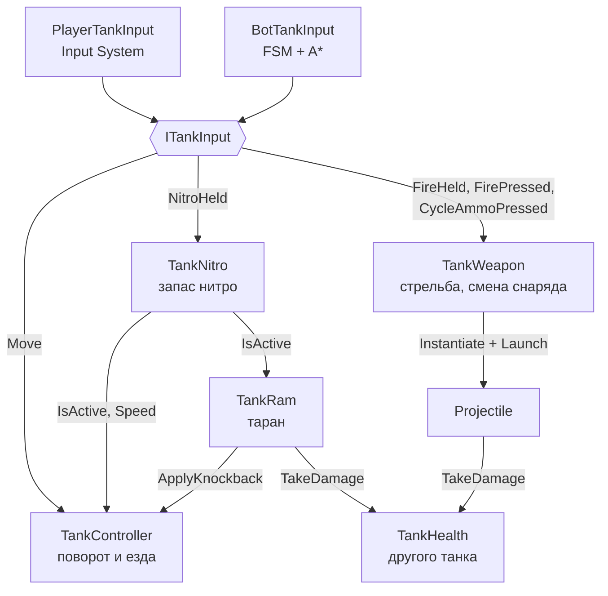
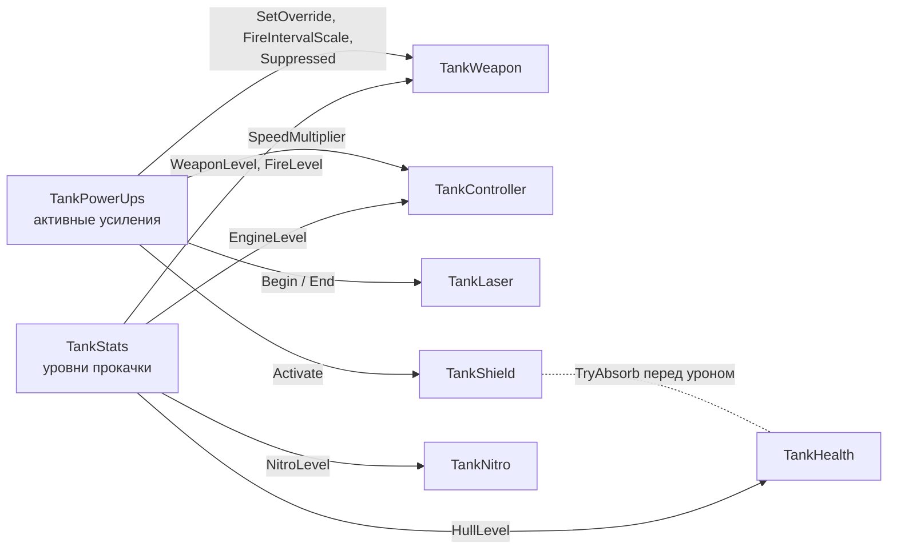
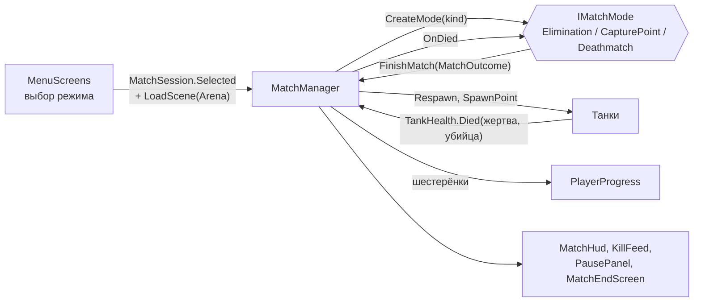
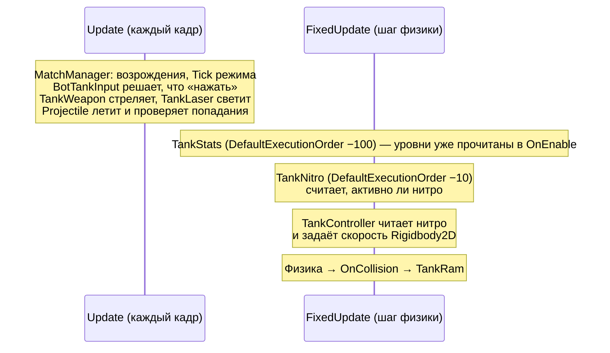

# Архитектура

> [!NOTE]
> **Коротко, без кода.** Игра собрана из независимых «деталей» (компонентов): одна отвечает за езду, другая за
> стрельбу, третья за здоровье и так далее. Танк игрока и танк бота собраны из одних и тех же деталей — отличается
> только «водитель»: у игрока это кнопки, у бота — программа. Поэтому бот не может делать ничего, чего не может
> игрок. Над танками стоит «судья» — менеджер матча: он расставляет танки, считает очки, возрождает погибших и
> показывает итоги. Все числа (скорость, урон, правила режимов, цены улучшений) вынесены в файлы настроек, которые
> можно править без программиста — см. [Как настраивать игру](../game/tuning.md). Незнакомые слова — в
> [Словаре](../game/glossary.md).

## Папки и неймспейсы

Весь код игры лежит в `Assets/_Project/Scripts`, у каждой папки свой неймспейс `TankBrawl.<Папка>`.
Скрипты редактора (меню **TankBrawl/…**, в том числе генератор карт `MapBuilder`) — в `Assets/_Project/Editor`,
в API-справочник они не попадают. Python-скрипты для карт (проверка и превью без Unity) — в `Tools/maps`.

| Неймспейс | Что внутри | Зависит от |
| --- | --- | --- |
| <xref:TankBrawl.Core> | Общие контракты: ввод танка, урон, команды и их цвета; камера, тряска экрана, частицы | Progress (только настройка вибрации) |
| <xref:TankBrawl.Input> | Ввод игрока через Input System | Core |
| <xref:TankBrawl.Tank> | Танк: движение, здоровье, нитро, таран, щит, кусты, уровни прокачки, внешний вид, полоска HP | Core, Map, Audio, Progress, Input, AI |
| <xref:TankBrawl.Weapons> | Стрельба, снаряды, взрывы, лазер | Core, Tank, Map, Audio |
| <xref:TankBrawl.PowerUps> | Усиления: пикап на карте с подписью, спавнер, эффекты на танке; зарядные точки нитро | Core, Tank, Weapons, Audio, UI (шрифт подписи) |
| <xref:TankBrawl.Map> | Тайлмапы: кирпич, кусты, рикошет, автотайлы, тени стен, зона точки, обход бага коллайдеров | Core, Audio |
| <xref:TankBrawl.AI> | Боты: навигация A* и «мозг» бота (FSM) | Core, Tank, Weapons, Map, PowerUps |
| <xref:TankBrawl.Match> | Матч: менеджер, три режима, точки появления, HUD, киллтаб, пауза, экран итога | почти все |
| <xref:TankBrawl.Progress> | Шестерёнки, уровни улучшений, настройки, сохранение | Tank, Weapons |
| <xref:TankBrawl.Audio> | Звуки и музыка | Progress |
| <xref:TankBrawl.UI> | Меню, экранное управление, кнопка «Назад», помощники построения интерфейса | Match, Progress, Audio, Input, PowerUps, Weapons |

Все области лежат в одной сборке, поэтому циклические ссылки (например, `Tank` ↔ `AI`: <xref:TankBrawl.Tank.TankStats>
проверяет, бот ли это) компилируются. Интерфейсы `Core` меняет только ответственный (см. `CLAUDE.md`).

## Из чего собран танк

Танк — один `GameObject` с набором маленьких компонентов, у каждого одна обязанность.
Игрок и бот отличаются **только источником ввода**: оба реализуют <xref:TankBrawl.Core.ITankInput>,
а остальные компоненты знают лишь этот интерфейс. Поэтому у бота те же ограничения, что у игрока.

Параметры этих компонентов меняют извне два других: усиления (временно) и уровни прокачки (на весь матч).

| Компонент | Обязанность |
| --- | --- |
| <xref:TankBrawl.Tank.TankController> | Поворачивает корпус к стику и едет только вдоль корпуса. Пушка всегда смотрит туда же |
| <xref:TankBrawl.Tank.TankHealth> | HP, неуязвимость после попадания, спавн-защита, события `Died` / `Damaged` / `ShieldAbsorbed`; смерть = деактивация объекта |
| <xref:TankBrawl.Tank.TankNitro> | Запас нитро: тратится при езде с зажатой кнопкой, сам восстанавливается |
| <xref:TankBrawl.Tank.TankRam> | Таран на нитро: урон и отталкивание врага, ломает кирпич |
| <xref:TankBrawl.Tank.TankShield> | Щит-усиление: поглощает одно попадание |
| <xref:TankBrawl.Tank.TankStats> | Уровни прокачки танка: купленные у игрока, ранг угрозы у бота |
| <xref:TankBrawl.Weapons.TankWeapon> | Стреляет выбранным типом снаряда, листает типы по кругу |
| <xref:TankBrawl.Weapons.TankLaser> | Луч лазера-усиления |
| <xref:TankBrawl.PowerUps.TankPowerUps> | Какие усиления сейчас действуют и сколько им осталось |
| <xref:TankBrawl.Core.TeamMember> | Команда танка (`Player`, `Enemy`, `Third`, `Fourth`) |
| <xref:TankBrawl.Tank.TankConcealment> | Прячет танк в кустах |
| <xref:TankBrawl.Tank.TankVisuals> | Спрайты скина, анимация гусениц, тень |
| <xref:TankBrawl.Tank.TankHealthBar> | Тонкая полоска HP под танком (на дочернем объекте `HealthBar`) |
| `Rigidbody2D` + `CircleCollider2D` | Физика. Круглый коллайдер радиусом 0,45 обтекает углы |

Префабы: базовый `Prefabs/Tank/Tank` и варианты `PlayerTank` (с <xref:TankBrawl.Input.PlayerTankInput>) и `Bot`
(с <xref:TankBrawl.AI.BotTankInput>, команда `Enemy`). Всё перечисленное выше, кроме ввода, лежит на базовом префабе.

## Матч поверх танков

Сцена с <xref:TankBrawl.Match.MatchManager> становится матчем: это `Arena` и карты из `Scenes/Maps`
(см. [Карты](maps.md)); сцена без него (песочницы) работает как раньше — танки просто воюют до гибели.

Подробно — в статье [Матч и режимы](match.md).

## Порядок обновления в кадре

- **Стрельба и снаряды — в `Update`**: короткое нажатие выстрела не теряется между шагами физики,
  а снаряд без `Rigidbody2D` не дёргается на 60 FPS.
- **Движение — в `FixedUpdate`**: контроллер каждый шаг сам пишет `linearVelocity`, поэтому внешний толчок
  нельзя дать импульсом — для этого есть <xref:TankBrawl.Tank.TankController.ApplyKnockback*>.
- <xref:TankBrawl.Tank.TankStats> выполняется раньше всех (`-100`), чтобы здоровье, нитро и оружие в своих `OnEnable`
  уже видели уровни прокачки.

## Урон

Всё, что получает урон, реализует <xref:TankBrawl.Core.IDamageable>. Урон передаётся одной структурой
<xref:TankBrawl.Core.DamageInfo>, а каждый получатель берёт из неё своё:

| Получатель | `Kind` | Что берёт из `DamageInfo` | Каким хитбоксом снаряда попадают |
| --- | --- | --- | --- |
| <xref:TankBrawl.Tank.TankHealth> | `Unit` | `Amount` (HP) и `Source` (кто убил) | большим, `tankHitRadius` |
| <xref:TankBrawl.Map.DestructibleTilemap> | `Terrain` | `BlockDamage` (прочность) и `Point` (какая клетка) | малым, `wallHitRadius` |

`DamageInfo.Source` — корневой объект стрелка (танка). Он доходит до события `TankHealth.Died`, по нему менеджер
матча засчитывает убийство. Сталь и вода не `IDamageable`, поэтому их не ломает ни снаряд, ни взрыв, ни таран.

## Команды и физические слои

- Команд четыре: `Player`, `Enemy`, `Third`, `Fourth` (<xref:TankBrawl.Core.Team>). Названия ничего не значат:
  «наша» команда — та, за которую играет человек, она лежит в <xref:TankBrawl.Core.TeamMember.LocalTeam>.
  Её выставляют <xref:TankBrawl.Input.PlayerTankInput> и менеджер матча. В режиме «Все против всех» менеджер
  раздаёт каждому танку свою команду через <xref:TankBrawl.Core.TeamMember.SetTeam*>.
- Цвет и русское название команды — <xref:TankBrawl.Core.TeamColors> (синие, красные, зелёные, жёлтые);
  ими красятся счёт, киллтаб, искры и вспышки.
- Снаряды, взрывы и лазер проходят сквозь танки и снаряды **своей** команды; встречные снаряды разных команд
  гасят друг друга. Таран своих не бьёт.
- Слои Physics2D: `Tank` (6), `Wall` (7), `Water` (4). Снаряды и лазер не видят слой `Water` (летят над водой),
  боты проверяют прямую видимость кастом по слою `Wall`.

## Конфиги

Все настраиваемые числа — в ScriptableObject-ассетах, в коде магических чисел нет:

| Конфиг | Что настраивает |
| --- | --- |
| <xref:TankBrawl.Tank.TankConfig> | Скорость, разгон, поворот, HP, неуязвимость, мигание; прибавки за уровень |
| <xref:TankBrawl.Tank.NitroConfig> | Запас и скорость нитро, параметры тарана; прибавка за уровень |
| <xref:TankBrawl.Tank.TankSkin> | Спрайты одного цвета танка и числа раскладки арта |
| <xref:TankBrawl.Tank.HealthBarStyle> | Размер, цвета и видимость полоски HP |
| <xref:TankBrawl.Weapons.WeaponConfig> | Один тип снаряда: скорость, урон, перезарядка, хитбоксы, рикошеты, взрыв, звук; прибавки за уровень |
| <xref:TankBrawl.PowerUps.PowerUpConfig> | Одно усиление: тип, длительность, числа своего типа, подпись на карте |
| <xref:TankBrawl.AI.BotProfile> | Характер бота: реакция, разброс, дистанции, таран, отступление, увороты, точка |
| <xref:TankBrawl.Match.MatchModeConfig> | Один режим: защита при появлении, возрождение, лимиты, раунды, очки, доп. цель |
| <xref:TankBrawl.Progress.ProgressionConfig> | Награды в шестерёнках, цены и описания веток улучшений |
| <xref:TankBrawl.Audio.SfxLibrary> | Какие клипы играют для каждого звука, музыка |
| <xref:TankBrawl.UI.UiTheme> | Необязательные спрайты интерфейса |

`ProgressionConfig`, `SfxLibrary` и `UiTheme` лежат в `ScriptableObjects/Resources` и загружаются по имени —
не переименовывайте их. Пункт меню **TankBrawl → Setup Data Assets** (`Assets/_Project/Editor/ProjectSetup.cs`) создаёт
недостающие ассеты и заполняет их стартовыми числами. Дубликатов он не создаёт, но **перезаписывает** числа режимов,
награды, цены веток, прибавки «за уровень» и звуки выстрелов значениями из своего кода — после ручной настройки этих полей
запускать его не нужно. Описание каждого поля — на странице [Параметры в инспекторе](inspector.md).

## Глобальные «самозапускающиеся» классы

Эти классы не нужно класть в сцену: они запускаются сами через `[RuntimeInitializeOnLoadMethod]`.

| Класс | Что делает |
| --- | --- |
| <xref:TankBrawl.Core.GameBootstrap> | Ставит `Application.targetFrameRate = 60` |
| <xref:TankBrawl.Map.TilemapColliderBootstrap> | Обходит баг Unity 6.6: перестраивает коллайдеры тайлмапов при загрузке сцены |
| <xref:TankBrawl.UI.SceneNavigator> | Escape / «Назад» на Android: в матче пауза, в меню шаг назад, в песочнице — выход в меню |
| <xref:TankBrawl.UI.TouchControlsBootstrap> | Добавляет экранное управление в каждую сцену с танком игрока |
| <xref:TankBrawl.Audio.AudioManager> | Живёт весь запуск: пул источников звука, музыка, отложенное сохранение настроек |
| <xref:TankBrawl.Core.Fx> | Общая система частиц, создаётся при первом вызове |

Статические классы <xref:TankBrawl.Progress.PlayerProgress> (сохранение) и <xref:TankBrawl.Match.MatchSession>
(выбранный режим) переживают смену сцен.

> [!IMPORTANT]
> Domain reload в редакторе выключен: static-поля не сбрасываются между запусками Play Mode.
> Каждое static-поле сбрасывайте в методе с
> `[RuntimeInitializeOnLoadMethod(RuntimeInitializeLoadType.SubsystemRegistration)]` — как в
> <xref:TankBrawl.Weapons.Projectile>, <xref:TankBrawl.Match.MatchManager> и <xref:TankBrawl.Progress.PlayerProgress>.
