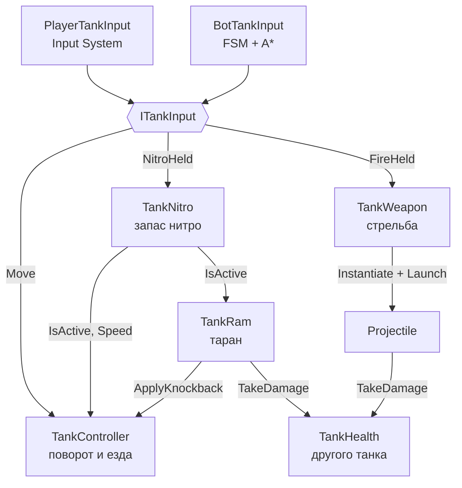
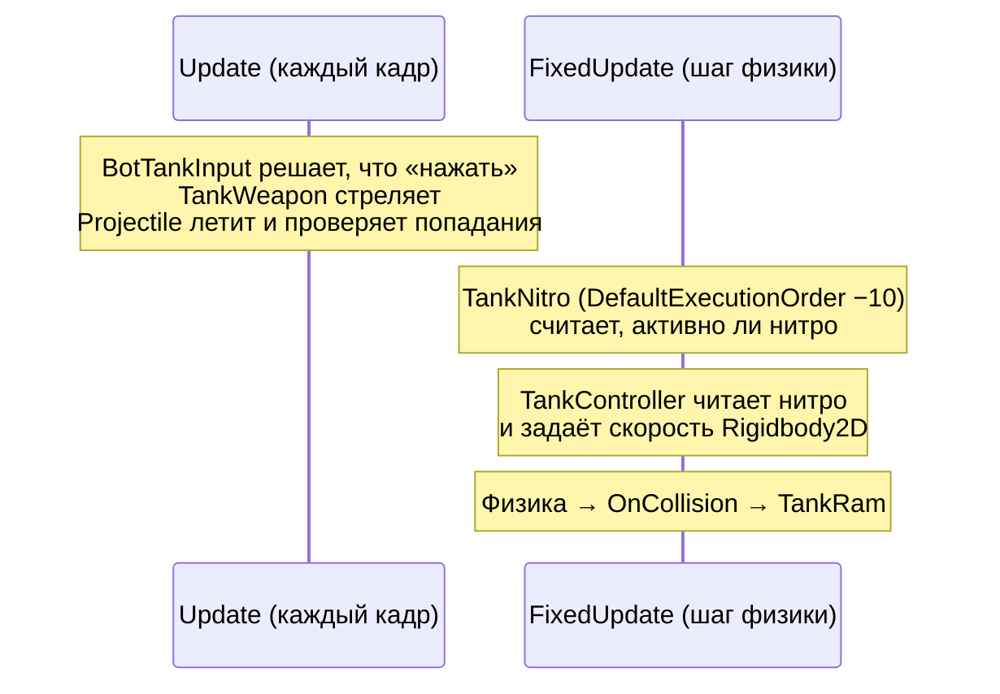

# Архитектура

> [!NOTE]
> **Коротко, без кода.** Игра собрана из независимых «деталей» (компонентов): одна отвечает за езду, другая за
> стрельбу, третья за здоровье и так далее. Танк игрока и танк бота собраны из одних и тех же деталей — отличается
> только «водитель»: у игрока это кнопки, у бота — программа. Поэтому бот не может делать ничего, чего не может
> игрок. Все числа (скорость, урон) вынесены в файлы настроек, которые можно править без программиста —
> см. [Как настраивать игру](../game/tuning.md). Незнакомые слова — в [Словаре](../game/glossary.md).

## Папки и неймспейсы

Весь код игры лежит в `Assets/_Project/Scripts`, у каждой папки свой неймспейс `TankBrawl.<Папка>`.

| Неймспейс | Что внутри | Зависит от |
| --- | --- | --- |
| <xref:TankBrawl.Core> | Общие контракты: ввод танка, урон, команды, камера, глобальные настройки | — |
| <xref:TankBrawl.Input> | Ввод игрока через Input System | Core |
| <xref:TankBrawl.Tank> | Танк: движение, здоровье, нитро, таран, маскировка в кустах | Core, Map |
| <xref:TankBrawl.Weapons> | Стрельба и снаряды | Core, Tank, Map |
| <xref:TankBrawl.Map> | Тайлмапы: кирпич, кусты, рикошет от стали, обход бага коллайдеров | Core |
| <xref:TankBrawl.AI> | Боты: навигация A* и «мозг» бота | Core, Tank, Weapons, Map |
| <xref:TankBrawl.UI> | Меню и кнопка «Назад» | — |

`Core` ни от кого не зависит, поэтому его интерфейсы меняет только ответственный (см. `CLAUDE.md`).

## Из чего собран танк

Танк — один `GameObject` с набором маленьких компонентов, у каждого одна обязанность.
Игрок и бот отличаются **только источником ввода**: оба реализуют <xref:TankBrawl.Core.ITankInput>,
а остальные компоненты знают лишь этот интерфейс. Поэтому у бота те же ограничения, что у игрока.

| Компонент | Обязанность |
| --- | --- |
| <xref:TankBrawl.Tank.TankController> | Поворачивает корпус к стику и едет только вдоль корпуса. Пушка всегда смотрит туда же |
| <xref:TankBrawl.Tank.TankHealth> | HP, неуязвимость с миганием после попадания, смерть = деактивация объекта |
| <xref:TankBrawl.Tank.TankNitro> | Запас нитро: тратится при езде с зажатой кнопкой, сам восстанавливается |
| <xref:TankBrawl.Tank.TankRam> | Таран на нитро: урон и отталкивание врага, ломает кирпич |
| <xref:TankBrawl.Weapons.TankWeapon> | Стреляет снарядом из конфига, пока зажат выстрел и прошла перезарядка |
| <xref:TankBrawl.Core.TeamMember> | Команда танка (`Player` / `Enemy`) |
| <xref:TankBrawl.Tank.TankConcealment> | Прячет танк в кустах |
| `Rigidbody2D` + `CircleCollider2D` | Физика. Круглый коллайдер радиусом 0,45 обтекает углы |

Префабы: базовый `Prefabs/Tank/Tank` и варианты `Player` (с <xref:TankBrawl.Input.PlayerTankInput>) и `Bot`
(с <xref:TankBrawl.AI.BotTankInput>, команда `Enemy`).

## Порядок обновления в кадре

- **Стрельба и снаряды — в `Update`**: короткое нажатие выстрела не теряется между шагами физики,
  а снаряд без `Rigidbody2D` не дёргается на 60 FPS.
- **Движение — в `FixedUpdate`**: контроллер каждый шаг сам пишет `linearVelocity`, поэтому внешний толчок
  нельзя дать импульсом — для этого есть <xref:TankBrawl.Tank.TankController.ApplyKnockback*>.

## Урон

Всё, что получает урон, реализует <xref:TankBrawl.Core.IDamageable>. Урон передаётся одной структурой
<xref:TankBrawl.Core.DamageInfo>, а каждый получатель берёт из неё своё:

| Получатель | `Kind` | Что берёт из `DamageInfo` | Каким хитбоксом снаряда попадают |
| --- | --- | --- | --- |
| <xref:TankBrawl.Tank.TankHealth> | `Unit` | `Amount` (HP) | большим, `tankHitRadius` |
| <xref:TankBrawl.Map.DestructibleTilemap> | `Terrain` | `BlockDamage` (прочность) и `Point` (какая клетка) | малым, `wallHitRadius` |

Сталь и вода не `IDamageable`, поэтому их не ломает ни снаряд, ни таран.

## Команды и физические слои

- Снаряды проходят сквозь танки и снаряды **своей** команды; встречные снаряды разных команд гасят друг друга.
- Таран своих не бьёт.
- Слои Physics2D: `Tank` (6), `Wall` (7), `Water` (4). Снаряды не видят слой `Water` (летят над водой),
  боты проверяют прямую видимость кастом по слою `Wall`.

## Конфиги

Все настраиваемые числа — в ScriptableObject-ассетах, в коде магических чисел нет:

| Конфиг | Что настраивает |
| --- | --- |
| <xref:TankBrawl.Tank.TankConfig> | Скорость, разгон, поворот, HP, неуязвимость после попадания |
| <xref:TankBrawl.Tank.NitroConfig> | Запас и скорость нитро, параметры тарана |
| <xref:TankBrawl.Weapons.WeaponConfig> | Один тип снаряда: скорость, урон, перезарядка, хитбоксы, рикошеты |
| <xref:TankBrawl.AI.BotProfile> | Характер бота: реакция, разброс, дистанции, нитро, навигация |

Описание каждого поля — на странице [Параметры в инспекторе](inspector.md).

## Глобальные «самозапускающиеся» классы

Эти классы не нужно класть в сцену: они запускаются сами через `[RuntimeInitializeOnLoadMethod]`.

| Класс | Что делает |
| --- | --- |
| <xref:TankBrawl.Core.GameBootstrap> | Ставит `Application.targetFrameRate = 60` |
| <xref:TankBrawl.Map.TilemapColliderBootstrap> | Обходит баг Unity 6.6: перестраивает коллайдеры тайлмапов при загрузке сцены |
| <xref:TankBrawl.UI.SceneNavigator> | Escape / «Назад» на Android: из сцены в меню, из меню — выход |

> [!IMPORTANT]
> Domain reload в редакторе выключен: static-поля не сбрасываются между запусками Play Mode.
> Каждое static-поле сбрасывайте в методе с
> `[RuntimeInitializeOnLoadMethod(RuntimeInitializeLoadType.SubsystemRegistration)]` — как в
> <xref:TankBrawl.Weapons.Projectile> и <xref:TankBrawl.AI.BotTankInput>.
