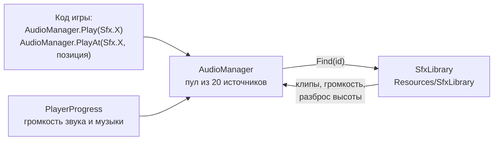

# Звук и эффекты

> [!NOTE]
> **Коротко, без кода.** Каждое событие в игре — выстрел, попадание, взрыв, подбор усиления, победа — просит
> «сыграть звук такого-то вида». Какой именно файл звучит, записано в одном файле настроек, поэтому заменить заглушку
> настоящим звуком можно без программиста. Сейчас все звуки — синтетические заглушки, музыки нет. Искры, обломки,
> вспышки и тряска экрана тоже пока простые, но вызовы уже расставлены: когда нарисуют настоящие эффекты, менять
> придётся только их внешний вид.

## Звук

Неймспейс: <xref:TankBrawl.Audio>

| Класс | Что делает |
| --- | --- |
| <xref:TankBrawl.Audio.Sfx> | Перечисление всех звуков игры: выстрелы по типам, попадания, взрывы, стены, рикошет, кирпич, таран, нитро, лазер, смена снаряда, возрождение, усиления, ход матча, интерфейс |
| <xref:TankBrawl.Audio.SfxLibrary> | Ассет: для каждого `Sfx` — массив клипов (играет случайный), громкость, разброс высоты тона; музыка меню и боя, общая громкость музыки |
| <xref:TankBrawl.Audio.AudioManager> | Создаёт себя сам при запуске (`DontDestroyOnLoad`), играет звуки и музыку |

- `Play(Sfx)` — звук без места (интерфейс, события матча). `PlayAt(Sfx, позиция)` — звук в мире: в пределах 6 юнитов
  от камеры на полной громкости, дальше 22 — на 15 %.
- Громкость = громкость записи × затухание × настройка звука игрока (<xref:TankBrawl.Progress.PlayerProgress.SfxVolume>).
- Музыка: в сцене `Menu` — `menuMusic`, в остальных — `battleMusic`; при смене сцены старая затухает, новая нарастает.
- Нет библиотеки, записи или клипа — тишина без ошибок.
- Звук выстрела задаётся в конфиге снаряда: <xref:TankBrawl.Weapons.WeaponConfig>.`fireSfx`.

**Заглушки.** Пункт меню **TankBrawl → Generate Placeholder Sounds** пишет синтетические `.wav` в
`Assets/_Project/Audio/Placeholders` и заполняет `SfxLibrary`. Записи, где уже лежат настоящие клипы (не из папки
заглушек), он не трогает, поэтому запускать его повторно безопасно. Полный список нужных звуков — `sound_list.md`
в корне репозитория.

## Частицы

Класс: <xref:TankBrawl.Core.Fx> (статический)

Одна общая система частиц на сцену, создаётся при первом вызове и пересоздаётся, если загрузка сцены её уничтожила.
Ассетов не нужно: частицы — белые квадраты, цвет задаёт вызов.

| Метод | Где вызывается |
| --- | --- |
| `Sparks(позиция, нормаль, цвет)` | Попадание по танку (цвет команды), по стене, рикошет, столкновение снарядов |
| `MuzzleFlash(позиция, направление)` | Каждый выстрел |
| `Debris(позиция, цвет)` | Разрушение кирпича |
| `TankExplosion(позиция, цвет танка)` | Гибель танка |
| `Burst(…)` | Взрыв снаряда, подбор пикапа, вспышка возрождения |
| `Haptic()` | Попадание по игроку: вибрация телефона, если она включена в настройках (только Android/iOS) |

## Тряска экрана

Класс: <xref:TankBrawl.Core.ScreenShake> (статический)

Тряска как «травма»: события добавляют `Add(0…1)` (или `AddAt(позиция, сила)` — слабее с расстоянием до камеры,
дальше ~20 юнитов не трясёт), травма сама затухает, а смещение камеры растёт с её квадратом (до 0,45 юнита).
<xref:TankBrawl.Core.CameraFollow> добавляет смещение поверх сглаженной позиции, не ломая сглаживание.

| Событие | Сила |
| --- | --- |
| Попадание по игроку | 0,1 + 0,8 × доля потерянного HP |
| Таран | 0,35 (с затуханием по расстоянию) |
| Взрыв снаряда | 0,3 (с затуханием) |
| Гибель танка | 0,4, своего — 0,7 (с затуханием) |

Тряска работает, только если включены оба выключателя: настройка игрока «Тряска экрана»
(<xref:TankBrawl.Progress.PlayerProgress.ScreenShakeOn>, меню «Настройки») и `ScreenShake.Enabled` для кода.

## Красная виньетка

При попадании по игроку <xref:TankBrawl.Match.MatchHud> по событию `TankHealth.Damaged` подсвечивает красным края
экрана; центр остаётся прозрачным, поэтому вспышка сильная, но не закрывает бой. Текстура виньетки генерируется
кодом (заглушка до арта `ui_damage_vignette`), гаснет сама. Есть только в матче (в песочницах HUD нет).

## Что нужно нарисовать

Список спрайтов под все эти эффекты, усиления и интерфейс — `sprites_new_features.md` в корне репозитория.
