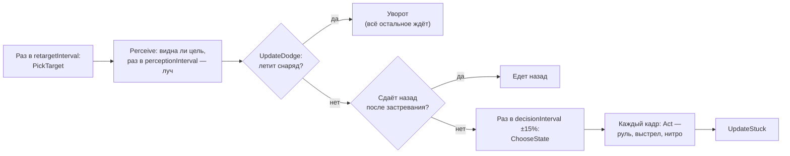
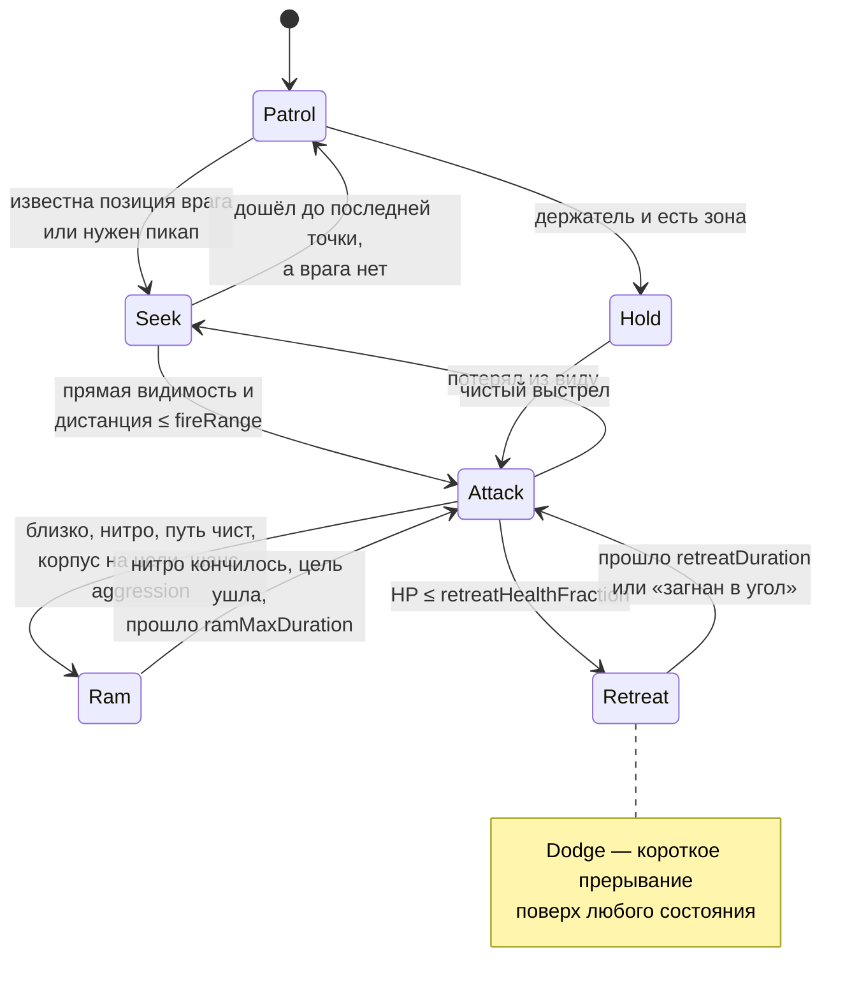

# Боты

> [!NOTE]
> **Коротко, без кода.** Бот — это такой же танк, только вместо человека кнопки «нажимает» программа. Он выбирает
> противника, прокладывает к нему путь по лабиринту, в бою кружит вокруг цели и разворачивается для выстрела, когда
> пушка заряжена. Может пойти на таран, увернуться от летящего снаряда, отступить в укрытие при малом здоровье,
> съездить за усилением, а в режиме «Удержание точки» — держать зону. Бойцов в кустах не видит, реагирует с задержкой
> и иногда мажет. Характер (агрессор, осторожный, уравновешенный) задаётся файлом профиля — см.
> [Как настраивать игру](../game/tuning.md).

Бот — обычный танк, у которого вместо <xref:TankBrawl.Input.PlayerTankInput> стоит
<xref:TankBrawl.AI.BotTankInput>. Он «нажимает» те же кнопки, что и игрок, через
<xref:TankBrawl.Core.ITankInput>, поэтому у него та же перезарядка, нитро и пушка по корпусу.
Характер бота задаётся ассетом <xref:TankBrawl.AI.BotProfile>.

Для работы в сцене нужен один объект с <xref:TankBrawl.AI.BotNavGrid> (в сценах — `BotNav`).
Без него бот едет к цели по прямой.

`BotTankInput` разбит на `partial`-файлы:

| Файл | Что внутри |
| --- | --- |
| `BotTankInput.cs` | Ядро: выбор цели, восприятие, выбор состояния, атака, таран, поиск, патруль, путь, анти-застревание |
| `BotTankInput.Dodge.cs` | Уворот от снарядов |
| `BotTankInput.Retreat.cs` | Отступление и охота за усилениями |
| `BotTankInput.Hold.cs` | Удержание точки |

## Цикл бота

Решения о состоянии принимаются раз в `decisionInterval` (0,3 с со случайным разбросом ±15 %, чтобы боты не думали
в один кадр), а руление и стрельба — каждый кадр.

## Состояния

Перечисление <xref:TankBrawl.AI.BotState>. Текущее — <xref:TankBrawl.AI.BotTankInput.State>.

**Приоритет в `ChooseState`**: Retreat (липкое) → Ram (липкое) → поход за пикапом (Seek) → Attack → Hold → Seek → Patrol.
«Липкие» состояния, однажды начавшись, идут до собственных условий выхода.

| Состояние | Что делает |
| --- | --- |
| `Patrol` | Едет к случайной свободной точке карты не ближе `patrolMinDistance`; по приезде, через `patrolMaxTime` или если путь не строится — новая точка |
| `Seek` | Едет по A* к последней известной позиции врага или к пикапу. Попутно стреляет, если корпус случайно смотрит на цель. Дошёл до последней точки, а врага не видно — след остыл, бот патрулирует. Если путь к врагу не строится (враг в «кармане»), бот на 5 с уходит в патруль и пробует снова |
| `Attack` | Пока пушка перезаряжается — **кружит** вокруг цели; за `aimLeadTime` до готовности разворачивается на цель и стреляет (подробнее ниже) |
| `Ram` | Едет прямо на цель, нитро включено, только пока корпус смотрит на неё. Стреляет, если выровнен |
| `Retreat` | При малом HP бежит к безопасному пикапу или в укрытие (подробнее ниже) |
| `Hold` | Держатель в сцене с зоной точки: едет в зону и ходит по ней (подробнее ниже) |
| `Dodge` | Шаг в сторону от летящего снаряда, прерывает всё остальное |

### Attack: кружение вместо стояния

- Направление кружения (`CircleHeading`) — касательная к окружности вокруг цели плюс радиальная добавка, которая
  тянет к дистанции `preferredDistance` (плавно в полосе `distanceBand`). Сторона меняется раз в
  `strafeSwitchMin…Max` секунд.
- Раз в решение бот проверяет, не упирается ли кружение в стену (<xref:TankBrawl.AI.BotNavGrid.IsSegmentWalkable*>),
  и перебирает планы: другая сторона → кружение без радиальной добавки → прямо на цель.
- Когда пушка почти готова: дальше `preferredDistance + distanceBand` — едет к цели (по прямой или по пути), ближе —
  разворачивается на месте.
- С лазером (`TankWeapon.Suppressed`) бот всё время держит прицел и сближается: луч жжёт, пока смотрит на цель.

### Ram: таран

Вход из Attack: прямой путь свободен (`directClear`), цель ближе `nitroRamDistance`, запас нитро ≥ `nitroStartStock`,
корпус смотрит на цель с точностью `nitroAlignTolerance`, цель без спавн-защиты и выпал шанс `aggression`.
Выход: запас ≤ `nitroStopStock`, потеряна прямая видимость, цель дальше 1,5 × `nitroRamDistance` или прошло
`ramMaxDuration`; потом пауза `ramCooldown`.

### Retreat: отступление

- Начинается при HP ≤ `retreatHealthFraction` (если враг известен). Повторно — не раньше чем через `retreatLockout`.
- Куда: безопасный пикап в пределах `retreatPickupDistance` (бот ближе к нему, чем враг, и враг не ближе
  `retreatCornerDistance` к пикапу), иначе укрытие: `coverSamples` случайных точек в кольце
  `coverMinDistance…coverMaxDistance`, оценка = «не простреливается врагом» (+10) + удалённость от врага − длина пути.
  Уже вне линии огня — остаётся на месте.
- В укрытии стоит, повернув пушку туда, где был враг. Пока враг его видит, раз в `coverReplanInterval` выбирает
  укрытие заново. На бегу стреляет, если корпус случайно выровнен.
- Конец: прошло `retreatDuration` (HP не восстанавливается, поэтому отступление обязано кончаться само) или бот
  «загнан»: враг с прямой видимостью ближе `retreatCornerDistance` — тогда бой.

### Hold: удержание точки

Только в сцене с активной <xref:TankBrawl.Map.CapturePointZone>. При каждом появлении бот бросает кубик `pointDuty`:
выпало — он «держатель», нет — «охотник» (ведёт себя как обычно).

- Держатель без чистого выстрела едет в зону и ходит между случайными точками внутри неё (не дальше 0,7 радиуса,
  новая точка раз в `holdSpotInterval`): стоящий танк — лёгкая мишень. Пушку поворачивает туда, где был враг,
  стреляет попутно.
- С чистым выстрелом — обычный Attack, но кружение притягивается к зоне (`PullToPoint`): чем дальше за краем,
  тем сильнее, полная сила на `pointLeash` за краем, множитель `pointPull`.

### Dodge: уворот

- Раз в `perceptionInterval` бот перебирает <xref:TankBrawl.Weapons.Projectile.InFlight>. Угроза — чужой снаряд
  в радиусе `dodgeSightRange` (≈ половина ширины экрана), который заденет корпус (радиус корпуса + хитбокс снаряда +
  `dodgeMargin`) за `dodgeLookahead` секунд, если между ними нет стены. Рикошеты не предсказываются.
- На каждую угрозу — бросок `dodgeChance`; затем «человеческая» задержка `dodgeReactionMin…Max`.
- Манёвр: шаг перпендикулярно траектории в ту сторону, где свободно на `dodgeDistance`, предпочитая сторону, где бот
  уже стоит, и ту, что ближе к курсу. Длится не дольше `dodgeDuration` или пока снаряд не пролетел. Если снаряд долетит
  быстрее `dodgeNitroTime` — с нитро. Во время уворота бот не стреляет.

## Выбор цели

`PickTarget` раз в `retargetInterval`:

- кандидаты — танки чужой команды, **видимые** боту (не в кустах); общий список танков обновляется раз в 0,5 с на всех ботов;
- выбирается ближайший по прямой (не по пути);
- **гистерезис**: текущую видимую цель бот держит минимум `targetHoldTime` и меняет, только если новая ближе в
  `retargetDistanceRatio` раз (0,7 = хотя бы на 30 % ближе) — так он не мечется между двумя врагами;
- цель, ушедшая в куст, сразу заменяется любой видимой; если видимых нет, бот держит спрятавшуюся и едет в её
  последнюю точку.

## Восприятие — «честная информация»

- Цель в кустах (`TankConcealment.IsHiddenFrom`) для бота невидима и не выбирается как новая цель.
- Прямая видимость проверяется `CircleCast` радиусом **стенового хитбокса снаряда** по слою `Wall`:
  «если пролетит снаряд, значит, видно». Вода не мешает. При появлении цели в поле зрения запускается задержка
  реакции и перебрасывается разброс.
- `directClear` — видимость плюс проходимый по сетке отрезок до цели (можно ехать по прямой, а не только стрелять).

> [!WARNING]
> **Известное отступление от честности.** Пока враг не в кустах, бот знает его позицию **на всей карте, сквозь стены
> и без ограничения дальности** (`lastKnownPosition` обновляется каждый кадр). У игрока обзор ограничен камерой
> (≈ ±9 × ±5 юнитов). То же с пикапами. Ограничение обзора ботов пока не сделано.

## Когда бот стреляет

Все условия сразу (`CanFire`):

1. цель видна и ближе `fireRange`;
2. корпус смотрит в точку прицела с точностью `fireAlignTolerance`;
3. прошла задержка реакции (`reactionDelayMin…Max` с момента, как цель появилась в поле зрения);
4. прямо перед дулом нет стали ближе `steelPointBlankDistance` — иначе рикошет вернётся в самого бота;
5. у цели нет спавн-защиты (стрелять в неуязвимого — тратить снаряд).

**Точка прицела** = позиция цели + её скорость × время полёта снаряда (по <xref:TankBrawl.Weapons.TankWeapon.ProjectileSpeed>)
× `leadFactor`, затем поворот на случайный угол ±`aimSpreadDegrees`. Угол перебрасывается после каждого выстрела
(событие `TankWeapon.Fired`) и при появлении цели в поле зрения.

## Усиления

- Бот хочет пикап, если: пикап не занят другим ботом (<xref:TankBrawl.PowerUps.PowerUpPickup.ClaimedBy>, это не замок,
  а подсказка), такого эффекта на боте ещё нет, путь строится и прямая дистанция ≤ `powerUpMaxDistance × powerUpGreed`
  (в бою, когда есть чистый выстрел, — `combatPowerUpDistance × powerUpGreed`).
- Едет, пока не подберёт, пикап не исчезнет или не пройдёт `powerUpGiveUpTime`. Недостижимый пикап забывается на 5 с.
- Щит и лазер бот сам не «включает»: это эффекты танка, они работают сразу после подбора.

## Характеры

Один ассет <xref:TankBrawl.AI.BotProfile> на характер, лежат в `ScriptableObjects/Bots`:

| Параметр | `DefaultBotProfile` (уравновешенный) | `BotProfile_Aggressor` | `BotProfile_Cautious` |
| --- | --- | --- | --- |
| `aggression` (шанс тарана) | 0,5 | 0,9 | 0,15 |
| `preferredDistance` | 4 | 3 | 6 |
| `retreatHealthFraction` | 0,3 | 0,15 | 0,55 |
| `powerUpGreed` | 0,6 | 0,4 | 0,9 |
| `dodgeChance` | 0,7 | 0,5 | 0,85 |
| `aimSpreadDegrees` | 8 | 10 | 6 |
| `reactionDelayMin…Max` | 0,2…0,4 | 0,15…0,3 | 0,25…0,45 |
| `pointDuty` | 0,7 | 0,5 | 0,9 |
| `targetHoldTime` / `retargetDistanceRatio` | 2 / 0,7 | 1,5 / 0,8 | 3 / 0,6 |

На арене и в песочницах `Bot_A` и `Ally_1` — агрессоры, `Bot_B` и `Ally_2` — осторожные, `Bot_C` — по умолчанию.

## Анти-застревание

Если бот хочет ехать, но за `stuckTime` сдвинулся меньше чем на `stuckMinDistance`, он `reverseDuration` секунд едет
в обратную сторону (± `reverseAngleSpread`) и перестраивает путь. Танк ездит только вперёд по корпусу, поэтому «сдать
назад» = развернуться и отъехать.

## Навигация

Класс: <xref:TankBrawl.AI.BotNavGrid>

A* по сетке тайлмапов. Узлы графа — **центры клеток**: узел свободен, если свободна его клетка. Танк (коллайдер
диаметром 0,9 в клетке 1 юнит) проходит коридор шириной в одну клетку.

- Ходы — в 8 направлений. По диагонали можно, только если свободны обе боковые клетки (иначе танк заденет угол).
- Узлы рядом со стенами дороже на `wallPenalty` — путь держится посередине прохода.
- Стартовая или конечная точка внутри препятствия «прилипает» к ближайшему свободному узлу в радиусе `snapRadius`.
- Готовый путь **сглаживается**: из каждой точки бот прыгает к самой дальней следующей, до которой круг радиусом
  `agentRadius` проходит по прямой.
- `solidMaps` (бортик, сталь, вода) блокируют всегда, `brickMaps` — только где кирпич стоит сейчас.
  Когда кирпич ломается или появляется, растёт `Version`, и боты перестраивают пути.
- Случайные точки для патруля, укрытий и удержания: <xref:TankBrawl.AI.BotNavGrid.TryGetRandomPoint*> (свободная клетка
  в кольце дистанций от точки) и <xref:TankBrawl.AI.BotNavGrid.TryGetPointAround*> (выборка прямо в кольце вокруг центра,
  работает и для маленькой зоны на большой карте). Достижимость они не проверяют — это делает построение пути.
- Поиск не создаёт мусора: рабочие массивы выделяются один раз, а вместо очистки перед каждым поиском
  используется «штамп» номера поиска.

## Известные ограничения

- Обзор не ограничен (см. предупреждение выше).
- Цель выбирается по прямой, а не по пути; память только о текущей цели.
- Боты не координируются: развод по пикапам только через `ClaimedBy`, засад и ролей нет.
- Укрытие выбирается случайной выборкой без анализа карты; отступление кончается по таймеру, и бот возвращается
  в бой раненым.
- Во время уворота бот не стреляет; рикошет в предсказании не учитывается; от очень близкого выстрела (< ~0,3 с)
  уворот не успевает.
- Бот не выбирает тактику под взрывные снаряды (лазер учтён).

План развития — раздел «Тактика ботов» в `CLAUDE.md`.
