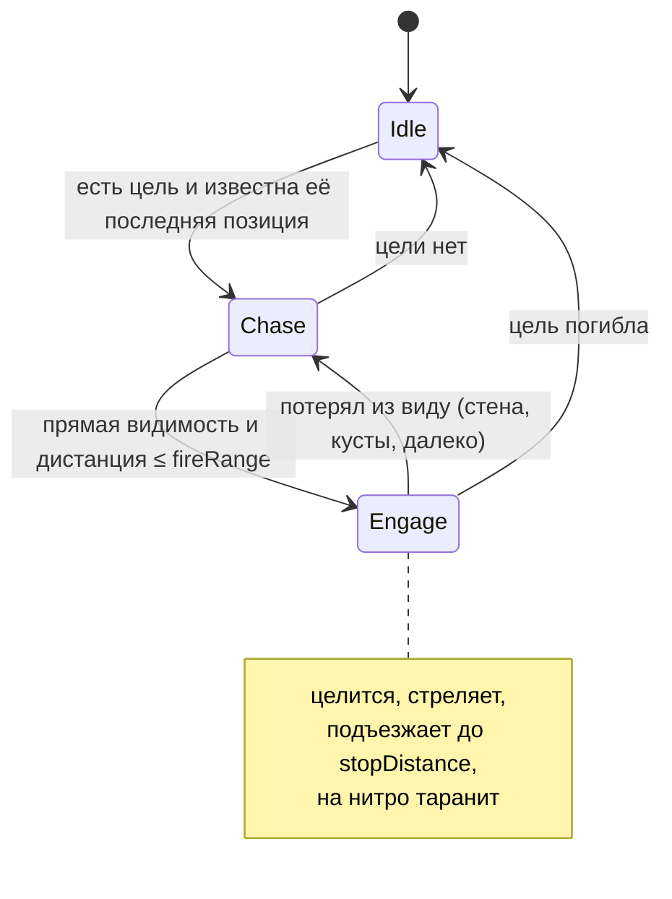
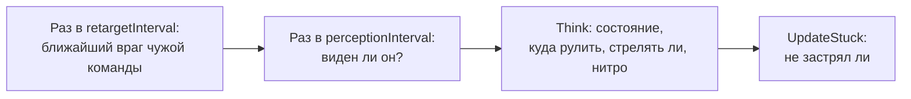

# Боты

Бот — обычный танк, у которого вместо <xref:TankBrawl.Input.PlayerTankInput> стоит
<xref:TankBrawl.AI.BotTankInput>. Он «нажимает» те же кнопки, что и игрок, через
<xref:TankBrawl.Core.ITankInput>, поэтому у него та же перезарядка, нитро и пушка по корпусу.
Характер бота задаётся ассетом <xref:TankBrawl.AI.BotProfile>.

Для работы в сцене нужен один объект с <xref:TankBrawl.AI.BotNavGrid> (в песочнице — `BotNav`).
Без него бот едет к цели по прямой.

## Состояния



Поверх любого состояния работает **анти-застревание**: если бот хочет ехать, но за `stuckTime` сдвинулся меньше
чем на `stuckMinDistance`, он `reverseDuration` секунд едет в обратную сторону (со случайным отклонением)
и перестраивает путь.

## Что бот делает каждый кадр



## Восприятие — «честная информация»

Бот знает только то, что увидел бы игрок:

- Цель в кустах (`TankConcealment.IsHiddenFrom`) для бота невидима.
- Прямая видимость проверяется `CircleCast` радиусом **стенового хитбокса снаряда** по слою `Wall`:
  «если пролетит снаряд, значит, видно». Вода не мешает.
- Потеряв цель, бот едет в её последнюю увиденную точку.

## Когда бот стреляет

Все условия сразу:

1. цель видна и ближе `fireRange`;
2. корпус смотрит в точку прицела с точностью `fireAlignTolerance`;
3. прошла задержка реакции (`reactionDelayMin…Max` с момента, как цель появилась в поле зрения);
4. прямо перед дулом нет стали ближе `steelPointBlankDistance` — иначе рикошет вернётся в самого бота.

**Точка прицела** = позиция цели + её скорость × время полёта снаряда × `leadFactor`, затем поворот на случайный
угол ±`aimSpreadDegrees`. Угол перебрасывается после каждого выстрела и при появлении цели в поле зрения.

## Таран

Бот включает нитро, если цель ближе `nitroRamDistance`, путь до неё по прямой свободен, запас не меньше
`nitroStartStock`, а корпус смотрит на цель с точностью `nitroAlignTolerance`. Выключает — когда запас упал до
`nitroStopStock` (гистерезис, чтобы не мигать). Пока нитро включено, бот не останавливается на `stopDistance`.

## Навигация

Класс: <xref:TankBrawl.AI.BotNavGrid>

A* по сетке тайлмапов, но узлы графа — **вершины клеток**, а не сами клетки:

```
 ┌───┬───┐
 │ a │ b │   узел ● — общий угол четырёх клеток a, b, c, d.
 ├───●───┤   Узел свободен, если свободны все четыре:
 │ c │ d │   тогда там помещается центр танка 2×2.
 └───┴───┘
```

Так танк проходит коридор шириной ровно две клетки.

- Ходы — в 8 направлений. По диагонали можно, только если свободны оба боковых узла (иначе танк заденет угол).
- Узлы рядом со стенами дороже на `wallPenalty` — путь держится посередине прохода.
- Стартовая или конечная точка внутри препятствия «прилипает» к ближайшему свободному узлу в радиусе `snapRadius`.
- Готовый путь **сглаживается**: из каждой точки бот прыгает к самой дальней следующей, до которой круг радиусом
  `agentRadius` проходит по прямой.
- `solidMaps` (бортик, сталь, вода) блокируют всегда, `brickMaps` — только где кирпич стоит сейчас.
  Когда кирпич ломается или появляется, растёт `Version`, и боты перестраивают пути.
- Поиск не создаёт мусора: рабочие массивы выделяются один раз, а вместо очистки перед каждым поиском
  используется «штамп» номера поиска.

## Известные ограничения

Цель — просто ближайший враг без гистерезиса, память только об одной цели, после потери цели бот стоит в последней
точке, боты не координируются. План развития — в разделе «Тактика ботов» в `CLAUDE.md`.
