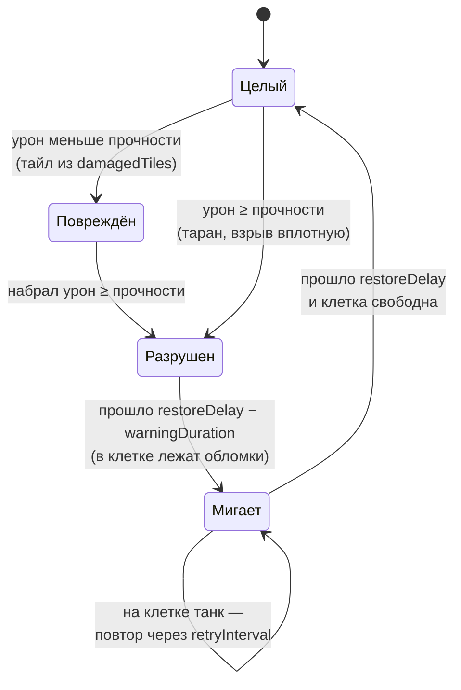

# Карта

> [!NOTE]
> **Коротко, без кода.** Карта нарисована несколькими слоями клеток: бортик, сталь, кирпич, вода, кусты, земля.
> У каждого слоя свои правила (таблица ниже). Разбитый кирпич оставляет обломки и через 5 секунд вырастает обратно,
> но не под танком. Стены сами подбирают нужный кусочек рисунка по соседям, под ними лежит мягкая тень.
> В режиме «Удержание точки» в центре карты есть круглая зона.

Карта собрана из нескольких тайлмапов под одним `Grid`, по одному на вид местности. Готовые карты и то, как их
рисовать текстом и собирать генератором, — в статье [Карты](maps.md).
Размер клетки — **1 юнит** (целый блок), танк занимает одну клетку и проходит в коридор шириной в одну клетку.
Спрайт блока — 64×64 px при 64 PPU. Раньше клетки были 0,5 юнита (танк 2×2); при переходе карты сконвертированы
автоматически: блок заполнен, если был заполнен любой из его четырёх старых клеток.

| Тайлмап | Танк | Снаряд | Компоненты |
| --- | --- | --- | --- |
| `Border` — край карты | не проходит | гибнет | только коллайдер (тайл пока плейсхолдер) |
| `Steel` — сталь | не проходит | рикошет до `maxBounces` раз | <xref:TankBrawl.Map.RicochetSurface> |
| `Bricks` — кирпич | не проходит, таран ломает | разрушает (прочность 2) | <xref:TankBrawl.Map.DestructibleTilemap> |
| `BricksWarning` — обломки и мигание | проходит | пролетает | только рендер, без коллайдера |
| `Water` — вода (слой `Water`) | не проходит | пролетает | только коллайдер |
| `Bushes` — кусты | проезжает, прячется | пролетает | <xref:TankBrawl.Map.BushTilemap>, без коллайдера |
| `Ground` — земля | проезжает | пролетает | <xref:TankBrawl.Map.CheckerTile>, без коллайдера |

## Жизнь кирпича

Класс: <xref:TankBrawl.Map.DestructibleTilemap>

- Урон приходит в точку `DamageInfo.Point`; по ней определяется клетка. Взрыв бьёт по области:
  <xref:TankBrawl.Map.DestructibleTilemap.DamageArea*> повреждает каждый кирпич, чья клетка касается круга и для
  которого он первая стена на луче от центра (к ближней точке клетки или к её центру). Сталь и передние кирпичи
  прикрывают задние, вода не прикрывает.
- **Цвет из кода не меняется**: каждое состояние — отдельный тайл. Повреждённый кирпич — элемент `damagedTiles[i]`
  после `i + 1` попаданий. Поэтому возрождённый блок выглядит ровно как исходный.
- Пока кирпича нет, в его клетке на тайлмапе `BricksWarning` (`warningTilemap`, порядок отрисовки ниже танков) лежат
  обломки (`rubbleTile`). Последние `warningDuration` секунд клетка мигает «блок / обломки». У этого тайлмапа нет
  коллайдера: через мигающую клетку пока можно проехать и прострелить.
- Кирпич не появится под танком: перед восстановлением клетка проверяется `OverlapBox` по слоям `blockers`.
- После каждого изменения коллайдер перестраивается сразу (`ProcessTilemapChanges`), чтобы следующий снаряд
  не врезался в уже разрушенный кирпич.
- Разрушение — звук и обломки-частицы цвета `brickDebrisColor`, возрождение — свой звук.
- <xref:TankBrawl.Map.DestructibleTilemap.ResetAll*> возвращает все кирпичи разом (начало раунда матча).
- Боты узнают об изменении через событие `Tilemap.tilemapTileChanged` и перестраивают пути
  (см. [Боты](bots.md#навигация)).

## Как рисуются тайлы

| Класс | Что делает | Где используется |
| --- | --- | --- |
| <xref:TankBrawl.Map.BlobTile> | Автотайл стены: выбирает один из 47 спрайтов набора «blob» по восьми соседям той же группы `connectGroup` | Кирпич, повреждённый кирпич (одна группа `brick`, чтобы повреждённый блок не рвал стену), сталь, вода, кусты |
| <xref:TankBrawl.Map.CheckerTile> | Шахматная земля: светлая/тёмная клетка по чётности, вариант рисунка по хэшу координат с весами `weights` | `Ground` (`GroundCheckerTile`) |
| <xref:TankBrawl.Map.VariantTile> | Тайл с несколькими вариантами по хэшу координат | Сейчас не используется |

**Маска соседей `BlobTile`**: N = 1, NE = 2, E = 4, SE = 8, S = 16, SW = 32, W = 64, NW = 128. Угловой сосед
учитывается, только если заняты обе стороны рядом с ним, поэтому спрайтов 47, а не 256. Число в имени файла спрайта —
это его маска. Наборы лежат в `Art/Tiles/<папка>/`, оригиналы и генератор — в `incoming_art/` (вне `Assets`, не удалять:
набор могут перегенерировать целиком). Коллайдер у тайлов — `Grid` (целая клетка, а не контур рисунка).

Мигание перед возрождением рисует тот же `BlobTile` на `BricksWarning`, поэтому соседние мигающие блоки смыкаются
между собой, а с живой стеной — нет.

## Тени стен

Класс: <xref:TankBrawl.Map.WallShadows>

Объект `WallShadows` под `Grid` рисует **одну** мягкую текстуру на всю карту: занятые клетки тайлмапов `casters`
(кирпич и сталь; бортик тени не отбрасывает) размываются на `blurRadius`, сдвигаются на `offset` и рисуются под стенами
с прозрачностью `opacity`. Одна текстура, а не спрайт на блок, — чтобы тени соседних блоков не складывались в полосы.
Пересчитывается при разрушении и возрождении кирпича. Работает только в Play Mode.

## Зона точки

Класс: <xref:TankBrawl.Map.CapturePointZone>

Круг на карте для режима «Удержание точки»: центр — позиция объекта, радиус `radius` (на арене 3). Танк в зоне,
если в круге его центр (`Contains`).

- `Primary` — первая активная зона сцены. **Наличие активной зоны = режим с точкой**: без неё боты точку игнорируют.
  Менеджер матча включает объект зоны только в этом режиме.
- Зона рисует себя сама: пульсирующее кольцо (`LineRenderer`) и полупрозрачный диск, оба сгенерированы в коде.
  `SetTint(цвет)` красит их в цвет команды-владельца, `SetNeutral()` возвращает нейтральный.
- Очки за удержание считает режим (<xref:TankBrawl.Match.CapturePointMode>), а не зона.

## Баг коллайдеров Unity 6.6

Класс: <xref:TankBrawl.Map.TilemapColliderBootstrap>

Unity 6.6 не строит формы `TilemapCollider2D` при загрузке сцены: танки и снаряды проходят сквозь стены.
`TilemapColliderBootstrap` при загрузке **любой** сцены выключает и включает каждый такой коллайдер, и тот
строится. В сцены ничего добавлять не нужно; удалять класс нельзя.

Проверка в Play Mode: у `CompositeCollider2D` стен `shapeCount > 0`.
