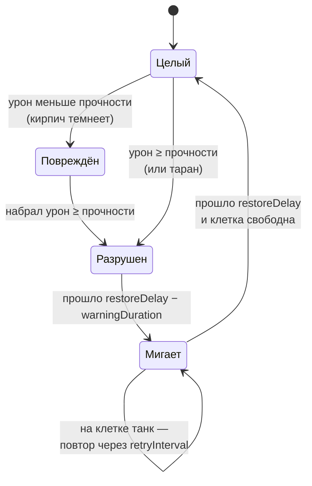

# Карта

> [!NOTE]
> **Коротко, без кода.** Карта нарисована несколькими слоями клеток: бортик, сталь, кирпич, вода, кусты. У каждого
> слоя свои правила (таблица ниже). Разбитый кирпич через 5 секунд вырастает обратно, но не под танком.

Карта собрана из нескольких тайлмапов под одним `Grid`, по одному на вид местности.
Размер клетки — 0,5 юнита, танк занимает 2×2 клетки.

| Тайлмап | Танк | Снаряд | Компоненты |
| --- | --- | --- | --- |
| `Border` — край карты | не проходит | гибнет | только коллайдер |
| `Steel` — сталь | не проходит | рикошет до `maxBounces` раз | <xref:TankBrawl.Map.RicochetSurface> |
| `Bricks` — кирпич | не проходит, таран ломает | разрушает (прочность 2) | <xref:TankBrawl.Map.DestructibleTilemap> |
| `Water` — вода (слой `Water`) | не проходит | пролетает | только коллайдер |
| `Bushes` — кусты | проезжает, прячется | пролетает | <xref:TankBrawl.Map.BushTilemap>, без коллайдера |

## Жизнь кирпича

Класс: <xref:TankBrawl.Map.DestructibleTilemap>

- Урон приходит в точку `DamageInfo.Point`; по ней определяется клетка.
- Мигающий кирпич рисуется на отдельном дочернем тайлмапе (`warningTilemap`), у которого нет коллайдера:
  через мигающую клетку пока можно проехать и прострелить.
- Кирпич не появится под танком: перед восстановлением клетка проверяется `OverlapBox` по слоям `blockers`.
- После каждого изменения коллайдер перестраивается сразу (`ProcessTilemapChanges`), чтобы следующий снаряд
  не врезался в уже разрушенный кирпич.
- Боты узнают об изменении через событие `Tilemap.tilemapTileChanged` и перестраивают пути
  (см. [Боты](bots.md#навигация)).

## Баг коллайдеров Unity 6.6

Класс: <xref:TankBrawl.Map.TilemapColliderBootstrap>

Unity 6.6 не строит формы `TilemapCollider2D` при загрузке сцены: танки и снаряды проходят сквозь стены.
`TilemapColliderBootstrap` при загрузке **любой** сцены выключает и включает каждый такой коллайдер, и тот
строится. В сцены ничего добавлять не нужно; удалять класс нельзя.

Проверка в Play Mode: у `CompositeCollider2D` стен `shapeCount > 0`.
