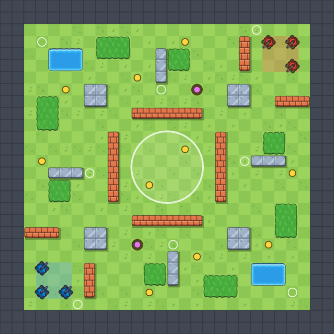
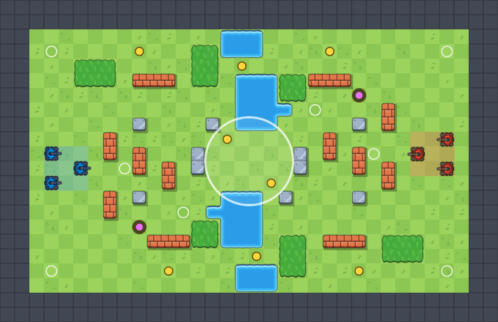
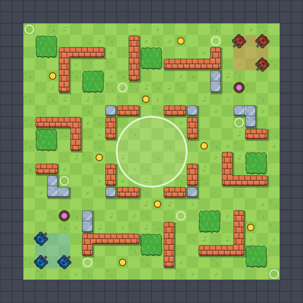

# Карты

> [!NOTE]
> **Коротко, без кода.** Кроме исходной `Arena` в игре три карты: «Перекрёсток», «Река» и «Лабиринт». Каждая
> нарисована обычным текстом — одна буква на клетку, — а сцену Unity из этого текста строит кнопка в редакторе.
> Чтобы поменять карту, правят текстовый файл и пересобирают сцену. Карту выбирают на экране режимов.

## Какие есть карты

Все карты подходят под все три режима. В каждой: 3 + 3 точки баз, 8 точек «Все против всех», зона точки в центре,
8–10 мест для усилений и 2 зарядные точки нитро. Раскладки симметричны поворотом на 180°: базы в равных условиях,
путь от каждой базы до зоны одинаковый.

| Карта | Размер | Характер |
| --- | --- | --- |
| **Арена** (`Scenes/Arena.unity`) | 24 × 24 | Исходная открытая карта, редкие стены |
| **Перекрёсток** (`Crossroads`) | 24 × 24 | Зона в кирпичной коробке с проходами по углам, стальные столбы на диагоналях, нейтральные углы с прудом и кустами |
| **Река** (`River`) | 30 × 18 | Широкая, под горизонтальный экран. Базы слева и справа, река с двумя мостами в одну клетку и бродом; зона на броде захватывает оба берега |
| **Лабиринт** (`Maze`) | 22 × 22 | Кирпичные коридоры, которые всё время ломаются и вырастают; зона в кольце с воротами на каждой стороне |







На превью: танки — точки баз (синяя и красная), белые кольца — точки «Все против всех», жёлтые кружки — места
появления усилений, фиолетовые — зарядные точки нитро, большой круг — зона точки.

## Раскладка

Файл `Assets/_Project/Editor/MapLayouts/<Id>.txt`. Первая строка карты — север (верх экрана), один символ — одна
клетка 1 × 1. Бортик толщиной 2 клетки генератор добавляет сам.

| Символ | Что это |
| --- | --- |
| `.` | Земля |
| `#` | Сталь (рикошет) |
| `x` | Кирпич (ломается, вырастает) |
| `~` | Вода (снаряды пролетают) |
| `%` | Кусты |
| `1` / `2` | Точка базы синих / красных (по 3) |
| `f` | Точка «Все против всех» (8 и больше) |
| `p` | Место появления усиления |
| `n` | Зарядная точка нитро |
| `Z` | Центр зоны: 1–4 клетки, зона встаёт в их среднюю точку |

Строки, начинающиеся с `# ` (решётка и пробел), — комментарии и заголовок: `name` — подпись в меню (в меню её
пока нужно продублировать, см. ниже), `id` — имя сцены, `zone` — радиус зоны. Строка карты может начинаться
со стали `#`, но пробелов в ней не бывает, поэтому с комментарием она не путается.

## Генератор сцен

Класс `MapBuilder` (`Assets/_Project/Editor/MapBuilder.cs`), меню Unity **TankBrawl → Maps**:

| Пункт | Что делает |
| --- | --- |
| **Build New Maps** | Строит сцены для раскладок, у которых сцены ещё нет; существующие пропускает |
| **Rebuild All Maps (overwrite)** | Пересоздаёт все сцены из раскладок. Ручные правки в этих сценах пропадут |

Как строится карта:

1. `Scenes/Arena.unity` копируется в `Scenes/Maps/<Id>.unity` — менеджер матча, танки, спавнер, камера и свет
   те же, что на арене.
2. Тайлмапы перерисовываются теми же тайлами: земля, бортик, сталь, кирпич, вода, кусты; затем `CompressBounds`,
   чтобы сетка ботов, тени и интервал усилений видели настоящий размер карты.
3. Точки появления (`SpawnPoints`) ставятся на маркеры `1`, `2`, `f` лицом к зоне (шаг 45°), места усилений
   (`PowerUpPoints`) — на `p` вместе с массивом `spawnPoints` спавнера; зона (`CapturePoint`) — в центр клеток `Z`
   с радиусом из заголовка; площадки баз (`BasePads`) — в середину своих баз; зарядные точки (`NitroStations`) — на `n`.
4. Танки и камера встают на базы, сцена сохраняется и добавляется в Build Settings.

Готовые сцены лежат в git (`Assets/_Project/Scenes/Maps`), так что играть можно без пересборки.
Пересобирает и коммитит сцены один человек: сцены Unity плохо сливаются.

## Выбор карты в меню

На экране режимов под карточками переключатель «< КАРТА: … >» (<xref:TankBrawl.UI.MenuScreens>, поле `maps`:
подпись и имя сцены). Карта, чьей сцены нет в Build Settings, не показывается; если карта одна, переключателя нет.
Выбор хранится в <xref:TankBrawl.Match.MatchSession.MapScene>, «Ещё раз» перезапускает ту же сцену.

## Новая карта

1. Нарисуйте `Assets/_Project/Editor/MapLayouts/<Id>.txt` (удобно начать с копии готовой раскладки).
2. Проверьте её без Unity:

   ```sh
   python3 Tools/maps/validate_map.py Assets/_Project/Editor/MapLayouts/<Id>.txt
   python3 Tools/maps/render_map.py Assets/_Project/Editor/MapLayouts/<Id>.txt preview.png
   ```

   Валидатор проверяет символы, симметрию, что всё проходимо без разрушения кирпича (теми же ходами, что у ботов),
   число маркеров, свободу зоны и равенство путей до неё. Рендер рисует превью настоящими тайлами (нужен ImageMagick).
3. В Unity: **TankBrawl → Maps → Build New Maps**, затем **File → Save Project**.
4. Добавьте строку в `maps` у `MenuScreens` (сцена `Menu.unity`).
5. Закоммитьте раскладку, сцену с `.meta` и `ProjectSettings/EditorBuildSettings.asset`.
