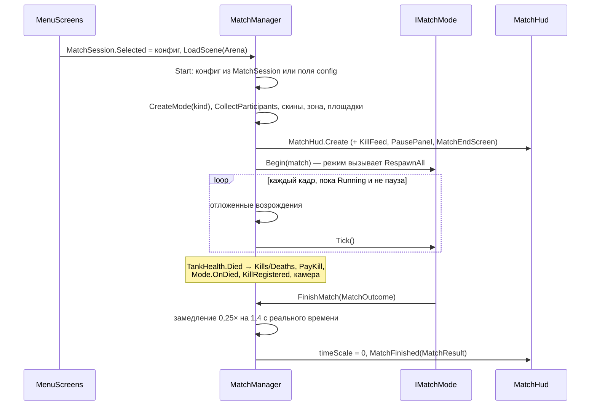

# Матч и режимы

> [!NOTE]
> **Коротко, без кода.** Менеджер матча — «судья» на арене. Он собирает все танки, раздаёт им команды и цвета,
> ставит на базы, следит, кто кого уничтожил, возрождает погибших (если режим это позволяет), платит шестерёнки,
> ставит игру на паузу и показывает экран итогов. Правила подсчёта очков у каждого режима свои: «Команда на команду»,
> «Удержание точки», «Все против всех». Как это выглядит для игрока — на странице [Как проходит матч](../game/match.md).

Неймспейс: <xref:TankBrawl.Match>. Режимы играются на любой карте: `Scenes/Arena.unity` (индекс 1 в Build Settings)
или сценах из `Scenes/Maps` (см. [Карты](maps.md)) — у всех одинаковый набор объектов, ниже он описан на примере арены.

## Сцена арены

| Объект | Что это |
| --- | --- |
| `MatchManager` | <xref:TankBrawl.Match.MatchManager>: ссылки на скины команд, объект зоны точки, площадки баз, режим по умолчанию |
| `PlayerTank` | Танк человека (команда `Player`) |
| `Ally_1`, `Ally_2` | Союзные боты (`Player`, синий скин) |
| `Bot_A`, `Bot_B`, `Bot_C` | Вражеские боты (`Enemy`) |
| `SpawnPoints` | <xref:TankBrawl.Match.SpawnPoint>: базы 3 + 3 по углам (синие (−10,5; −10,5), красные (10,5; 10,5)) и 8 точек `Free_N` для «Все против всех» |
| `BasePads` | Полупрозрачные квадраты 3 × 3 под базами (заглушка); скрыты в «Все против всех» |
| `CapturePoint` | <xref:TankBrawl.Map.CapturePointZone> радиусом 3 в центре (0,5; 0,5); включена только в «Удержании точки» |
| `PowerUpSpawner`, `PowerUpPoints` | Спавнер усилений и его 9 точек |
| `BotNav` | <xref:TankBrawl.AI.BotNavGrid> |

Все три режима играются на одной карте. Сцена без `MatchManager` (песочницы) работает как раньше: танки воюют
до гибели, без очков и возрождений.

## Жизнь матча

Состояния менеджера: `Running` → `Finishing` (замедление, режим больше не считает очки — `IsOver`) → `Finished`
(экран итога, `IsFinished`).

### Участники

<xref:TankBrawl.Match.MatchParticipant> — один танк в матче. Танки никогда не уничтожаются, только деактивируются,
поэтому ссылка остаётся рабочей.

- Собираются все объекты с <xref:TankBrawl.Core.TeamMember> и <xref:TankBrawl.Tank.TankHealth>, по имени объекта.
  Человек (с <xref:TankBrawl.Input.PlayerTankInput>) — первый и зовётся «Я», боты — «Бот 1», «Бот 2»… по порядку имён.
- В «Все против всех» остаются человек и первые три бота, остальные танки выключаются; каждому выдаётся своя
  команда (`Player`, `Enemy`, `Third`, `Fourth`).
- Скин — из `teamSkins` по номеру команды: синий, красный, зелёный, жёлтый.
- `TeamMember.LocalTeam` = команда человека.
- `SpawnIndex` — номер танка внутри команды (человек первый), по нему выбирается точка базы.

### Появление и возрождение

| Метод | Что делает |
| --- | --- |
| `RespawnAll()` | Новый раунд: убирает снаряды (`Projectile.ClearAll`), возвращает кирпичи (`DestructibleTilemap.ResetAll`), сбрасывает усиления (`PowerUpSpawner.ResetSpawner`) и зарядные точки (`NitroStation.ResetAll`), ставит все танки на точки, камера — `Snap()` |
| `Respawn(p)` | Выключает и включает танк на точке: полное HP, нитро, без усилений, со спавн-защитой `spawnProtection` |
| `ScheduleRespawn(p, delay)` | То же через `delay` секунд (0 — сразу) |

Выбор точки:

- **база** (командные режимы): точки <xref:TankBrawl.Match.SpawnPoint> своей команды по номеру танка по кругу;
  при возрождении посреди матча пропускается точка, где стоит живой танк (ближе 1,3);
- **случайная** (`randomSpawn`, «Все против всех»): случайная из точек `freeForAll`, не ближе `safeSpawnDistance` (6)
  к живым врагам; если таких нет — самая дальняя от них;
- точек нет — танк встаёт туда, где стоял в начале матча.

Направление танка — ось Y объекта точки (зелёная стрелка в редакторе). Гизмо точки окрашено в цвет команды,
у общих точек — белое.

### Гибель, убийства и награды

`MatchManager` подписан на `TankHealth.Died` каждого участника. В колбэке он только записывает:

- жертве `Deaths++`; убийце чужой команды `Kills++`; гибель от собственного рикошета или без известного убийцы никому
  не засчитывается;
- убил человек — сразу `+gearsPerKill` шестерёнок (12) в кошелёк и звуки `KillConfirm`, `GearGain` (`KillGears` копит
  сумму за матч);
- `IMatchMode.OnDied`, событие `KillRegistered` (его слушает киллтаб), обновление камеры.

Все решения (конец раунда, возрождения) режим принимает в `Tick`, а не в колбэке урона.

### Камера

<xref:TankBrawl.Core.CameraFollow> следует за человеком. Пока человек мёртв — за живым союзником (`IsSpectating`,
HUD пишет «Вы наблюдаете за союзником»); союзников нет — камера остаётся на месте. `Snap()` ставит камеру на цель
без сглаживания (начало раунда).

### Конец матча и итог

`FinishMatch(MatchOutcome)` → замедление `0,25×` на 1,4 с реального времени, звук победы или поражения →
`timeScale = 0` и <xref:TankBrawl.Match.MatchResult>:

- заголовок «ПОБЕДА» / «ПОРАЖЕНИЕ», режим, строка счёта из `MatchOutcome.Summary`;
- таблица: в командных режимах сначала команда человека, внутри — по убийствам; в «Все против всех» — по очкам
  (и колонка «Очки»);
- награда: убийства (уже выплачены), `+gearsPerWin` (100) за победу, `+extraGoalGears` (20) за доп. цель — только
  вместе с победой (баланс §12: при поражении остаются лишь шестерёнки за убийства); невыплаченная часть добавляется
  в кошелёк, `PlayerProgress.RegisterMatch` считает матчи и победы.

### Пауза и «Назад»

`SceneNavigator.GoBack()` (Escape, кнопка «Назад» Android, экранная кнопка «ПАУЗА») в матче вызывает
`MatchManager.OnBackPressed`: идущий матч ставит на паузу и снимает с неё, на экране итога — выход в меню.
Пауза — `Time.timeScale = 0`. `OnDestroy` менеджера возвращает `timeScale = 1`. `RestartMatch` перезагружает сцену,
`ExitToMenu` грузит меню.

## Режимы

Контракт — <xref:TankBrawl.Match.IMatchMode>; общий код (кэшированные строки HUD, часы раз в секунду, подсказка
«Возрождение через N») — <xref:TankBrawl.Match.MatchModeBase>. Строки HUD пересобираются, только когда меняется число
внутри них, поэтому HUD читает их каждый кадр без аллокаций. Числа режима — в
<xref:TankBrawl.Match.MatchModeConfig> (`ScriptableObjects/Match/{TeamElimination,CapturePoint,Deathmatch}`).

| | Команда на команду | Удержание точки | Все против всех |
| --- | --- | --- | --- |
| Класс | <xref:TankBrawl.Match.EliminationMode> | <xref:TankBrawl.Match.CapturePointMode> | <xref:TankBrawl.Match.DeathmatchMode> |
| Состав | 3 × 3 | 3 × 3 | человек + 3 бота, каждый сам за себя |
| Очки | Раунд выигрывает команда, у которой остались живые | 1 очко в секунду команде, которая **одна** стоит в зоне; обе в зоне — спор, очков нет | 10 за убийство; после 25 с жизни +1 каждые 5 с (смерть сбрасывает) |
| Победа | 3 выигранных раунда | 100 очков или больше очков через 8 мин | 100 очков или первое место через 7 мин |
| Ничья | Все погибли одновременно — раунд без очка | По времени — дополнительное время до первого очка перевеса | За первое место — дополнительное время |
| Возрождение | Нет (до конца раунда) | Через 7 с на базе | Через 7 с в случайной точке |
| Спавн-защита | 2 с | 3 с | 3 с |
| Доп. цель (+20, только при победе) | Человек ни разу не погиб | Человек провёл 30 с в зоне, пока его команда набирала очки | 5 убийств |
| Победа человека | Его команда выиграла матч | Его команда набрала больше | Первое место |

- **Команда на команду**: раунд — баннер «РАУНД N» на `roundIntroSeconds` (2 с), бой, итог раунда на
  `roundEndSeconds` (3 с), затем `RespawnAll` и новый раунд. Каждый раунд кирпичи, снаряды и пикапы сбрасываются.
- **Удержание точки**: зона красится цветом команды-владельца; звук `ZoneCapture`, когда точку берёт команда человека.
- **Все против всех**: полоса счёта — ячейка на каждого участника, у лидера подпись «лидер». Итог — «N место · M очков».

Режимы пишут тексты HUD по-русски: `TitleText` («РАУНД 2 · до 3 побед»), `TimerText` («7:42»), `BannerText`,
`HintText`, полоса счёта — список <xref:TankBrawl.Match.ScoreEntry> и счётчик `ScoreVersion`.

## Интерфейс матча

Всё строится кодом из `MatchManager.Start` через <xref:TankBrawl.UI.UiKit>; сцена ничего не содержит.

| Класс | Порядок канваса | Что показывает |
| --- | --- | --- |
| <xref:TankBrawl.Match.MatchHud> | 90 (под экранным управлением, у него 100) | Сверху: заголовок режима, полоса счёта (своя ячейка в жёлтой рамке, под значением «живы N» / «держим точку» / «лидер»), часы, подсказка. В центре: баннер. Слева сверху под кнопкой «ПАУЗА»: HP, нитро, шестерёнки за матч. Красная виньетка при попадании в игрока |
| <xref:TankBrawl.Match.KillFeed> | внутри HUD | Справа сверху до 5 строк «Убийца » Жертва» в цветах команд; без убийцы — «Бот N погиб». Строки с участием игрока — на тёмной плашке. Гаснут через 6 с |
| <xref:TankBrawl.Match.PausePanel> | 120 | «ПРОДОЛЖИТЬ», «НАЧАТЬ ЗАНОВО», «В МЕНЮ» |
| <xref:TankBrawl.Match.MatchEndScreen> | 130 | Победа/поражение, счёт, таблица, награда с разбивкой и кошельком, кнопки «ЕЩЁ РАЗ», «УЛУЧШЕНИЯ», «В МЕНЮ» |

Кнопка «УЛУЧШЕНИЯ» на экране итога ставит `MenuScreens.OpenUpgradesOnStart`, и меню открывается сразу на улучшениях.

## Как добавить режим

См. [Рецепты](recipes.md#новый-режим-матча).
