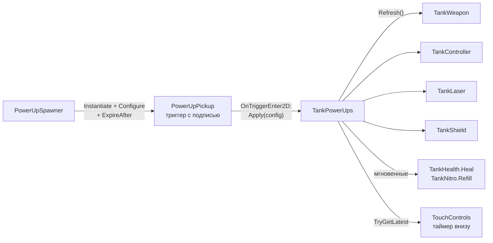

# Усиления

> [!NOTE]
> **Коротко, без кода.** На карте время от времени появляются цветные пикапы-усиления с короткой подписью, что они
> дают. Кто первым наехал — тот и забрал (боты тоже). Временные усиления действуют несколько секунд: взрывные
> снаряды, удвоенная скорострельность, лазер или щит; мгновенные сразу чинят танк или заполняют нитро. Пикап,
> который никто не взял, через 20 секунд исчезает. Отдельно на картах есть зарядные точки нитро.

Неймспейс: <xref:TankBrawl.PowerUps>.

## Виды

Перечисление <xref:TankBrawl.PowerUps.PowerUpKind>, по ассету <xref:TankBrawl.PowerUps.PowerUpConfig> на вид
в `ScriptableObjects/PowerUps` (у ремонта и заряда нитро ассета может не быть, см. ниже):

| Вид | Подпись на карте | Длится | Что делает | Через что работает |
| --- | --- | --- | --- | --- |
| `RapidFire` | Стрельба ×2 · 10 с | 10 с | Перезарядка × 0,5 (`fireIntervalScale`) | `TankWeapon.FireIntervalScale` |
| `ExplosiveShells` | Взрывные снаряды · 7 с | 7 с | Каждый выстрел — взрывной снаряд `ExplosiveShell` (50 прямого + 30 по площади, радиус 2) | `TankWeapon.SetOverride` |
| `Laser` | Лазер · 4 с | 4 с | Луч вместо пушки: 20 урона раз в 0,65 с каждому чужому танку в луче; танк замедлен до × 0,6 | <xref:TankBrawl.Weapons.TankLaser>, `TankWeapon.Suppressed`, `TankController.SpeedMultiplier` |
| `Shield` | Щит · 15 с | 15 с | Поглощает одно попадание; последние 2 с кольцо мигает | <xref:TankBrawl.Tank.TankShield> |
| `Repair` | +30 HP | сразу | +`repairAmount` (30) здоровья, не выше максимума | <xref:TankBrawl.Tank.TankHealth.Heal*> |
| `NitroRefill` | Полное нитро | сразу | Полный запас нитро | <xref:TankBrawl.Tank.TankNitro.Refill*> |

Мгновенные виды (`IsInstant`) не занимают таймер и не показываются в таймере экранного управления.
Новые виды добавляются только в конец перечисления: в ассетах вид хранится числом.

> [!NOTE]
> **Отличия от `tank_balance_v0_2.md`** (решения команды записаны в разделе 0 баланса): взрывные снаряды 7 с вместо 15,
> радиус их взрыва 2,0; интервал лазера 0,65 с вместо 0,5; щит 15 с вместо 6; скорострельность — своё усиление.
> Замедление лазером × 0,6, длина луча 40 и его радиус 0,15 — предложения.

## Как это устроено

### Эффекты на танке

Класс: <xref:TankBrawl.PowerUps.TankPowerUps>

- Хранит по одному слоту на вид: конфиг, время конца, время подбора. Повторный подбор того же вида **обновляет**
  таймер, а не складывает его; разные виды работают одновременно.
- Сами эффекты живут в компонентах танка, а `TankPowerUps` только выставляет их рычаги в `Refresh()` — при подборе
  и когда какой-то эффект кончился. Мгновенные виды применяются сразу (`ApplyInstant`) и слота не занимают.
- Щит считает время сам (он может кончиться и от поглощённого удара), поэтому активность щита берётся из
  <xref:TankBrawl.Tank.TankShield.IsActive>.
- `TryGetLatest` отдаёт название и остаток последнего подобранного из действующих — его показывает таймер экранного
  управления («ЩИТ 12.3»).
- **Кольцо под танком**: пока действует хоть одно временное усиление, под танком пульсирует кольцо цвета последнего
  из них (`pickupColor`). Его видят все, вражеский танк в кустах прячет его. Кольцо создаётся в `Start` — после того,
  как <xref:TankBrawl.Tank.TankHealth> и <xref:TankBrawl.Tank.TankConcealment> собрали спрайты танка, иначе оно
  мигало бы вместе с ними.
- При деактивации танка (гибель) все эффекты сбрасываются: каждый компонент возвращает себя в исходное состояние
  в `OnEnable` / `OnDisable`.
- Танк без <xref:TankBrawl.Weapons.TankLaser> лазер просто игнорирует.

### Пикап

Класс: <xref:TankBrawl.PowerUps.PowerUpPickup>, префаб `Prefabs/PowerUps/PowerUpPickup`

- Триггер: первый танк **любой команды** с `TankPowerUps`, въехавший в него, получает эффект; пикап исчезает
  со звуком и вспышкой частиц.
- Цвет спрайта — `pickupColor` из конфига (пока это цветной круг-заглушка), лёгкая пульсация размера
  (`pulseAmount`, `pulsePeriod`).
- **Подпись**: над пикапом белый текст с тенью — <xref:TankBrawl.PowerUps.PowerUpConfig.MapLabel>: поле `mapLabel`,
  а если оно пустое — строка из чисел конфига («Стрельба ×2 · 10 с», «+30 HP»). Это `TextMesh` встроенным шрифтом
  интерфейса, порядок отрисовки 17 (над танками и полосками HP). Подпись не пульсирует вместе с пикапом; высота —
  `labelHeight`, отступ — `labelOffset`.
- **Исчезновение**: спавнер вызывает <xref:TankBrawl.PowerUps.PowerUpPickup.ExpireAfter*>; за `expireWarning` (3 с)
  до конца пикап с подписью мигает, потом исчезает с облачком частиц. Положенный в сцену вручную пикап не исчезает.
- Можно положить в сцену вручную (заполнить `config`) или создать из кода (`Configure`).
- <xref:TankBrawl.PowerUps.PowerUpPickup.OnMap> — все пикапы на карте (для ботов),
  <xref:TankBrawl.PowerUps.PowerUpPickup.ClaimedBy> — какой бот за ним едет, чтобы второй выбрал другой.

### Спавнер

Класс: <xref:TankBrawl.PowerUps.PowerUpSpawner> — компонент на объекте сцены (`PowerUpSpawner` с точками
в `PowerUpPoints`).

- Первый пикап — через `firstDelay` (8–12 с) после старта.
- Дальше — каждые `clamp(minInterval, maxInterval, baseInterval × √(referenceArea / площадь карты))` секунд:
  10…40 с, 25 с на эталонной карте 27 × 27. Чем больше карта, тем чаще. Площадь берётся из границ тайлмапа
  `areaSource` (бортика); без него — эталонная, то есть 25 с.
- Не больше `maxOnMap` (2) пикапов одновременно; на лимите таймер стоит. Пикап, который никто не взял,
  исчезает через `pickupLifetime` (20 с) и освобождает место.
- Точка — случайная из `spawnPoints`, где нет другого пикапа и ни одного танка ближе `clearRadius`. Все заняты —
  повтор через `retryDelay`.
- Вид — случайный из тех, что ещё не лежат на карте (если все лежат — любой).
- **Ремонт и заряд нитро** (`addInstantPowerUps`, по умолчанию включено): если в списке `powerUps` нет ассета этого
  вида, спавнер добавляет конфиг с числами по умолчанию (<xref:TankBrawl.PowerUps.PowerUpConfig.CreateDefault*>).
  Чтобы настроить числа, создайте ассет этого вида и добавьте его в `powerUps`.
- <xref:TankBrawl.PowerUps.PowerUpSpawner.ResetSpawner*> убирает все пикапы и заново отсчитывает первую задержку —
  менеджер матча зовёт его в начале каждого раунда.

### Боты и усиления

Бот едет за пикапом, если тот виден ему (в пределах экрана), не занят другим ботом и нужен: временный — если такого
эффекта на боте ещё нет; «Ремонт» — если здоровье ниже `repairWantedBelow` (85 %); «Заряд нитро» — если запас ниже
`nitroRefillWantedBelow` (50 %). Подробнее — в [Ботах](bots.md#усиления).

## Зарядные точки нитро

Класс: <xref:TankBrawl.PowerUps.NitroStation> (баланс §8, отдельно от усилений)

- Танк любой команды, заехавший на точку, получает полный запас нитро; танк с полным нитро точку не тратит.
- После зарядки точка перезаряжается `rechargeTime` (12–16 с, случайно в диапазоне). Ждущий на ней танк зарядится,
  как только точка снова готова.
- Префаб не нужен: триггер-круг (`radius`, 0,45) и вид-заглушка (тёмная площадка и фиолетовое ядро, которое
  пульсирует, пока точка готова, и вырастает заново во время перезарядки) создаются кодом. В редакторе точка видна
  как гизмо.
- На картах из генератора точки ставятся по маркерам `n` (по две на карту). На исходной `Arena` их нет.
- <xref:TankBrawl.PowerUps.NitroStation.ResetAll*> — все точки готовы сразу; вызывается в начале раунда.
- Боты точки специально не ищут: заряжаются, если проезжают по ним.

## Песочница

`Scenes/Sandbox/PowerUps.unity` (меню: Настройки → Отладка → «Павер-апы»): спавнер с десятью точками и четыре пикапа
рядом с игроком, по одному каждого временного вида (возвращаются перезаходом в сцену). Ремонт и заряд нитро
спавнер добавит сам.

## Как добавить новое усиление

См. [Рецепты](recipes.md#новое-усиление).
