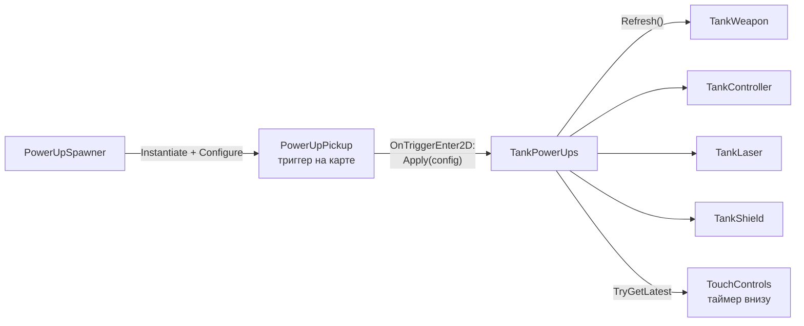

# Усиления

> [!NOTE]
> **Коротко, без кода.** На карте время от времени появляются цветные пикапы-усиления. Кто первым наехал — тот и
> забрал (боты тоже). Усиление действует несколько секунд: взрывные снаряды, удвоенная скорострельность, лазер или щит.
> Разные усиления работают вместе, повторный подбор того же продлевает его. Оставшееся время показано внизу экрана.

Неймспейс: <xref:TankBrawl.PowerUps>.

## Виды

Перечисление <xref:TankBrawl.PowerUps.PowerUpKind>, по ассету <xref:TankBrawl.PowerUps.PowerUpConfig> на вид
в `ScriptableObjects/PowerUps`:

| Ассет | Надпись у таймера | Длится | Что делает | Через что работает |
| --- | --- | --- | --- | --- |
| `RapidFire` | СКОРОСТРЕЛ | 10 с | Перезарядка × 0,5 (`fireIntervalScale`) | `TankWeapon.FireIntervalScale` |
| `ExplosiveShells` | ВЗРЫВ | 7 с | Каждый выстрел — взрывной снаряд `ExplosiveShell` (50 прямого + 30 по площади, радиус 2) | `TankWeapon.SetOverride` |
| `Laser` | ЛАЗЕР | 4 с | Луч вместо пушки: 20 урона раз в 0,65 с каждому чужому танку в луче; танк замедлен до × 0,6 | <xref:TankBrawl.Weapons.TankLaser>, `TankWeapon.Suppressed`, `TankController.SpeedMultiplier` |
| `Shield` | ЩИТ | 15 с | Поглощает одно попадание; последние 2 с кольцо мигает | <xref:TankBrawl.Tank.TankShield> |

> [!NOTE]
> **Отличия от `tank_balance_v0_2.md`** (решения команды, документ баланса не менялся): взрывные снаряды 7 с вместо 15,
> радиус их взрыва 2,0 (в балансе не задан; больше осколочного 1,4, чтобы усиление выделялось); интервал лазера 0,65 с
> вместо 0,5; щит 15 с вместо 6. Скорострельности в балансе нет (она из концепции), замедление лазером × 0,6, длина луча 40
> и его радиус 0,15 — предложения. «Ремонт» и «Заряд нитро» из баланса (раздел 7) не сделаны.

## Как это устроено

### Эффекты на танке

Класс: <xref:TankBrawl.PowerUps.TankPowerUps>

- Хранит по одному слоту на вид: конфиг, время конца, время подбора. Повторный подбор того же вида **обновляет**
  таймер, а не складывает его; разные виды работают одновременно.
- Сами эффекты живут в компонентах танка, а `TankPowerUps` только выставляет их рычаги в `Refresh()` — при подборе
  и когда какой-то эффект кончился.
- Щит считает время сам (он может кончиться и от поглощённого удара), поэтому активность щита берётся из
  <xref:TankBrawl.Tank.TankShield.IsActive>.
- `TryGetLatest` отдаёт название и остаток последнего подобранного из действующих — его показывает таймер экранного
  управления («ЩИТ 12.3»).
- При деактивации танка (гибель) все эффекты сбрасываются: каждый компонент возвращает себя в исходное состояние в
  `OnEnable` / `OnDisable`.
- Танк без <xref:TankBrawl.Weapons.TankLaser> лазер просто игнорирует.

### Пикап

Класс: <xref:TankBrawl.PowerUps.PowerUpPickup>, префаб `Prefabs/PowerUps/PowerUpPickup`

- Триггер: первый танк **любой команды** с `TankPowerUps`, въехавший в него, получает эффект; пикап исчезает
  со звуком и вспышкой частиц.
- Цвет спрайта — `pickupColor` из конфига (пока это цветной круг-заглушка), лёгкая пульсация размера
  (`pulseAmount`, `pulsePeriod`).
- Можно положить в сцену вручную (заполнить `config`) или создать из кода (`Configure`).
- <xref:TankBrawl.PowerUps.PowerUpPickup.OnMap> — все пикапы на карте (для ботов),
  <xref:TankBrawl.PowerUps.PowerUpPickup.ClaimedBy> — какой бот за ним едет, чтобы второй выбрал другой.
- Времени жизни у пикапа нет: лежит, пока не подберут или пока не начнётся новый раунд.

### Спавнер

Класс: <xref:TankBrawl.PowerUps.PowerUpSpawner> — компонент на объекте сцены (на арене — `PowerUpSpawner` с девятью
точками в `PowerUpPoints`).

- Первый пикап — через `firstDelay` (8–12 с) после старта.
- Дальше — каждые `clamp(minInterval, maxInterval, baseInterval × √(referenceArea / площадь карты))` секунд:
  10…40 с, 25 с на эталонной карте 27 × 27. Площадь берётся из границ тайлмапа `areaSource` (бортика); без него —
  эталонная, то есть 25 с.
- Не больше `maxOnMap` (2) пикапов одновременно; на лимите таймер стоит.
- Точка — случайная из `spawnPoints`, где нет другого пикапа и ни одного танка ближе `clearRadius`. Все заняты —
  повтор через `retryDelay`.
- Вид — случайный из тех, что ещё не лежат на карте (если все лежат — любой).
- <xref:TankBrawl.PowerUps.PowerUpSpawner.ResetSpawner*> убирает все пикапы и заново отсчитывает первую задержку —
  менеджер матча зовёт его в начале каждого раунда.

## Песочница

`Scenes/Sandbox/PowerUps.unity` (меню: Настройки → Отладка → «Павер-апы»): спавнер с десятью точками и четыре пикапа
рядом с игроком, по одному каждого вида (возвращаются перезаходом в сцену).

## Как добавить новое усиление

См. [Рецепты](recipes.md#новое-усиление).
