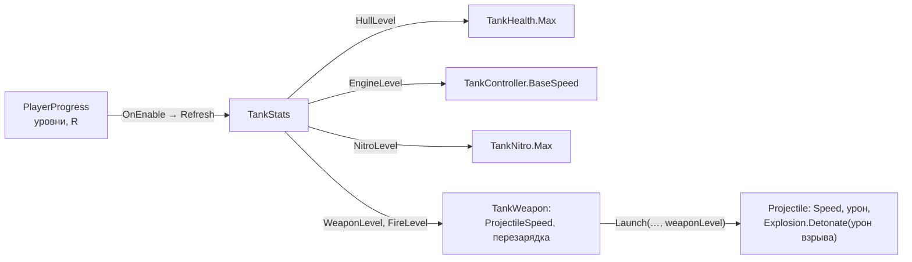

# Прокачка и сохранение

> [!NOTE]
> **Коротко, без кода.** За уничтоженных врагов, победы и дополнительные цели игрок получает шестерёнки. На них в меню
> покупаются постоянные улучшения танка в пяти ветках, у каждой следующий уровень дороже. Сумма всех купленных уровней —
> «ранг угрозы»: чем он выше, тем крепче и быстрее боты, причём и вражеские, и союзные. Всё это, а также настройки звука и
> вибрации, хранится на устройстве и не пропадает между запусками. Числа — `tank_balance_v0_2.md`, разделы 12–15.

Неймспейс: <xref:TankBrawl.Progress>, плюс <xref:TankBrawl.Tank.TankStats> на танке.

## Награды

| За что | Шестерёнок | Когда | Где число |
| --- | --- | --- | --- |
| Каждый враг, уничтоженный человеком | 12 | сразу | `ProgressionConfig.gearsPerKill` |
| Победа в матче | 100 | на экране итога | `ProgressionConfig.gearsPerWin` |
| Доп. цель режима | 20 | на экране итога, только вместе с победой | `MatchModeConfig.extraGoalGears` |

Выплачивает <xref:TankBrawl.Match.MatchManager> (см. [Матч и режимы](match.md#гибель-убийства-и-награды)).

## Ветки улучшений

Перечисление <xref:TankBrawl.Progress.UpgradeBranch>. Цена уровня `n` (считая с нуля):
`round(baseCost × costGrowth^n)`, `costGrowth` = 1,35. Потолка уровня нет.

| Ветка | Первый уровень стоит | За уровень у игрока | Где число «за уровень» |
| --- | --- | --- | --- |
| `Hull` — корпус | 100 | +10 HP | `PlayerTankConfig.healthPerLevel` |
| `Engine` — двигатель | 90 | +0,15 D/с | `PlayerTankConfig.speedPerLevel` |
| `Weapon` — орудие | 140 | +4 урона бронебойному; осколочному +2 прямого и +1 по площади | `damagePerLevel`, `explosionDamagePerLevel` в `WeaponConfig` |
| `FireRate` — скорострельность | 130 | +0,05 выстр/с: интервал = 1 / (1 / база + 0,05 · n) | `WeaponConfig.fireRatePerLevel` |
| `Nitro` — нитро | 80 | +0,25 с запаса | `NitroConfig.capacityPerLevel` |

Числа «за уровень» лежат **в тех же конфигах, что и базовые значения**, а <xref:TankBrawl.Progress.ProgressionConfig>
только назначает цены и описывает ветки игроку (название, описание, иконка; `StatText` — значение до и после покупки
для карточки в меню).

## Ранг угрозы и боты

<xref:TankBrawl.Progress.PlayerProgress.ThreatRank> **R** = сумма уровней всех пяти веток. У каждого бота (враги и
союзники) уровни корпуса, двигателя, орудия и скорострельности равны R, нитро — 0 (баланс, раздел 14). Числа «за
уровень» у бота свои — в `BotTankConfig` и `BotWeapon`:

| Параметр бота | Формула |
| --- | --- |
| HP | 100 + 4R |
| Урон | round(35 + 0,5R) |
| Скорость | 2,6 + 0,01R |
| Скорострельность | 0,8 + 0,01R выстр/с |
| Скорость снаряда | 9 + 0,03R |

Покупка в меню действует везде, где есть человек и боты, включая песочницы.

## Как уровни доходят до танка

<xref:TankBrawl.Tank.TankStats> выполняется раньше остальных компонентов (`[DefaultExecutionOrder(-100)]`) и читает
уровни в `OnEnable`, то есть при каждом появлении танка.

## Сохранение

Класс: <xref:TankBrawl.Progress.PlayerProgress> (статический, переживает смену сцен)

- Хранит шестерёнки, уровни пяти веток, громкость звука и музыки, вибрацию, тряску экрана (`ScreenShakeOn`), число
  сыгранных и выигранных матчей.
- Формат — JSON в `PlayerPrefs` под ключом `tankbrawl.progress.v1`. Загружается при первом обращении; повреждённые
  данные заменяются новыми с предупреждением в консоли.
- Любое изменение сохраняется сразу, кроме ползунков громкости: они пишутся через 0,6 с после последнего движения
  (`FlushIfDue` вызывает <xref:TankBrawl.Audio.AudioManager> каждый кадр, а также при сворачивании и выходе).
- Событие `Changed` — после любой правки (меню обновляет кошелёк и карточки).
- `ResetProgress()` стирает шестерёнки, уровни и статистику, но сохраняет настройки. В меню: Настройки → Сбросить прогресс
  (с подтверждением) или Отладка → Сбросить прогресс. Там же в Отладке есть «+500 шестерёнок».
- `ProgressionConfig` загружается из `Resources/ProgressionConfig`; без него улучшения не работают (ошибка в консоли).

> [!WARNING]
> Тесты в Play Mode пишут в настоящие `PlayerPrefs` редактора. После экспериментов с покупками сбросьте прогресс,
> иначе прокачанный игрок и усиленные боты останутся во всех сценах.
