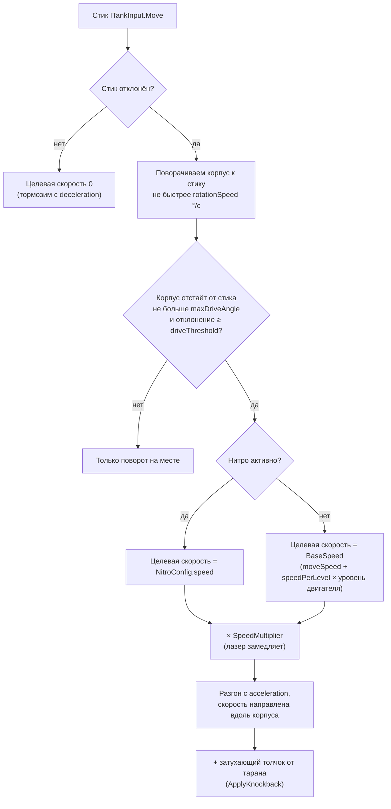
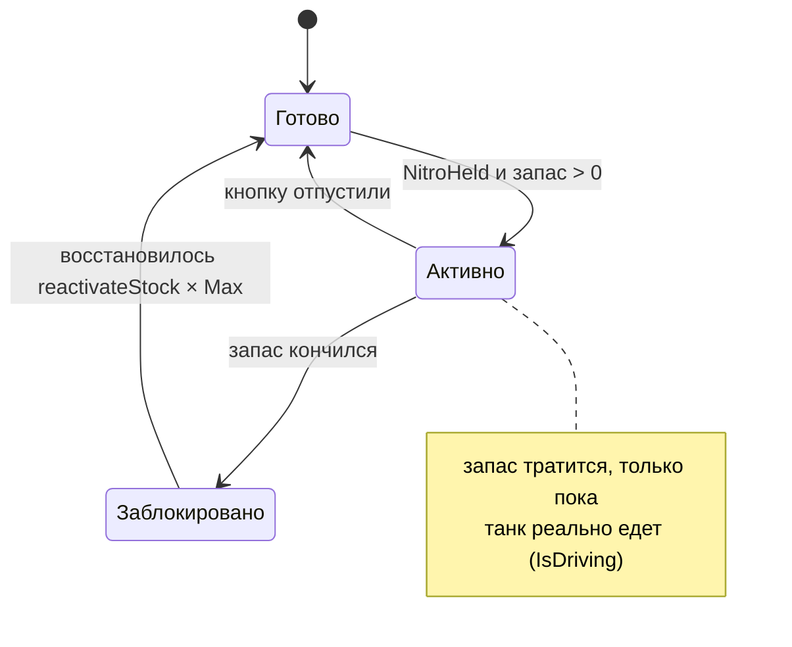

# Танк

> [!NOTE]
> **Коротко, без кода.** Танк разворачивается к стику и едет только вперёд, пушка смотрит туда же, куда корпус.
> Здоровье не восстанавливается, после попадания 0,3 с неуязвимости, после появления на карте — 2–3 с защиты
> с медленным миганием. Нитро тратится, только пока танк едет, и само восстанавливается. Таран работает только
> на нитро и передом. Улучшения из меню прибавляют здоровье, скорость и нитро. Правила для игрока — в
> [Правилах боя](../game/rules.md); ниже — как это устроено внутри.

Масштаб: **1 юнит Unity = 1D** (диаметр танка), клетка тайлмапа = 1 юнит, танк занимает одну клетку
(коллайдер — круг радиусом 0,45). Спрайт танка смотрит вдоль локальной оси **+Y**.

## Движение

Класс: <xref:TankBrawl.Tank.TankController>

Пушка отдельно не вращается: прицеливание = руление. Каждый шаг физики контроллер решает так:

Отсюда два правила управления:

- **слабое отклонение стика** — танк разворачивается на месте, можно прицелиться не сдвигаясь;
- **резкий разворот** — сначала поворот (пока угол больше `maxDriveAngle`), потом езда.

Мёртвую зону стика контроллер не применяет: её задаёт сам Input System (Project Settings → Input System Package →
Default Deadzone), одна на геймпад и экранный стик.

`SpeedMultiplier` выставляет <xref:TankBrawl.PowerUps.TankPowerUps> (лазер), `OnDisable` сбрасывает скорость,
толчок и множитель — возрождённый танк стартует с места.

## Здоровье

Класс: <xref:TankBrawl.Tank.TankHealth>

- `Max` = `maxHealth` + `healthPerLevel` × уровень корпуса (<xref:TankBrawl.Tank.TankStats>).
- После попадания танк `hitInvulnerability` секунд не получает урон и мигает с периодом `hitBlinkInterval`.
- **Спавн-защита**: <xref:TankBrawl.Tank.TankHealth.GrantSpawnProtection*> (её даёт менеджер матча после каждого
  появления) делает танк неуязвимым на заданное время и мигает медленнее, с периодом `spawnBlinkInterval`, чтобы
  отличаться от мигания после удара. `IsInvulnerable` учитывает оба окна, `HasSpawnProtection` — только защиту:
  по такой цели боты не стреляют и не таранят.
- Перед уроном здоровье спрашивает <xref:TankBrawl.Tank.TankShield>: если щит поднят, он съедает удар,
  танк получает обычное окно неуязвимости и событие `ShieldAbsorbed`.
- При нуле HP: эффекты взрыва, событие `Died(жертва, источник)`, затем объект **деактивируется**. На момент события
  `IsDead` уже истинно, а объект ещё активен. Повторная активация (`OnEnable`) возвращает полное HP и снимает защиту.
- Регенерации нет. Здоровье возвращает только усиление «Ремонт»: <xref:TankBrawl.Tank.TankHealth.Heal*> (не выше `Max`).

| Событие | Когда | Кто слушает |
| --- | --- | --- |
| `Died(TankHealth, GameObject source)` | HP кончилось; `source` — корень танка-стрелка или `null` | <xref:TankBrawl.Match.MatchManager> (очки, киллтаб, возрождение) |
| `Damaged(TankHealth, float amount, GameObject source)` | HP реально уменьшилось | <xref:TankBrawl.Match.MatchHud> (красная виньетка у игрока) |
| `ShieldAbsorbed(TankHealth)` | Удар поглотил щит | — |

**Отклик на попадание.** Искры цвета команды (<xref:TankBrawl.Core.Fx>), звук. Если попали в танк человека —
отдельный звук, тряска экрана пропорционально урону и вибрация телефона (если включена в настройках).
При гибели — взрыв частицами, звук, тряска (сильнее, если погиб сам игрок).

## Уровни прокачки

Класс: <xref:TankBrawl.Tank.TankStats>

Хранит уровни пяти веток для одного танка. Компоненты, которым нужен уровень, читают его отсюда и умножают на число
«за уровень» из своего конфига, поэтому уровень 0 — это ровно базовый конфиг.

| Танк | Откуда уровни |
| --- | --- |
| С <xref:TankBrawl.Input.PlayerTankInput> | Купленные в меню (<xref:TankBrawl.Progress.PlayerProgress>) |
| С <xref:TankBrawl.AI.BotTankInput> (враги и союзники) | Корпус, двигатель, орудие, скорострельность = ранг угрозы R; нитро = 0 |
| Без ввода (манекен) | Все нули |

Уровни читаются в `OnEnable` (компонент выполняется первым, `[DefaultExecutionOrder(-100)]`), то есть заново
при каждом возрождении. Подробнее об экономике — в статье [Прокачка и сохранение](progression.md).

## Нитро

Класс: <xref:TankBrawl.Tank.TankNitro>

- Запас измеряется в **секундах буста**: `Max` = `capacity` + `capacityPerLevel` × уровень нитро. В остальное время
  восстанавливается на `regenPerSecond × Max` в секунду.
- Блокировка после опустошения нужна, чтобы нитро не «мерцало» на нулевом запасе.
- Расход идёт, только если танк **реально движется** не медленнее `minDrainSpeed` (1 ед/с): берётся скорость тела
  после физики, поэтому в упоре в стену запас не тратится.
- <xref:TankBrawl.Tank.TankNitro.Refill*> заполняет запас и снимает блокировку — так работают усиление «Заряд нитро»
  и зарядные точки (см. [Усиления](powerups.md#зарядные-точки-нитро)).
- Компонент выполняется раньше контроллера (`[DefaultExecutionOrder(-10)]`), чтобы контроллер видел состояние
  нитро этого же шага. Включение нитро на ходу играет звук `NitroStart`.

## Таран

Класс: <xref:TankBrawl.Tank.TankRam>

Срабатывает на `OnCollisionEnter2D` и `OnCollisionStay2D`, только если **одновременно**:

1. нитро активно;
2. скорость танка не меньше `ramMinSpeed`;
3. препятствие спереди — в пределах `ramMaxAngle` от курса (скольжение вдоль стены не считается).

| Во что врезались | Результат |
| --- | --- |
| Танк чужой команды | `ramDamage` HP + отталкивание (`knockbackSpeed`, затухает за `knockbackDuration`), звук и тряска. **Один удар за касание**: прижатый к стене враг получает один удар; следующий — только когда танки разъедутся (пауза в контакте дольше 0,1 с) и не раньше чем через `ramCooldown` |
| Неуязвимый танк (удар, спавн-защита) | Ничего: кулдаун не тратится, толчка нет |
| Танк со щитом | Щит поглощает удар, толчок проходит |
| Свой танк | Ничего |
| Кирпич | Ломается сразу (`ramBlockDamage`) в трёх точках по ширине корпуса (`brickBreakHalfWidth`) |
| Сталь, вода, бортик | Ничего — они не `IDamageable` |

## Щит

Класс: <xref:TankBrawl.Tank.TankShield>

Включается усилением «Щит» (<xref:TankBrawl.Tank.TankShield.Activate*>). Поглощает **одно** получение урона
с `Amount > 0` (снаряд, взрыв, лазер, таран) или спадает сам по таймеру. Последние `shieldBlinkTime` секунд кольцо
мигает. Кольцо — неактивный дочерний объект `ShieldRing`; в кустах оно прячется само, потому что не входит в спрайты,
которые гасит <xref:TankBrawl.Tank.TankConcealment>.

## Кусты

Класс: <xref:TankBrawl.Tank.TankConcealment>

Танк считается в кустах, если в клетке под **его центром** есть тайл <xref:TankBrawl.Map.BushTilemap>.

- Танки команды человека (<xref:TankBrawl.Core.TeamMember.LocalTeam>, включая союзных ботов) в кустах
  полупрозрачные (`ownAlphaInBush`), чужие исчезают. `VisibilityAlpha` — с какой прозрачностью их видит человек.
- Для ботов: `IsHiddenFrom(observerTeam)`. `IsConcealed` — это «скрыт от человека», у его команды всегда `false`.
  `InBush` — стоит ли танк в кусте вообще.
- Прозрачность меняется через альфу цвета спрайта, поэтому не конфликтует с миганием после попадания
  (оно выключает сами рендереры).

## Внешний вид

Классы: <xref:TankBrawl.Tank.TankVisuals>, <xref:TankBrawl.Tank.TankSkin>

- **Скин** — ассет со спрайтами одного цвета (`ScriptableObjects/Tank/TankSkin_{Blue,Green,Red,Yellow}`): тень, корпус,
  башня, ствол, по два кадра каждой гусеницы и числа из `layout.json` арта (расстояние до гусениц, смещение тени,
  расстояние до дула). Все части лежат в локальной точке (0, 0) — у спрайтов общий холст и пивот.
- `TankVisuals` ставит спрайты скина и **анимирует гусеницы** по пройденному пути: скорость гусеницы =
  скорость корпуса ± скорость поворота × `trackHalfSpacing`, кадр меняется каждые `trackStride` юнита. Танк, крутящийся
  на месте, гонит гусеницы в разные стороны; стоящий держит кадр; скачок быстрее `maxPlausibleSpeed` (возрождение)
  не считается ездой.
- **Тень** крутится вместе с корпусом, но смещена в мировых координатах — свет не вращается с танком.
- Скин меняется полем `skin` и пунктом контекстного меню **Apply Skin** или из кода `SetSkin` — так менеджер матча
  красит танки по командам.

## Полоска HP

Классы: <xref:TankBrawl.Tank.TankHealthBar>, <xref:TankBrawl.Tank.HealthBarStyle>

Тонкая полоска без цифр под каждым танком (дочерний объект `HealthBar` с детьми `Back` и `Fill`). Стиль один на всех —
`ScriptableObjects/Tank/HealthBarStyle`. Полоска не вращается с корпусом: каждый `LateUpdate` ставится в мировую позицию
танка + `offset`. Цвет плавно идёт от `fullColor` к `lowColor`.

- Чужой танк в кусте — полоски нет (она бы выдала позицию), свой — полупрозрачная вместе с танком.
- <xref:TankBrawl.Tank.TankHealth> и <xref:TankBrawl.Tank.TankConcealment> берут спрайты танка через
  <xref:TankBrawl.Tank.TankHealthBar.FindTankRenderers*>, который пропускает полоску: она не мигает при ударе
  и не гаснет в кустах вместе с корпусом.
- `hideWhenFull` в ассете выключен (решение команды: полоска видна всегда). Если начнёт мешать — включите,
  и полоска появится только с первым попаданием.
