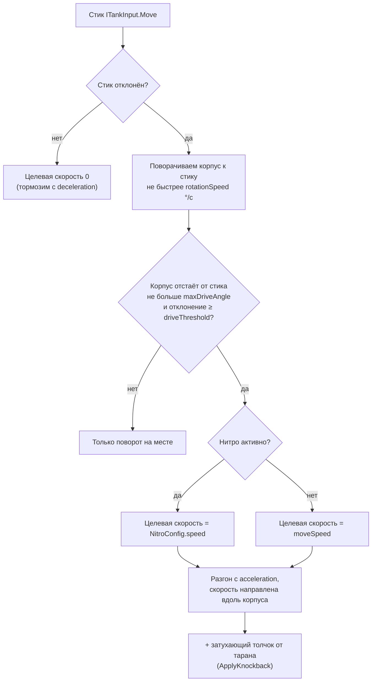
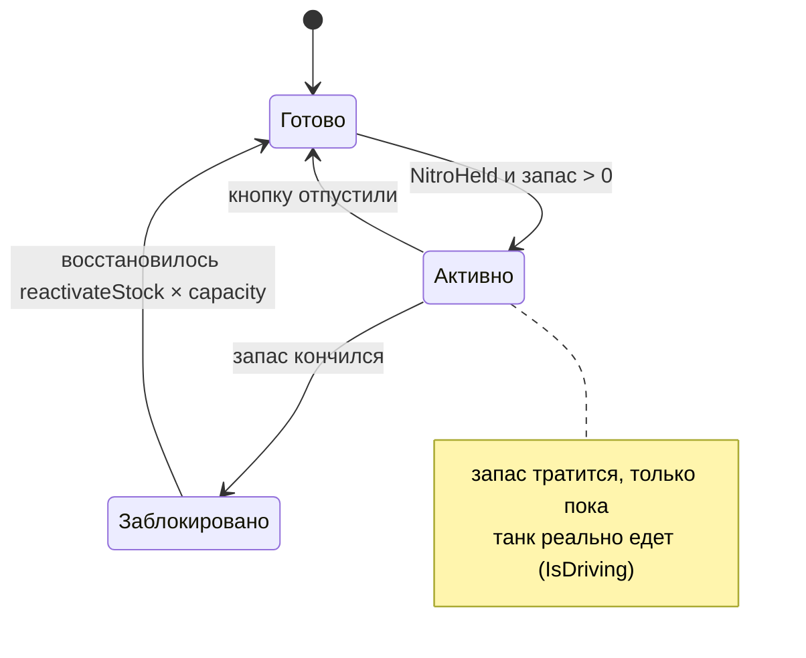

# Танк

> [!NOTE]
> **Коротко, без кода.** Танк разворачивается к стику и едет только вперёд, пушка смотрит туда же, куда корпус.
> Здоровье не восстанавливается, после попадания 0,3 с неуязвимости. Нитро тратится, только пока танк едет,
> и само восстанавливается. Таран работает только на нитро и передом. Правила для игрока — в
> [Правилах боя](../game/rules.md); ниже — как это устроено внутри.

Масштаб: **1 юнит Unity = 1D** (диаметр танка), клетка тайлмапа = 0,5 юнита, танк занимает 2×2 клетки.
Спрайт танка смотрит вдоль локальной оси **+Y**.

## Движение

Класс: <xref:TankBrawl.Tank.TankController>

Пушка отдельно не вращается: прицеливание = руление. Каждый шаг физики контроллер решает так:

Отсюда два правила управления:

- **слабое отклонение стика** — танк разворачивается на месте, можно прицелиться не сдвигаясь;
- **резкий разворот** — сначала поворот (пока угол больше `maxDriveAngle`), потом езда.

Мёртвую зону стика контроллер не применяет: её задаёт сам Input System (Project Settings → Input System Package →
Default Deadzone), одна на геймпад и экранный стик.

## Здоровье

Класс: <xref:TankBrawl.Tank.TankHealth>

- После попадания танк `hitInvulnerability` секунд не получает урон и мигает спрайтами.
- При нуле HP вызывается событие `Died`, затем объект **деактивируется**. Повторная активация возвращает полное HP.
- Регенерации нет.

## Нитро

Класс: <xref:TankBrawl.Tank.TankNitro>

- Запас измеряется в **секундах буста** (`capacity`), в остальное время восстанавливается на
  `regenPerSecond × capacity` в секунду.
- Блокировка после опустошения нужна, чтобы нитро не «мерцало» на нулевом запасе.
- Компонент выполняется раньше контроллера (`[DefaultExecutionOrder(-10)]`), чтобы контроллер видел состояние
  нитро этого же шага.

## Таран

Класс: <xref:TankBrawl.Tank.TankRam>

Срабатывает на `OnCollisionEnter2D` и `OnCollisionStay2D`, только если **одновременно**:

1. нитро активно;
2. скорость танка не меньше `ramMinSpeed`;
3. препятствие спереди — в пределах `ramMaxAngle` от курса (скольжение вдоль стены не считается).

| Во что врезались | Результат |
| --- | --- |
| Танк чужой команды | `ramDamage` HP + отталкивание (`knockbackSpeed`, затухает за `knockbackDuration`). Повторно ту же цель — не раньше чем через `ramCooldown` |
| Неуязвимый танк | Ничего: кулдаун не тратится, толчка нет |
| Свой танк | Ничего |
| Кирпич | Ломается сразу (`ramBlockDamage`) в трёх точках по ширине корпуса (`brickBreakHalfWidth`) |
| Сталь, вода, бортик | Ничего — они не `IDamageable` |

## Кусты

Класс: <xref:TankBrawl.Tank.TankConcealment>

Танк считается в кустах, если в клетке под **его центром** есть тайл <xref:TankBrawl.Map.BushTilemap>.

- Свой танк игрока в кустах становится полупрозрачным (`ownAlphaInBush`), вражеский исчезает.
- Для ботов: `IsHiddenFrom(observerTeam)`. `IsConcealed` — это «скрыт от игрока», у танка игрока всегда `false`.
- Прозрачность меняется через альфу цвета спрайта, поэтому не конфликтует с миганием после попадания
  (оно выключает сами рендереры).
