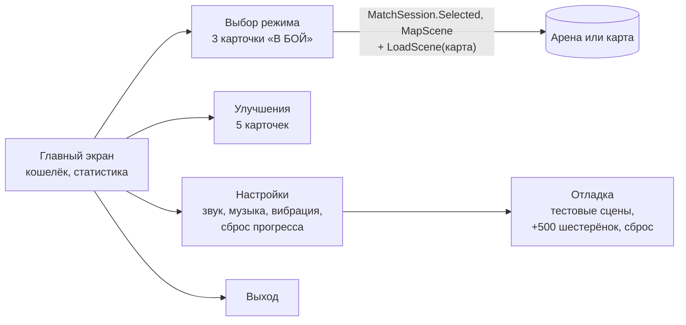

# Интерфейс и управление

> [!NOTE]
> **Коротко, без кода.** Меню, экран матча и экран итога строятся программой, а не рисуются вручную в сцене: поэтому
> игра полностью работает без единой картинки интерфейса, а когда художник нарисует рамки и иконки, их достаточно
> положить в один файл настроек. На телефоне поверх игры появляются стик и кнопки; они притворяются геймпадом, так что
> танк не знает, нажали кнопку на экране или на джойстике.

Неймспейс: <xref:TankBrawl.UI>. Текст везде — обычный `UnityEngine.UI.Text` (TextMeshPro не импортирован).

## Меню

Класс: <xref:TankBrawl.UI.MenuScreens> на объекте `MenuScreens` сцены `Scenes/Menu.unity` (индекс 0 в Build Settings).
Старый `MainMenu` удалён, прежний Canvas сцены выключен.

- **Главный экран**: «ИГРАТЬ», «УЛУЧШЕНИЯ», «НАСТРОЙКИ», «ВЫХОД»; кошелёк шестерёнок; матчи, победы, ранг угрозы.
- **Выбор режима**: карточка на каждый из `modes` (название и описание из <xref:TankBrawl.Match.MatchModeConfig>),
  под ними переключатель карты «< КАРТА: … >» (список `maps`, см. [Карты](maps.md#выбор-карты-в-меню)) и сколько
  шестерёнок дают за убийство и победу.
- **Улучшения**: уровень, значение сейчас → после покупки, цена и кнопка «КУПИТЬ»; подпись о ранге угрозы и о том,
  насколько он усиливает ботов.
- **Настройки**: ползунки звука и музыки, вибрация, тряска экрана, «СБРОСИТЬ ПРОГРЕСС» (с подтверждением), «ОТЛАДКА».
- **Отладка**: кнопки тестовых сцен из поля `debugScenes` (сцена должна быть в Build Settings, иначе кнопка выключена),
  «+500 шестерёнок», сброс прогресса.

«Назад» ходит на один экран назад (`SceneNavigator.BackHandler`), на главном — выход из приложения.
`MenuScreens.OpenUpgradesOnStart` открывает меню сразу на улучшениях (кнопка экрана итога).

## Построение экранов в коде

| Класс | Что это |
| --- | --- |
| <xref:TankBrawl.UI.UiKit> | Помощники: канвас 1920 × 1080 с масштабом по высоте (кнопка одного физического размера на любом соотношении сторон), область безопасной зоны, текст с обводкой, кнопка с автозвуком, ползунок, значок шестерёнки, палитра цветов, `EnsureEventSystem` |
| <xref:TankBrawl.UI.UiTheme> | Ассет `ScriptableObjects/Resources/UiTheme`: необязательные спрайты рамок (9-slice), иконок, режимов, фона, логотипа, баннеров победы/поражения и название игры. Пустое поле = плоский цветной прямоугольник |

Чтобы подключить арт интерфейса, достаточно заполнить поля `UiTheme` — код менять не надо. У 9-slice спрайтов
(панель, кнопка) границы задаются в настройках импорта.

Порядок канвасов: меню 10, HUD матча 90, экранное управление 100, пауза 120, экран итога 130.

## Экранное управление

Префаб `Prefabs/UI/Resources/TouchControls` (папка `Resources` нужна бутстрапу). Корень: `Canvas` (Overlay, порядок 100) +
`CanvasScaler` (1920 × 1080, по высоте) + <xref:TankBrawl.UI.TouchControls>. Всё лежит в `Content/SafeArea`:
<xref:TankBrawl.UI.SafeAreaPanel> растягивает панель на `Screen.safeArea` и пересчитывает её при повороте экрана.

| Элемент | Размер (ед. канваса) | Что эмулирует |
| --- | --- | --- |
| Стик слева (кольцо 300, ручка 150, ход 110, невидимая зона касания 520) | — | `<Gamepad>/leftStick` |
| «ОГОНЬ» справа | 250 | `<Gamepad>/buttonSouth` |
| «НИТРО» рядом | 180 | `<Gamepad>/buttonEast` |
| «СНАРЯД» над выстрелом у края; подпись — `displayName` выбранного типа | 130 | `<Gamepad>/buttonNorth` |
| «ПАУЗА» сверху слева | 180 × 90 | `SceneNavigator.GoBack()` |
| Таймер усиления внизу по центру («ЩИТ 12.3») | — | `TankPowerUps.TryGetLatest` |

- Стик и кнопки — стандартные `On-Screen Stick` / `On-Screen Button` из Input System: они притворяются геймпадом,
  и <xref:TankBrawl.Input.PlayerTankInput> читает их через обычные действия. Мёртвая зона — общая настройка Input System.
- Невидимая зона касания стика (дочерний `Zone`, 520 × 520) в префабе выходит за безопасную область; `TouchControls`
  подрезает её до безопасной области при старте и при смене экрана, чтобы касание у края не вызывало системный
  жест «Назад» на Android.
- Режим стика — `RelativePositionWithStaticOrigin`. Плавающий стик (`ExactPositionWithDynamicOrigin`) не использовать,
  пока панель смещается безопасной зоной: он «съезжает» на величину выреза.
- У кнопки «ПАУЗА» выключена навигация: иначе `buttonSouth` экранного геймпада сработает как Submit по выделенной кнопке.
- <xref:TankBrawl.UI.TouchButtonVisual> — отклик нажатия (масштаб 0,92, альфа 0,9).
- **Когда показывается**: `TouchControls.Awake` включает `Content` при `Application.isMobilePlatform` или в редакторе
  с галочкой `showTouchInEditor` **на префабе** (по умолчанию выключена). Выключенный `Content` не создаёт виртуальный
  геймпад и EventSystem.
- **Как попадает в сцену**: <xref:TankBrawl.UI.TouchControlsBootstrap> после загрузки любой сцены, где есть
  `PlayerTankInput`, создаёт экземпляр префаба, если своего `TouchControls` в сцене нет. EventSystem при необходимости
  создаётся сам. Меню экранного управления не получает.

> [!NOTE]
> Клик мышью по интерфейсу не стреляет: <xref:TankBrawl.Input.PlayerTankInput> гасит выстрел, если «огонь» держит
> только мышь, а курсор над интерфейсом (сама кнопка «ОГОНЬ» жмёт виртуальный геймпад и стреляет). Мультитач мышью
> не проверить — нужен Device Simulator или виртуальный `Touchscreen`.

## Кнопка «Назад»

Класс: <xref:TankBrawl.UI.SceneNavigator> (создаёт себя сам, живёт весь запуск)

`GoBack()` — общий «назад» для Escape, кнопки «Назад» Android (приходит как Escape) и экранной «ПАУЗА»:

| Где | Что происходит |
| --- | --- |
| Матч (есть `MatchManager`) | Пауза / снять паузу; на экране итога — выход в меню |
| Меню | Шаг на экран назад (`BackHandler`); на главном экране — выход из приложения |
| Любая другая сцена (песочница) | Первое нажатие показывает «Нажмите ещё раз, чтобы выйти в меню», второе в течение 2 с (`ExitConfirmSeconds`) выходит |
