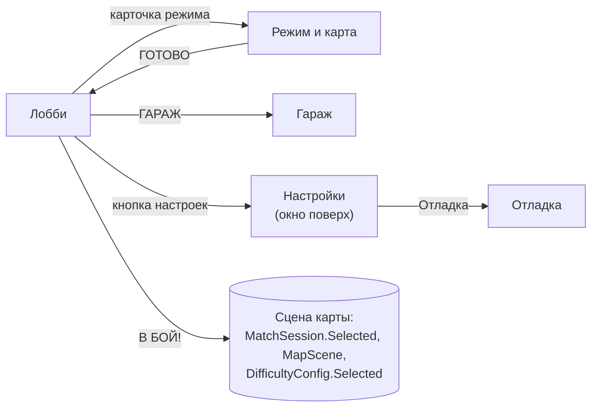

# Интерфейс и управление

> [!NOTE]
> **Коротко, без кода.** Меню, экран матча и экран итога строятся программой, а не рисуются вручную в сцене: поэтому
> игра полностью работает без единой картинки интерфейса, а когда художник нарисует рамки и иконки, их достаточно
> положить в один файл настроек. На телефоне поверх игры появляются стик и кнопки; они притворяются геймпадом, так что
> танк не знает, нажали кнопку на экране или на джойстике.

Неймспейс: <xref:TankBrawl.UI>. Текст везде — обычный `UnityEngine.UI.Text` (TextMeshPro не импортирован).

## Меню

Класс: <xref:TankBrawl.UI.MenuScreens> на объекте `MenuScreens` сцены `Scenes/Menu.unity` (индекс 0 в Build Settings).
Код разбит по экранам: `MenuScreens.cs` (каркас, навигация, общие кусочки), `.Lobby.cs`, `.Modes.cs`, `.Garage.cs`,
`.Settings.cs`. Стиль — по макету `tanks_art_style.html` (см. «Построение экранов в коде» ниже).

Поверх всех экранов: слева сверху кнопка «назад», справа шестерёнки и кнопка настроек.

| Экран | Что на нём |
| --- | --- |
| **Лобби** | Логотип (`UiTheme.gameName`), танк на подиуме (покачивается, пунктирное кольцо вращается), «МОЙ ТАНК», «РАНГ» (ранг угрозы), панель «ХАРАКТЕРИСТИКИ» (5 веток: уровень и значение `ProgressionConfig.StatText`), кнопка «ГАРАЖ» с красным счётчиком доступных покупок, карточка режима («РЕЖИМ · 3 × 3» / «4 игрока», название, карта), «В БОЙ!»; на ПК ещё «ВЫХОД» |
| **Режим и карта** | Три карточки режимов (вкладка «ВЫБРАН»), на каждой выбор сложности (закрытая — «Закрыта: победите на …», кнопка выключена), ряд карт из `maps` (картинки `UiTheme`), «ГОТОВО» |
| **Гараж** | Танк на подиуме, подсказка, пять карточек улучшений (значок, уровень, «сейчас → после», цена; при нехватке — «не хватает N»), карточка «РАНГ УГРОЗЫ» (насколько выросли боты), счётчик матчей и побед |
| **Настройки** (окно) | «Музыка» и «Звуки», переключатели «Вибрация» и «Тряска экрана», «Сбросить прогресс» (с подтверждением), «Отладка» |
| **Отладка** | Кнопки тестовых сцен из `debugScenes` (сцена должна быть в Build Settings), «+500 шестерёнок», «Открыть все сложности», «Сбросить прогресс» |

- Лобби запускает выбранный режим на выбранной карте и сложности; закрытая сложность заменяется самой высокой открытой.
- Выбор сложности на карточке запоминается в `MatchSession.LastDifficulty` (по режиму, по умолчанию — самая высокая
  открытая), в матч уходит через `DifficultyConfig.Selected`.
- «Назад» закрывает окно, иначе ведёт на экран назад; в лобби — выход из приложения (`SceneNavigator.BackHandler`).
- `MenuScreens.OpenUpgradesOnStart` открывает меню сразу в гараже (кнопка «ГАРАЖ» экрана итога).

## Построение экранов в коде

| Класс | Что это |
| --- | --- |
| <xref:TankBrawl.UI.UiKit> | Базовые помощники: канвас 1920 × 1080 с масштабом по высоте, безопасная зона, текст, кнопка с автозвуком, ползунок, `EnsureEventSystem`, шрифт |
| <xref:TankBrawl.UI.UiStyle> | Стиль игры: палитра (`Yellow`, `Green`, `Blue`, `Orange`, `Red`, `Steel`, `Ink`…), фабрики `Panel`, `Plate`, `Pill`, `Cream`, `Button`, `IconButton`, `Label`, `Plain`, `Icon` |
| <xref:TankBrawl.UI.UiPlate> | «Плашка» без спрайтов: скруглённый прямоугольник с толстой обводкой, объёмом снизу (`Depth`), лицевой частью и бликом |
| <xref:TankBrawl.UI.UiShape> | Фигура для HUD: скос сторон, заливка-прогресс (`FillAmount`, `FillFromRight`), обводка, блик |
| <xref:TankBrawl.UI.UiButton> | Кнопка на плашке, «проседает» при нажатии |
| <xref:TankBrawl.UI.UiLayout> | Размещение от углов и краёв: `LT`, `RT`, `RB`, `Mid`, `BottomMid`, `Fill` |
| <xref:TankBrawl.UI.UiTextOutline> | Толстая обводка текста |
| <xref:TankBrawl.UI.UiTheme> | Ассет `ScriptableObjects/Resources/UiTheme`: фон, иконки (назад, настройки, шестерёнка, ветки), картинки карт и танков для меню, название игры |

Шрифты интерфейса — `Art/UI/Fonts` (Lilita One, Nunito; лицензии OFL рядом). Картинки — `Art/UI/{Backgrounds,Controls,Icons,Maps,Tanks}`.

Порядок канвасов: меню 10, HUD матча 90, экранное управление 100, пауза 120, экран итога 130.

## Экранное управление

Префаб `Prefabs/UI/Resources/TouchControls` (папка `Resources` нужна бутстрапу). Корень: `Canvas` (Overlay, порядок 100) +
`CanvasScaler` (1920 × 1080, по высоте) + <xref:TankBrawl.UI.TouchControls>. Всё лежит в `Content/SafeArea`:
<xref:TankBrawl.UI.SafeAreaPanel> растягивает панель на `Screen.safeArea` и пересчитывает её при повороте экрана.

| Элемент | Размер (ед. канваса) | Что эмулирует |
| --- | --- | --- |
| Стик слева (кольцо 300, ручка 150, ход 110, невидимая зона касания 520) | — | `<Gamepad>/leftStick` |
| «ОГОНЬ» справа | 250 | `<Gamepad>/buttonSouth` |
| «НИТРО» рядом; кольцо вокруг — запас нитро (светлое при полном, синее при малом, серое при блокировке) | 180 | `<Gamepad>/buttonEast` |
| «СНАРЯД» над выстрелом у края; подпись — `displayName` выбранного типа | 130 | `<Gamepad>/buttonNorth` |
| «ПАУЗА» сверху слева | 180 × 90 | `SceneNavigator.GoBack()` |
| Таймер усиления внизу по центру («ЩИТ 12.3») | — | `TankPowerUps.TryGetLatest` |

- Стик и кнопки — стандартные `On-Screen Stick` / `On-Screen Button` из Input System: они притворяются геймпадом,
  и <xref:TankBrawl.Input.PlayerTankInput> читает их через обычные действия. Мёртвая зона — общая настройка Input System.
- Невидимая зона касания стика (дочерний `Zone`, 520 × 520) в префабе выходит за безопасную область; `TouchControls`
  подрезает её до безопасной области при старте и при смене экрана, чтобы касание у края не вызывало системный
  жест «Назад» на Android.
- Режим стика — `RelativePositionWithStaticOrigin`. Плавающий стик (`ExactPositionWithDynamicOrigin`) не использовать,
  пока панель смещается безопасной зоной: он «съезжает» на величину выреза.
- У кнопки «ПАУЗА» выключена навигация: иначе `buttonSouth` экранного геймпада сработает как Submit по выделенной кнопке.
- <xref:TankBrawl.UI.TouchButtonVisual> — отклик нажатия (масштаб 0,92, альфа 0,9).
- **Когда показывается**: `TouchControls.Awake` включает `Content` при `Application.isMobilePlatform` или в редакторе
  с галочкой `showTouchInEditor` **на префабе** (по умолчанию выключена). Выключенный `Content` не создаёт виртуальный
  геймпад и EventSystem.
- **Как попадает в сцену**: <xref:TankBrawl.UI.TouchControlsBootstrap> после загрузки любой сцены, где есть
  `PlayerTankInput`, создаёт экземпляр префаба, если своего `TouchControls` в сцене нет. EventSystem при необходимости
  создаётся сам. Меню экранного управления не получает.

> [!NOTE]
> Клик мышью по интерфейсу не стреляет: <xref:TankBrawl.Input.PlayerTankInput> гасит выстрел, если «огонь» держит
> только мышь, а курсор над интерфейсом (сама кнопка «ОГОНЬ» жмёт виртуальный геймпад и стреляет). Мультитач мышью
> не проверить — нужен Device Simulator или виртуальный `Touchscreen`.

## Кнопка «Назад»

Класс: <xref:TankBrawl.UI.SceneNavigator> (создаёт себя сам, живёт весь запуск)

`GoBack()` — общий «назад» для Escape, кнопки «Назад» Android (приходит как Escape) и экранной «ПАУЗА»:

| Где | Что происходит |
| --- | --- |
| Матч (есть `MatchManager`) | Пауза / снять паузу; на экране итога — выход в меню |
| Меню | Шаг на экран назад (`BackHandler`); на главном экране — выход из приложения |
| Любая другая сцена (песочница) | Первое нажатие показывает «Нажмите ещё раз, чтобы выйти в меню», второе в течение 2 с (`ExitConfirmSeconds`) выходит |
