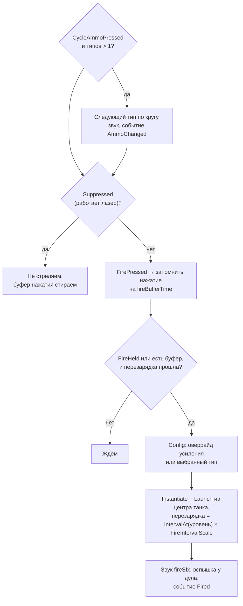
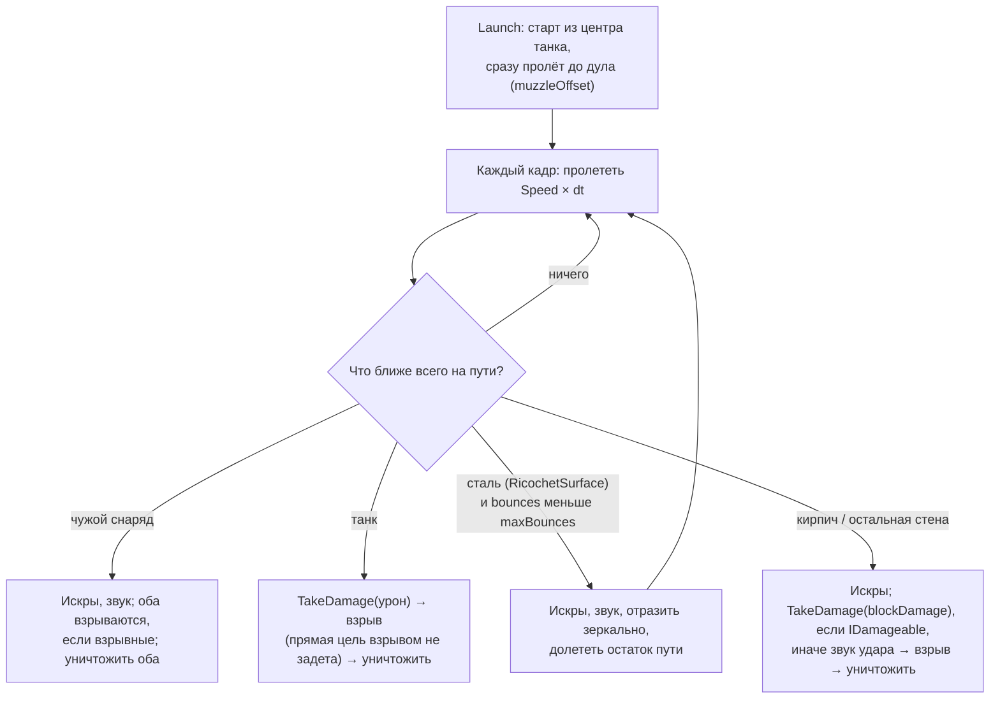

# Оружие и снаряды

> [!NOTE]
> **Коротко, без кода.** Пока зажата кнопка, танк стреляет после каждой перезарядки; короткое нажатие во время
> перезарядки запоминается на 0,2 с. Снаряд летит по прямой, пока во что-нибудь не врежется: в танк (урон), в кирпич
> (ломает), в сталь (отскакивает), во встречный снаряд (гибнут оба). По танкам он попадает «всей шириной», а о стены
> задевает только серединой, чтобы не цепляться за углы. У игрока два типа снарядов — бронебойный и осколочный
> (взрывается и задевает соседей); кнопка «СНАРЯД» переключает их. Усиления временно меняют стрельбу: взрывные
> снаряды, скорострельность, лазер.

## Типы снарядов

Каждый тип — отдельный ассет <xref:TankBrawl.Weapons.WeaponConfig> в `ScriptableObjects/Weapons` и свой префаб снаряда
в `Prefabs/Weapons`.

| Ассет | Надпись на кнопке | Кто стреляет | Урон прямой / по площади | Радиус взрыва | Кирпичу прямой / взрыв | Скорость | Рикошетов | Хитбоксы (танк / стена) |
| --- | --- | --- | --- | --- | --- | --- | --- | --- |
| `ArmorPiercing` | БРОНЕБ | игрок, основной | 50 / — | — | 2 / — | 10 | 2 | 0,2 / 0,09 |
| `Fragment` | ОСКОЛ | игрок, второй | 30 / 25 | 1,4 | 1 / 1 | 9 | 0 | 0,2 / 0,09 |
| `ExplosiveShell` | ВЗРЫВНОЙ | усиление «Взрывные снаряды» | 50 / 30 | 2,0 | 2 / 1 | 10 | 0 | 0,28 / 0,12 |
| `BotWeapon` | ПРОСТОЙ | боты | 35 / — | — | 2 / — | 9 | 2 | 0,2 / 0,09 |

Перезарядка у всех типов игрока 0,9 с, у ботов 1,25 с. Числа — значения в ассетах на момент написания; уровни прокачки
к ним прибавляются (см. ниже). Бронебойный, осколочный и бот-снаряд сделаны уже взрывного: тонкий ствол с широким
снарядом выглядел неестественно.

## Выстрел

Класс: <xref:TankBrawl.Weapons.TankWeapon>

- **Типы снарядов**: основной `weapon` (индекс 0) и массив `extraAmmo`. Перезарядка общая для всех типов.
  У игрока `extraAmmo = [Fragment]`, у ботов пусто. При активации танка выбирается основной тип.
- **Буфер нажатия**: <xref:TankBrawl.Core.ITankInput.FirePressed> ловит тап короче кадра, а нажатие во время
  перезарядки помнится `fireBufferTime` (0,2 с) — выстрел произойдёт, как только пушка зарядится.
- **Что стреляет**: <xref:TankBrawl.Weapons.TankWeapon.Config> — то, чем выстрелит следующий выстрел (оверрайд
  усиления, если он есть, иначе выбранный тип), <xref:TankBrawl.Weapons.TankWeapon.SelectedAmmo> — выбранный кнопкой
  тип без учёта усиления (его показывает надпись на кнопке «СНАРЯД»).
- **Рычаги для усилений**: `SetOverride(config)` подменяет тип снаряда, `FireIntervalScale` умножает перезарядку,
  `Suppressed` глушит пушку. Ими управляет <xref:TankBrawl.PowerUps.TankPowerUps>, `OnEnable` всё сбрасывает.
- `CooldownLeft` — сколько осталось до выстрела; по нему бот решает, когда разворачиваться на цель.
- Событие `Fired` слушает бот, чтобы перебросить разброс прицела.

## Прокачка оружия

Уровни берутся из <xref:TankBrawl.Tank.TankStats>: `WeaponLevel` (урон, скорость снаряда) и `FireLevel`
(скорострельность). Формулы — в <xref:TankBrawl.Weapons.WeaponConfig>:

| Метод | Формула |
| --- | --- |
| `DamageAt(n)` | `round(damage + damagePerLevel × n)` |
| `ExplosionDamageAt(n)` | `explosionDamage + explosionDamagePerLevel × n` |
| `SpeedAt(n)` | `speed + speedPerLevel × n` |
| `IntervalAt(n)` | `1 / (1 / fireInterval + fireRatePerLevel × n)` — растёт частота выстрелов, потолка нет |

Снаряд запоминает свои скорость и урон в момент выстрела (`Launch(…, weaponLevel)`), поэтому
<xref:TankBrawl.Weapons.Projectile.Speed> — это скорость конкретного снаряда с учётом уровня стрелка.

## Полёт

Класс: <xref:TankBrawl.Weapons.Projectile>

У снаряда **нет коллайдера и `Rigidbody2D`**. Каждый кадр он «заметает» путь, который пролетит за кадр,
тремя проверками и выбирает ближайшее попадание:

| Проверка | Радиус | Что ищет |
| --- | --- | --- |
| `CircleCast` | `tankHitRadius` — крупный | Танки чужой команды |
| `CircleCast` | `wallHitRadius` — мелкий | Стены и кирпич. Мелкий хитбокс, чтобы снаряд не цеплял углы |
| Пересечение окружностей | сумма `tankHitRadius` двух снарядов | Снаряды чужой команды (уничтожаются оба) |

Слой `Water` исключён из кастов — снаряды летят над водой.

Важные детали:

- **Выстрел в упор работает.** Снаряд стартует из центра танка и в тот же кадр «пролетает» до дула,
  поэтому стена или танк вплотную к дулу всё равно получат попадание.
- **Свой танк в безопасности до первого рикошета.** После отскока от стали снаряд может попасть и в стрелка.
  Танки своей команды не задевает никогда.
- **Срока жизни нет**: снаряд летит, пока во что-нибудь не попадёт. Арена обязана быть замкнута бортиком
  (`Border` — без `RicochetSurface`, о него снаряд гибнет).
- У взрывных типов `maxBounces = 0`: от стали они взрываются, а не отскакивают.
- Точку попадания по местности снаряд сдвигает на 0,02 внутрь стены, чтобы она попала в нужную клетку тайлмапа.
- За кадр — не больше 8 отрезков полёта (защита от бесконечного рикошета в углу).
- <xref:TankBrawl.Weapons.Projectile.InFlight> — все летящие снаряды (только чтение, для уворота ботов); у снаряда
  открыты стрелок (`Owner`), число отскоков (`Bounces`) и сколько их осталось (`BouncesLeft`);
  <xref:TankBrawl.Weapons.Projectile.ClearAll*> убирает их без взрыва (начало раунда).

## Взрыв

Класс: <xref:TankBrawl.Weapons.Explosion>

Снаряд с `explosionRadius > 0` взрывается при любом попадании: в танк, в стену, во встречный снаряд.
`Explosion.Detonate` делает `OverlapCircle` радиусом взрыва:

- каждый **чужой** танк в радиусе получает `ExplosionDamageAt(уровень)` один раз; танк, в которого снаряд попал
  напрямую, получает только прямой урон (двойного урона нет); свои танки не страдают;
- каждый кирпич, чья клетка касается круга, получает `explosionBlockDamage`
  (<xref:TankBrawl.Map.DestructibleTilemap.DamageArea*>), если на пути от центра он первая стена; коллайдер
  пересобирается один раз на весь взрыв;
- **стены прикрывают**: танк получает урон, только если от центра взрыва до его корпуса (центра или краёв)
  не мешает стена слоя `Wall` (<xref:TankBrawl.Weapons.Explosion.Reaches*>); сталь и передние кирпичи прикрывают
  задние, вода не прикрывает;
- прямой урон по кирпичу и взрыв суммируются: осколочный вплотную ломает кирпич прочностью 2 с одного выстрела.

Визуал — префаб `ExplosionEffect` с <xref:TankBrawl.Weapons.ExplosionVisual> (растущий и гаснущий круг, заглушка)
плюс частицы, звук и лёгкая тряска.

## Лазер

Класс: <xref:TankBrawl.Weapons.TankLaser>

Включается усилением «Лазер» (`Begin` / `End` вызывает <xref:TankBrawl.PowerUps.TankPowerUps>). Пока он включён,
пушка заглушена (`TankWeapon.Suppressed`), а танк замедлен.

- Каждый кадр `CircleCast` радиусом `laserBeamRadius` от центра танка вдоль корпуса на `laserRange`.
- Луч обрывается **первым не-танковым** коллайдером (кирпич, сталь, бортик); воду пропускает, стены не ломает.
- Сквозь танки луч **проходит** и бьёт каждый чужой танк по своему таймеру — не чаще раза в `laserInterval`.
  Таймер тратится, даже если удар поглотили щит или окно неуязвимости.
- Визуал — `LineRenderer` на дочернем объекте `LaserBeam` (мировые координаты), от дула до точки обрыва.

## Как добавить новый тип снаряда

См. [Рецепты](recipes.md#новый-тип-снаряда).
