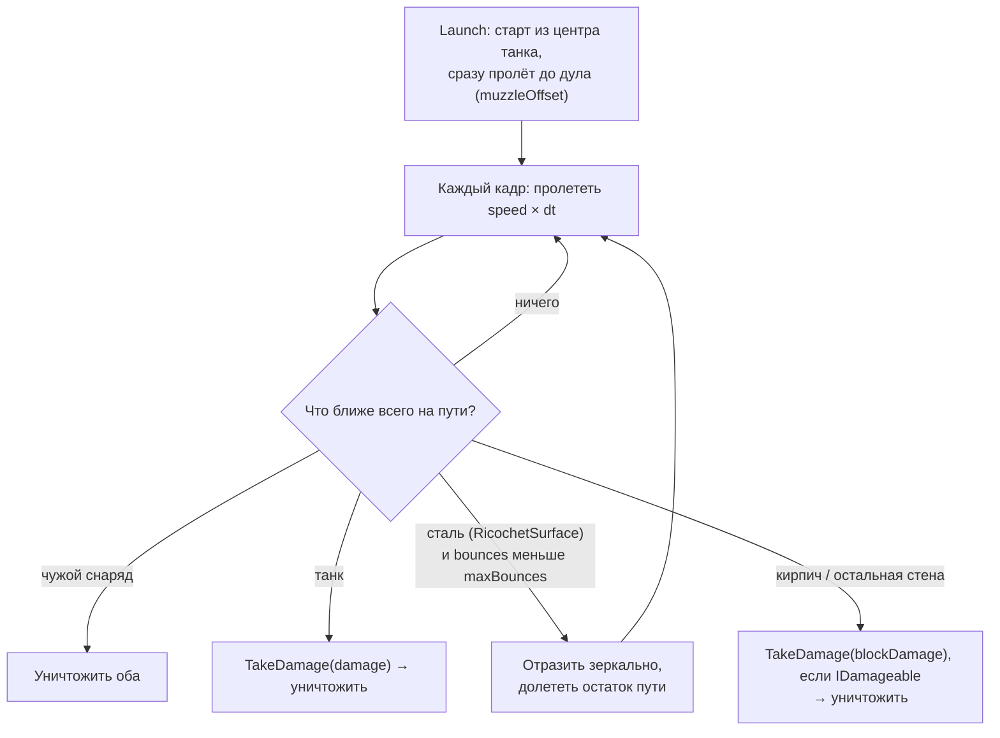

# Оружие и снаряды

## Выстрел

Класс: <xref:TankBrawl.Weapons.TankWeapon>

Пока зажат `FireHeld` и прошла перезарядка `fireInterval`, создаёт префаб снаряда из
<xref:TankBrawl.Weapons.WeaponConfig> и запускает его из **центра** танка вдоль корпуса.
После выстрела вызывается событие `Fired` (на него подписан бот, чтобы перебросить разброс прицела).

## Полёт

Класс: <xref:TankBrawl.Weapons.Projectile>

У снаряда **нет коллайдера и `Rigidbody2D`**. Каждый кадр он «заметает» путь, который пролетит за кадр,
тремя проверками и выбирает ближайшее попадание:

| Проверка | Радиус | Что ищет |
| --- | --- | --- |
| `CircleCast` | `tankHitRadius` (0,28) — крупный | Танки чужой команды |
| `CircleCast` | `wallHitRadius` (0,12) — мелкий | Стены и кирпич. Мелкий хитбокс, чтобы снаряд не цеплял углы |
| Пересечение окружностей | сумма `tankHitRadius` двух снарядов | Снаряды чужой команды (уничтожаются оба) |

Слой `Water` исключён из кастов — снаряды летят над водой.

Важные детали:

- **Выстрел в упор работает.** Снаряд стартует из центра танка и в тот же кадр «пролетает» до дула,
  поэтому стена или танк вплотную к дулу всё равно получат попадание.
- **Свой танк в безопасности до первого рикошета.** После отскока от стали снаряд может попасть и в стрелка.
  Танки своей команды не задевает никогда.
- **Срока жизни нет**: снаряд летит, пока во что-нибудь не попадёт. Арена обязана быть замкнута бортиком
  (`Border` — без `RicochetSurface`, о него снаряд гибнет).
- Точку попадания по местности снаряд сдвигает на 0,02 внутрь стены, чтобы она попала в нужную клетку тайлмапа.
- За кадр — не больше 8 отрезков полёта (защита от бесконечного рикошета в углу).

## Как добавить новый тип снаряда

См. [Рецепты](recipes.md#новый-тип-снаряда).
