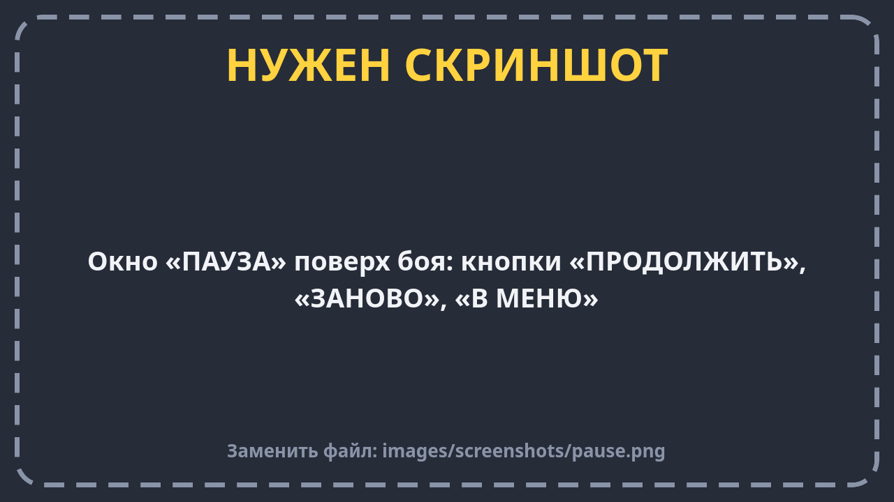

# Управление

В бою всего четыре действия: **ехать**, **стрелять**, **нитро** и **сменить снаряд**. И ещё кнопка паузы.

## На телефоне

Телефон держи **боком** (горизонтально). Кнопки появляются на экране сами.

| Где на экране | Что это | Что делает |
| --- | --- | --- |
| Слева | **Стик** (кружок, который можно тянуть пальцем) | Тянешь в сторону — танк поворачивается и едет туда. Отпустил — танк останавливается |
| Справа, самая большая | **ОГОНЬ** | Выстрел. Держишь — танк стреляет сам, как только пушка снова готова |
| Рядом с «ОГОНЬ» | **НИТРО** | Ускорение, пока держишь. Голубое кольцо вокруг кнопки — сколько нитро осталось. Серое кольцо — нитро «перегрелось», надо подождать |
| Над «ОГОНЬ», у края | **СНАРЯД** | Меняет тип снаряда. На кнопке написано, какой выбран: «БРОНЕБ» или «ОСКОЛ» |
| Сверху слева | **ПАУЗА** | Ставит бой на паузу |
| Внизу по центру | Таймер | Какое усиление сейчас работает и сколько секунд ему осталось, например «ЩИТ 12.3» |

Можно нажимать несколько кнопок сразу: ехать, стрелять и жать нитро одновременно.

Кнопка «Назад» на Android работает так же, как «ПАУЗА».

## Как танк слушается стика

Это самое важное, к чему надо привыкнуть. **Пушка не крутится отдельно — она всегда смотрит туда же, куда нос танка.**
Значит, чтобы прицелиться, нужно повернуть весь танк.

1. **Чуть-чуть сдвинул стик** — танк **разворачивается на месте** и никуда не едет. Так удобно целиться.
2. **Сдвинул стик сильно** — танк **едет** в ту сторону.
3. **Потянул стик назад** — танк сначала быстро развернётся, а потом поедет. Задом танк не ездит.
4. **Отпустил стик** — танк быстро тормозит.

Представь, что держишь игрушечную машинку за верёвочку: куда потянешь, туда она и повернёт носом.

## Как стрелять

- Нажал **«ОГОНЬ»** — танк выстрелил.
- После выстрела пушке нужно немного времени, чтобы **перезарядиться** — меньше секунды.
- Если нажать «ОГОНЬ» во время перезарядки, танк **запомнит** нажатие и выстрелит, как только сможет.
  Часто-часто тыкать в кнопку не нужно — можно просто держать её.

## Нитро

- Держишь **«НИТРО»** — танк едет почти в два раза быстрее.
- Нитро тратится, **только пока танк едет**. Если стоишь или упёрся в стену, нитро не тратится.
- Нитро **само восстанавливается**, когда ты его не жмёшь.
- Если истратить всё до нуля, нитро «перегреется», и включить его можно будет, только когда немного накопится.
- На нитро танк может **таранить**: врезаться во врага и отбросить его. Подробнее — в [Правилах боя](rules.md#таран).

## На компьютере (клавиатура и мышь)

| Действие | Кнопка |
| --- | --- |
| Ехать и поворачивать | `W` `A` `S` `D` или стрелки |
| Стрелять | `Пробел` или левая кнопка мыши |
| Нитро | Левый `Shift` (держать) |
| Сменить снаряд | `Q` |
| Пауза / назад | `Esc` |

## На геймпаде

| Действие | Кнопка |
| --- | --- |
| Ехать и поворачивать | Левый стик |
| Стрелять | Нижняя кнопка (A на Xbox, ✕ на PlayStation) или правый курок |
| Нитро | Правая кнопка (B / ◯) или левый курок |
| Сменить снаряд | Верхняя кнопка (Y / △) |

## Что делает кнопка «Назад» (Esc)

| Где ты сейчас | Что будет |
| --- | --- |
| В бою | Пауза: «ПРОДОЛЖИТЬ», «ЗАНОВО», «В МЕНЮ». Нажмёшь ещё раз — пауза снимется |
| На экране итогов | Выход в меню |
| В меню | Шаг назад, на предыдущий экран. На главном экране — выход из игры |
| На тестовой арене | Первое нажатие покажет «Нажмите ещё раз, чтобы выйти в меню», второе — выйдет |

