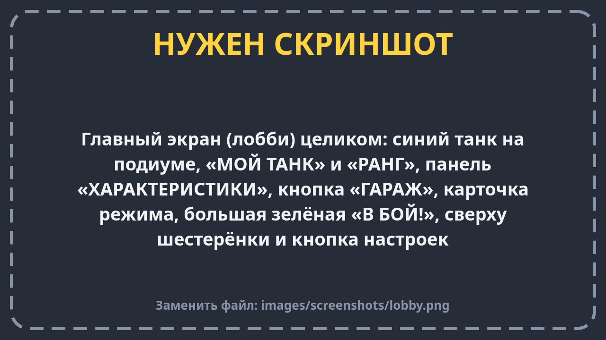
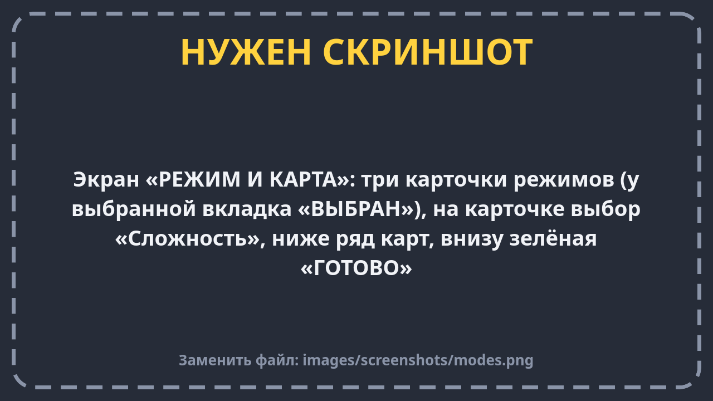
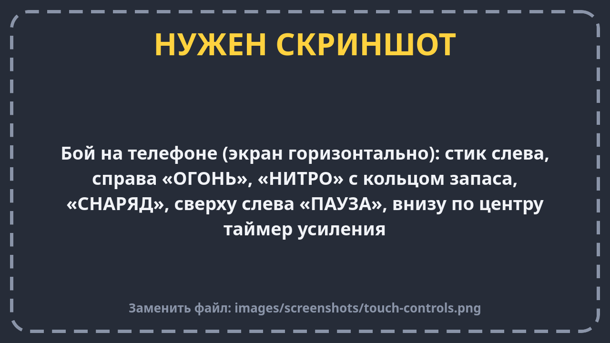
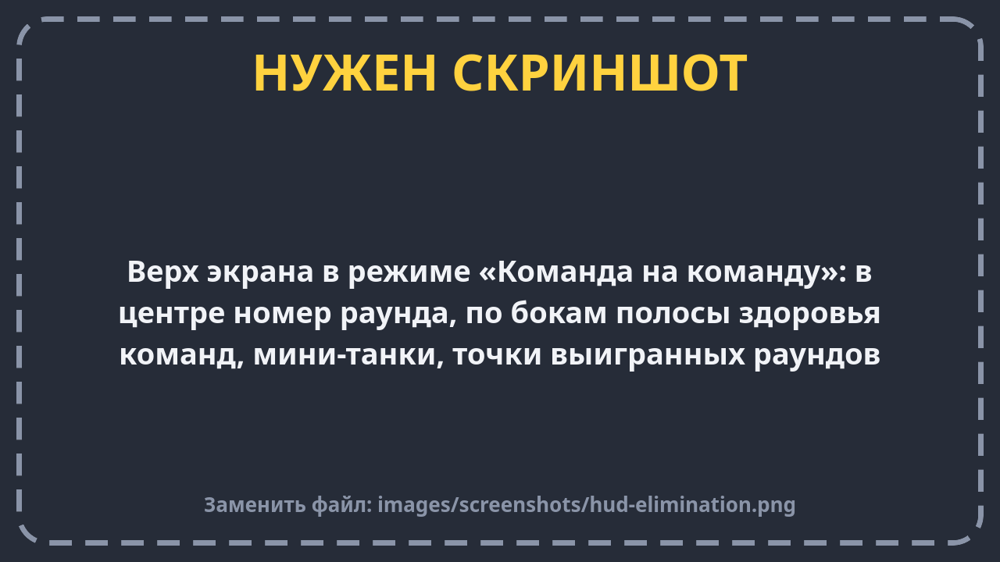
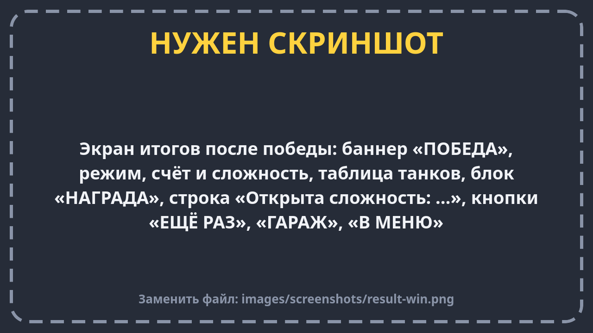

# Первый бой: пошагово

Эта страница — для тех, кто запускает игру в первый раз. Идём по шагам: от главного экрана до победы.

## Шаг 1. Главный экран

После запуска ты попадаешь на главный экран — его называют **лобби**.

Что здесь есть:

- в середине стоит **твой танк** на круглой подставке;
- рядом — **ранг**: число, которое растёт, когда ты улучшаешь танк;
- панель **«ХАРАКТЕРИСТИКИ»** — сколько у танка здоровья, какая скорость, урон и так далее;
- кнопка **«ГАРАЖ»** — там улучшают танк. Красный кружок с цифрой на ней значит: «есть улучшения, на которые хватает денег»;
- **карточка режима** — какой режим и какая карта сейчас выбраны;
- большая зелёная кнопка **«В БОЙ!»** — начать бой;
- сверху справа — твои **шестерёнки** (деньги игры) и кнопка **настроек**.

## Шаг 2. Выбери режим, карту и сложность

Нажми на **карточку режима**. Откроется экран **«РЕЖИМ И КАРТА»**.

1. **Выбери режим** — нажми на одну из трёх карточек. Для первого раза советуем **«Команда на команду»**:
   правила там самые простые.
2. **Выбери сложность** на карточке режима. Сначала открыта только **«Лёгкая»**. Следующая откроется, когда ты
   победишь на лёгкой в этом же режиме.
3. **Выбери карту** в ряду внизу. Для начала подойдёт «Арена» или «Перекрёсток».
4. Нажми **«ГОТОВО»** — вернёшься в лобби.

## Шаг 3. Начни бой

Нажми **«В БОЙ!»**. Загрузится карта, и твой танк появится на своей базе — в углу или у края карты, рядом
с союзниками.

Первые секунды после появления твой танк **мигает**. Пока он мигает, его нельзя повредить — это защита, чтобы
тебя не подбили сразу.

## Шаг 4. Езди и стреляй

- **Стик слева** — тянешь в сторону, танк поворачивается и едет туда.
- **«ОГОНЬ»** справа — выстрел. Можно держать: танк будет стрелять сам, как только пушка перезарядится.
- **«НИТРО»** — ускорение. Кольцо вокруг кнопки показывает, сколько нитро осталось.
- **«СНАРЯД»** — сменить тип снаряда.

Главное правило: **пушка смотрит туда, куда смотрит танк.** Чтобы попасть во врага, надо повернуться к нему.
Подробнее — на странице [Управление](controls.md).

## Шаг 5. Смотри на верх экрана

Сверху — **панель счёта**. В режиме «Команда на команду» там видно:

- какой сейчас раунд;
- сколько здоровья осталось у твоей команды (слева) и у врагов (справа);
- маленькие танки: какие ещё живы, а какие уже подбиты;
- точки — сколько раундов уже выиграно.

Слева сверху — **твоё здоровье** в цифрах и сколько шестерёнок ты уже заработал в этом бою.

## Шаг 6. Несколько советов для первого боя

- **Не стой на месте.** Снаряды летят не очень быстро: если двигаться, от них легко увернуться.
- **Подходи ближе.** Издалека трудно попасть, а вблизи — легко.
- **Прячься за стенами.** Кирпич закроет тебя от выстрелов, пока его не разобьют.
- **Подбирай значки на земле.** Это усиления: щит, лазер, ремонт и другие.
- **Если тебя подбили** — не страшно. В «Команде на команду» ты посмотришь, как играет союзник, а в следующем раунде
  вернёшься в бой.

## Шаг 7. Итоги

Когда матч закончится, игра на секунду замедлится, а потом покажет **экран итогов**:

- **«ПОБЕДА»** или **«ПОРАЖЕНИЕ»**;
- таблица: кто сколько врагов уничтожил и сколько раз погиб;
- **«НАГРАДА»** — сколько шестерёнок ты получил и за что;
- если ты победил, может появиться надпись **«Открыта сложность: …»** — теперь можно играть сложнее.

Кнопки внизу: **«ЕЩЁ РАЗ»** — сыграть снова, **«ГАРАЖ»** — потратить шестерёнки, **«В МЕНЮ»** — вернуться в лобби.

## Шаг 8. Улучши танк

Зайди в **гараж** и купи улучшение — например, больше здоровья. В следующем бою твой танк будет крепче.
Подробнее — на странице [Меню и гараж](menu.md).

Готово! Теперь ты знаешь всё, чтобы играть. Остальные страницы раздела рассказывают подробнее про каждую часть игры.
