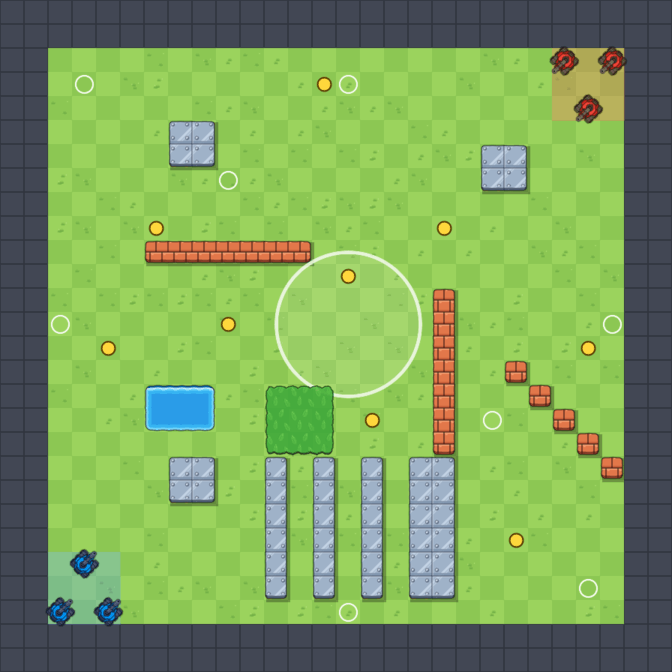

# Карты

В игре четыре карты. Карту выбирают на экране «Режим и карта» (см. [Меню и гараж](menu.md#режим-и-карта)).
Любой режим можно играть на любой карте.

На каждой карте есть:

- **две базы** — откуда появляются синие и красные (у синих обычно слева или внизу, у красных справа или вверху);
- **круг в центре** для режима «Удержание точки»;
- **места для усилений** — обычно там, где за них придётся побороться;
- **точки появления** для режима «Все против всех» по всей карте.

Карты **симметричные**: если повернуть карту на пол-оборота, синяя база окажется на месте красной. Так ни у одной
команды нет преимущества.

Как читать картинки ниже:

| На картинке | Что это |
| --- | --- |
| Синие и красные танки | Базы команд |
| Большой белый круг | Точка для режима «Удержание точки» |
| Жёлтые кружки | Где появляются усиления |
| Фиолетовые кружки | Зарядные точки нитро |
| Белые колечки | Где появляются танки в режиме «Все против всех» |

## Арена

Первая карта игры, 24 × 24: просторная, с редкими стенами. Синяя база в левом нижнем углу, красная — в правом верхнем.
Хороша, чтобы освоиться.

> [!TIP]
> На «Арене» мало укрытий — не стой на месте, иначе тебя легко подстрелить издалека.

## Перекрёсток

Квадратная карта 24 × 24. Точка в центре окружена **кирпичной коробкой** с проходами по углам. По диагоналям стоят
**стальные столбы** — за ними удобно прятаться и стрелять рикошетом. В двух свободных углах — пруд и кусты.

> [!TIP]
> Коробку вокруг точки можно разбить выстрелами — и через 5 секунд она вырастет снова. Заходи в точку через угловые
> проходы и держи их под прицелом.

## Река

**Широкая** карта 30 × 18 — удобна, когда телефон держишь боком. Синяя база слева, красная справа. Посередине течёт
**река**: через неё можно перебраться по двум **узким мостам** (сверху и снизу) или по **броду** в центре — там же
точка. У мостов растут кусты: хорошее место для засады.

> [!TIP]
> Снаряды пролетают над водой, а танки — нет. Стреляй через реку, а переезжай только по мостам и броду.

## Лабиринт

Карта 22 × 22, **много кирпичных стен** и кустов. Коридоры узкие, бои — в упор. Точка в центре внутри кольца
из кирпича с воротами с каждой стороны и стальными углами.

> [!TIP]
> Стены «Лабиринта» всё время ломаются и вырастают — карта постоянно меняется. Осколочный снаряд здесь особенно
> полезен: он ломает кирпичи вокруг и задевает врагов рядом с местом взрыва.

## Скоро будет больше

Новые карты команда рисует прямо текстом — каждая буква обозначает одну клетку. Как это работает —
в статье для разработчиков [Карты](../articles/maps.md).
