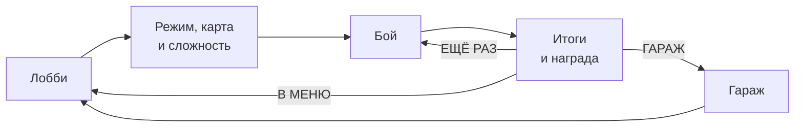
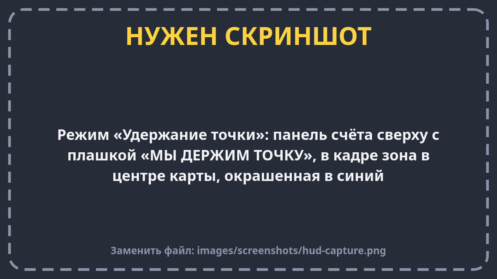
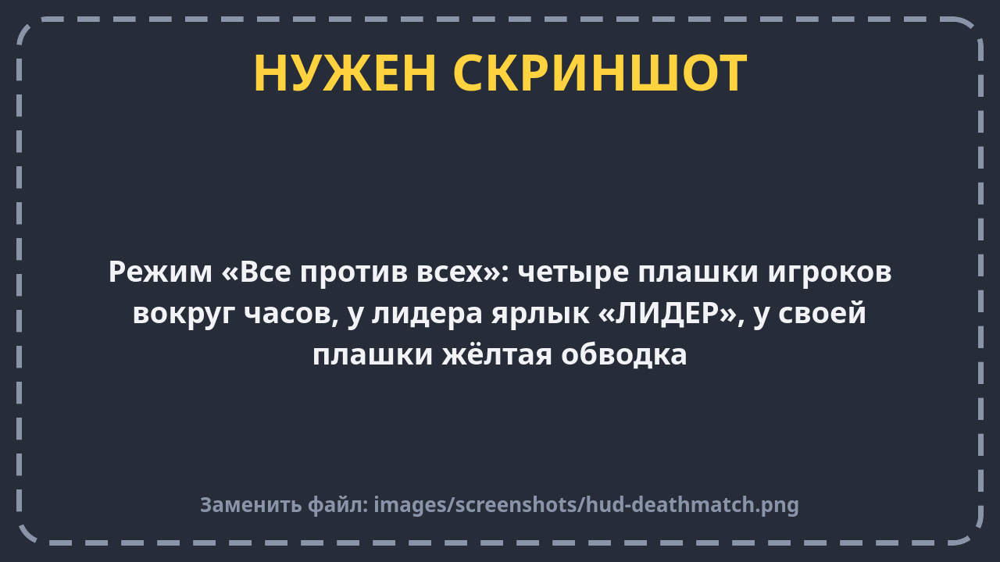

# Режимы и матч

**Матч** — это один бой от начала до экрана итогов. После матча ты получаешь шестерёнки, улучшаешь танк и идёшь
в следующий бой.

Во всех режимах ты играешь **один**, остальные танки — боты.

## Команда на команду

**Ты и два союзных бота (синие) против трёх вражеских (красные).**

1. В начале раунда все танки стоят на своих базах, на экране надпись «РАУНД 1».
2. Если танк подбили, он **не возвращается до конца раунда**. Если подбили тебя, ты смотришь за союзником —
   внизу написано «Вы наблюдаете за союзником».
3. Раунд выигрывает команда, у которой остался хоть один танк. Если последние танки погибли одновременно —
   ничья, очко никому.
4. Потом новый раунд: все возвращаются на базы целыми, стены вырастают обратно, усиления исчезают.
5. **Матч выигрывает команда, которая первой выиграла 3 раунда.**

Что на панели сверху:

- в середине — номер раунда и надпись «ДО 3 ПОБЕД»;
- по бокам — **полосы здоровья команд**: слева твоя, справа вражеская. Чем короче полоса, тем меньше у команды здоровья;
- под полосами — **маленькие танки** команды: подбитые темнеют, под твоим — жёлтая метка;
- **точки** — сколько раундов команда уже выиграла.

**Дополнительная цель:** выиграть матч, ни разу не погибнув.

## Удержание точки

**Тоже 3 на 3. В центре карты есть круг — «точка».**

- Каждую секунду, пока **в круге есть твой танк и нет вражеских**, твоя команда получает **1 очко**.
- Если в круге танки обеих команд — это **спор**, очки никому.
- Круг окрашивается в цвет команды, которая его держит.
- Подбитый танк возвращается на свою базу **через 7 секунд**. Внизу написано «Возрождение через …».
- **Победа — 100 очков.** Если за 8 минут никто не набрал 100, побеждает тот, у кого больше. При равенстве игра
  продолжается, пока кто-то не вырвется вперёд («ДОПОЛНИТЕЛЬНОЕ ВРЕМЯ»).

Что на панели сверху: в середине часы и «ДО 100», по бокам — очки команд, полосы растут к 100. Под панелью
плашка подсказывает, что происходит с точкой:

| Плашка | Что значит |
| --- | --- |
| **МЫ ДЕРЖИМ ТОЧКУ** | Мы получаем очки. Защищай круг! |
| **ВРАГ ДЕРЖИТ ТОЧКУ** | Очки идут врагам. Надо заехать в круг и выбить их |
| **СПОР ЗА ТОЧКУ** | В круге есть и наши, и чужие — очки никому |
| **ТОЧКА СВОБОДНА** | В круге никого. Кто первый заедет, тот и получает очки |

**Дополнительная цель:** простоять в круге 30 секунд, пока твоя команда получает очки.

## Все против всех

**Ты и три бота, каждый сам за себя: синий (ты), красный, зелёный и жёлтый.**

- **10 очков** за каждый уничтоженный танк.
- **Очки за выживание:** кто прожил 25 секунд, не погибнув, получает ещё +1 очко каждые 5 секунд — пока его не подбили.
- Подбитый танк возвращается **через 7 секунд** в случайное место подальше от врагов.
- **Победа — 100 очков** или первое место через 7 минут. Выиграть можно только первым местом.

Что на панели сверху: в середине часы, вокруг — четыре плашки игроков с их очками. Плашка заполняется по мере
приближения к 100. У твоей — жёлтая рамка, у лидера снизу ярлык **«ЛИДЕР»**.

**Дополнительная цель:** уничтожить 5 танков за матч.

## Что ещё видно в бою

- **Слева сверху** — твоё здоровье в цифрах и шестерёнки, заработанные в этом бою.
- **В центре** иногда появляются крупные надписи: «РАУНД 2», «РАУНД ВЫИГРАН», «ПОБЕДА В МАТЧЕ!».
- **Края экрана краснеют**, когда в тебя попали.
- **Пауза** — кнопка «ПАУЗА» (или «Назад» на телефоне). В паузе время стоит; можно продолжить, начать заново
  или выйти в меню.

## Итоги и награда

Когда матч закончился, игра на секунду замедляется, а потом показывает итоги: **«ПОБЕДА»** или **«ПОРАЖЕНИЕ»**,
режим, счёт и сложность, таблицу всех танков и награду.

| За что | Шестерёнок | Когда |
| --- | --- | --- |
| Каждый враг, которого уничтожил **ты** | 12 | сразу, прямо в бою |
| Победа в матче | 100 | на экране итогов |
| Дополнительная цель | 20 | на экране итогов, **только если ты победил** |

Пример: в «Команде на команду» ты уничтожил 4 врагов, ни разу не погиб и победил: 4 × 12 + 100 + 20 = **168 шестерёнок**.
Если проиграл, остаются только шестерёнки за уничтоженных врагов: 4 × 12 = **48**.

Шестерёнки за врагов, которых добили союзники, не начисляются: только твои победы считаются.

Если ты победил, а следующая сложность в этом режиме ещё была закрыта, появится надпись **«Открыта сложность: …»**.

## Боты растут вместе с тобой

Каждое улучшение из гаража чуть-чуть усиливает и ботов. Чем больше ты прокачался, тем крепче и точнее становятся
противники (и союзники тоже). Подробнее — на странице [Боты и сложность](bots.md).
