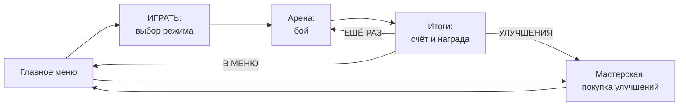

# Как проходит матч

Матч — это одна игровая сессия: одна арена, один режим, от старта до экрана итогов. Уровней и кампании нет: игрок
играет матч, получает шестерёнки, улучшает танк и идёт в следующий матч.

## Меню

- **Главный экран**: «ИГРАТЬ», «УЛУЧШЕНИЯ», «НАСТРОЙКИ», «ВЫХОД». Сверху — сколько у вас шестерёнок, ниже —
  сколько матчей сыграно и выиграно и ваш ранг угрозы.
- **ИГРАТЬ** — три карточки режимов с описанием и кнопкой «В БОЙ».
- **УЛУЧШЕНИЯ** — мастерская (см. ниже).
- **НАСТРОЙКИ** — громкость звука и музыки, вибрация, сброс прогресса и раздел «Отладка» с тестовыми аренами
  (для команды).

## Режимы

Все режимы идут на одной арене: квадратная карта с кирпичными лабиринтами, сталью, водой и кустами. Синяя база — в
левом нижнем углу, красная — в правом верхнем, в центре — круглая зона для режима «Удержание точки».
Человек всегда играет один; все остальные танки — боты.

### Команда на команду

**Вы и два союзных бота (синие) против трёх вражеских (красные). Без возрождений.**

1. В начале раунда все стоят на своих базах, на экране «РАУНД N».
2. Погибший танк в этом раунде больше не появляется. Если вас уничтожили, камера переключается на живого союзника —
   можно смотреть, как он доигрывает.
3. Раунд выигрывает команда, у которой остался хоть один танк. Если последние танки погибли одновременно — ничья,
   очко никому.
4. Через 3 секунды начинается следующий раунд: все танки возвращаются на базы с полным здоровьем, разрушенные стены
   восстанавливаются, усиления с карты убираются.
5. **Матч выигрывает команда, первой взявшая 3 раунда.**

Доп. цель: выиграть матч, ни разу не погибнув.

### Удержание точки

**3 на 3. Очки за то, что стоите в центральной зоне.**

- Каждую секунду, пока в зоне есть ваш танк и **нет** вражеских, ваша команда получает очко. Если в зоне танки обеих
  команд — зона спорная, очков никому. Зона окрашивается в цвет команды, которая её держит.
- Погибший танк возрождается на своей базе через **7 секунд** (на экране — «Возрождение через N»), первые 3 секунды
  неуязвим.
- **Победа — 100 очков** или больше очков, чем у соперника, через **8 минут**. Если по истечении времени счёт
  равный — дополнительное время до первого очка перевеса.

Доп. цель: провести в зоне 30 секунд, пока ваша команда набирает очки.

### Все против всех

**Вы и три бота, каждый сам за себя: синий, красный, зелёный, жёлтый.**

- **10 очков** за каждого уничтоженного. Кроме того, кто прожил **25 секунд** без смерти, получает **+1 очко каждые
  5 секунд**, пока его не уничтожат.
- Погибший возрождается через **7 секунд** в случайной точке карты подальше от врагов, первые 3 секунды неуязвим.
- **Победа — 100 очков** или первое место через **7 минут**. Если по истечении времени первое место делят двое —
  дополнительное время.
- Победа засчитывается только за первое место.

Доп. цель: 5 уничтожений за матч.

## Что на экране во время матча

| Где | Что |
| --- | --- |
| Сверху по центру | Название режима (или «РАУНД 2 · до 3 побед»), счёт команд или игроков, часы, подсказка |
| Под счётом | «живы N» — сколько танков команды осталось; «держим точку»; «лидер» |
| В центре | Крупные сообщения: «РАУНД 1», «РАУНД ВЫИГРАН», «ДОПОЛНИТЕЛЬНОЕ ВРЕМЯ», «ПОБЕДА В МАТЧЕ!» |
| Слева сверху | Ваше здоровье (полоска и цифры), нитро, шестерёнки, заработанные в этом матче |
| Справа сверху | Киллтаб: кто кого уничтожил, имена в цветах команд. Вы — «Я», боты — «Бот 1», «Бот 2»… Строки с вашим участием выделены |
| По краям экрана | Красная вспышка, когда в вас попали |

Ваша ячейка в счёте обведена жёлтой рамкой.

**Пауза** — кнопка «ПАУЗА» (или `Esc`, или «Назад» на Android): «ПРОДОЛЖИТЬ», «НАЧАТЬ ЗАНОВО», «В МЕНЮ». Время
на паузе стоит.

## Конец матча и итоги

Когда матч решён, игра на секунду замедляется, затем появляется экран итогов:

- **ПОБЕДА** или **ПОРАЖЕНИЕ**, режим и счёт («3 : 1», «100 : 87» или «2 место · 64 очков»);
- таблица всех танков: уничтожил, погиб, очки (в «Все против всех»); ваша строка выделена;
- награда с разбивкой и сколько всего шестерёнок теперь в кошельке;
- кнопки «ЕЩЁ РАЗ», «УЛУЧШЕНИЯ», «В МЕНЮ».

## Награды: шестерёнки

| За что | Сколько | Когда |
| --- | --- | --- |
| Каждый уничтоженный вами враг | 12 | сразу, во время боя |
| Победа в матче | 100 | на экране итогов |
| Дополнительная цель режима | 20 | на экране итогов — даже при поражении (кроме «Команды на команду», где цель включает победу) |

Пример: в «Команде на команду» вы уничтожили 4 врага, ни разу не погибли и победили — 4 × 12 + 100 + 20 = **168
шестерёнок**. Проиграли — остаются шестерёнки за уничтоженных.

Уничтожения засчитываются только вам: шестерёнки за врагов, которых добили союзные боты, не начисляются.

## Мастерская: улучшения между матчами

За шестерёнки покупаются **постоянные** улучшения танка. Предела нет, но каждый следующий уровень в ветке
дороже предыдущего примерно на треть (×1,35).

| Ветка | Что растёт с каждым уровнем | Первый уровень стоит |
| --- | --- | --- |
| Корпус | +10 здоровья | 100 |
| Двигатель | скорость +0,15 танка/с | 90 |
| Орудие | урон бронебойного +4, осколочного +2 прямого и +1 по площади | 140 |
| Скорострельность | +0,05 выстрела в секунду | 130 |
| Нитро | +0,25 с нитро | 80 |

На карточке видно, сколько сейчас и сколько станет после покупки.

### Боты растут вместе с игроком

Сумма всех купленных уровней — **ранг угрозы**. С каждым уровнем ранга у каждого бота (и вражеского, и союзного)
прибавляется +4 здоровья, +0,5 урона и чуть-чуть скорости, скорострельности и скорости снаряда. Это меньше, чем даёт
одно улучшение игроку, поэтому прокачка всё равно окупается — но игра не превращается в избиение.

Покупки сохраняются на устройстве. Начать с нуля: **Настройки → Сбросить прогресс** (настройки звука при этом
остаются).

## Что ещё не решено

- Карта пока одна на все режимы; отдельные карты под режимы не рисуем.
- Числа режимов и экономики — первый вариант, подберём на плейтестах.
- Боты знают, где враг, даже за стенами (если он не в кустах) — ограничения обзора пока нет.
