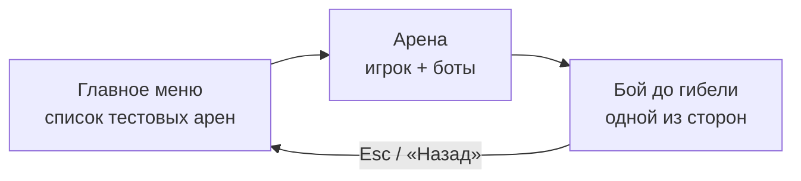
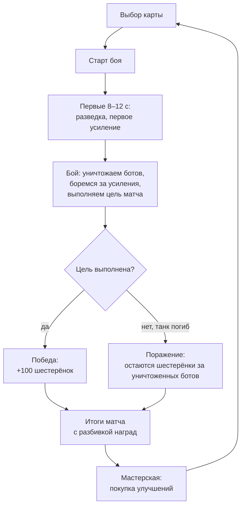

# Как проходит матч

Матч — это одна игровая сессия: одна арена, один бой. Уровней и кампании нет: игрок играет матч, получает награду,
улучшает танк и идёт в следующий матч.

На этой странице две части: **как матч выглядит сегодня** в прототипе и **каким он задуман** по документу баланса.

## Сегодня: что можно сыграть прямо сейчас

1. **Меню.** В главном меню — кнопки тестовых арен:
   - **«Танк: езда и стрельба»** — арена для обкатки управления и стрельбы, с неподвижными мишенями;
   - **«Боты: путь и атака»** — игрок против двух ботов;
   - **«Нитро и таран»** — стенд для нитро: кирпичная стенка, сталь, вода и неподвижные «жертвы» для тарана.
2. **Бой.** Боты сразу находят ближайшего противника и едут к нему по лабиринту, объезжая стены.
   Увидев игрока, сближаются, прицеливаются и стреляют. Подъехав близко, могут включить нитро и пойти на таран.
3. **Конец.** Уничтоженный танк исчезает. **Победы, поражения и экрана итогов пока нет**: чтобы начать заново,
   нажмите `Esc` (выход в меню) и снова выберите арену — она загрузится с нуля.

## Задумка: полный матч

### Длительность и темп

- Матч длится **примерно 1,5–2,5 минуты** (ориентир для первых тестов — 90–150 секунд).
- Арены маленькие: противник почти всегда где-то рядом, долго искать его не придётся.
- Первые 8–12 секунд — короткая передышка: игрок осматривается, а на карте появляется первое усиление.
  Дальше усиления появляются регулярно (на стандартной карте — примерно раз в 25 секунд, не больше двух на поле),
  и за них приходится драться.

### Как ощущается схватка

Типичный эпизод боя:

1. Бот выезжает из-за угла. Его снаряд виден издалека — игрок успевает увернуться или сбить его своим выстрелом.
2. Игрок сближается: вблизи крупный снаряд почти не промахивается. Два попадания — и бот уничтожен.
3. Бот прячется за кирпичом — игрок разбивает стену выстрелом или пробивает её тараном на нитро.
4. Мало здоровья? Можно уйти в кусты и переждать: оттуда противник тебя не видит.
5. Через 5 секунд разрушенные стены вырастают снова — арена всё время меняется.

### Цель матча — ещё решается

> [!IMPORTANT]
> **Режим игры пока не выбран.** Команда решила сначала доделать все основные механики, а режим определить на этапе
> «тактика ботов» (см. [Что уже готово](progress.md)). Ниже — варианты, которые обсуждаются, без выбора.

| Вариант | Суть |
| --- | --- |
| Защита базы | У игрока и у ботов есть базы. Нужно уничтожить базу ботов и не дать разрушить свою. Раунд 2–3 минуты |
| Уничтожить всех | Победа, когда на арене не осталось ботов |
| Другие цели | Документ баланса допускает дополнительные цели матча: «уничтожить всех ботов», «сохранить объект», «подобрать определённое усиление» |

### Награды: шестерёнки

Валюта игры — **шестерёнки**. Они копятся между матчами.

| За что | Сколько |
| --- | --- |
| Уничтожение бота | 12 — начисляются сразу |
| Победа (выполнена главная цель) | 100 |
| Дополнительная цель матча | 10–30 |
| Особое условие матча | 10–25 |

Если игрок проиграл, он **сохраняет** шестерёнки за уничтоженных ботов, но не получает награду за победу.
Пример: уничтожил 8 ботов и победил — 8 × 12 + 100 = **196 шестерёнок**. Обычный успешный матч должен приносить
примерно 180–260.

### Мастерская: улучшения между матчами

За шестерёнки покупаются **постоянные** улучшения танка. Предела нет, но каждое следующее улучшение в ветке
дороже предыдущего примерно на треть.

| Ветка | Что растёт с каждым уровнем | Первое улучшение стоит |
| --- | --- | --- |
| Прочность корпуса | +10 здоровья | 100 |
| Двигатель | скорость +0,15 танка/с | 90 |
| Мощность орудия | урон снарядов +4 | 140 |
| Скорострельность | выстрелы чаще | 130 |
| Ёмкость нитро | +0,25 с нитро | 80 |

### Боты растут вместе с игроком

Каждое купленное улучшение **чуть-чуть усиливает и ботов**: у них растут здоровье, урон, скорость и
скорострельность. Так игра не становится слишком лёгкой. Сила ботов зависит от общего числа покупок, а не от того,
что именно купил игрок: если прокачать корпус, боты не станут от этого крепче на те же 10 единиц.

## Что ещё не решено

- Режим игры и главная цель матча (см. выше).
- Что происходит после гибели игрока: сразу поражение или возрождение.
- Есть ли выбор карты и сколько их будет.
