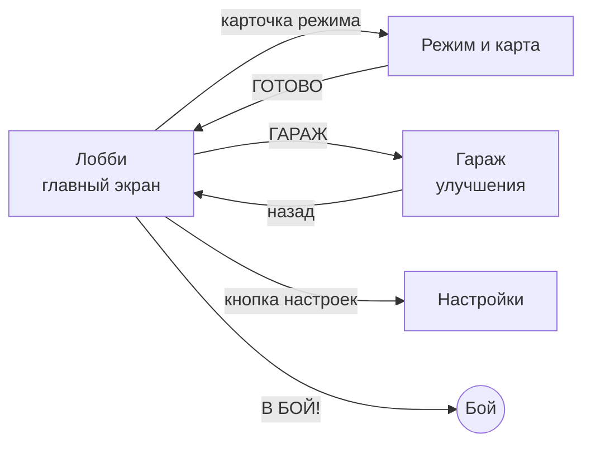
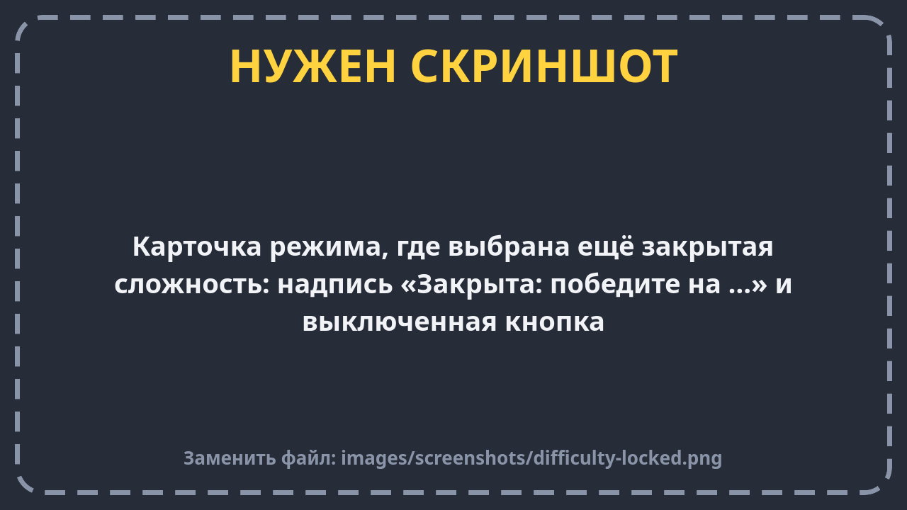
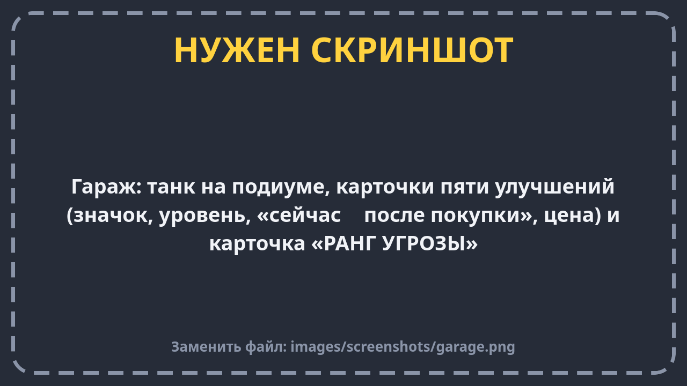
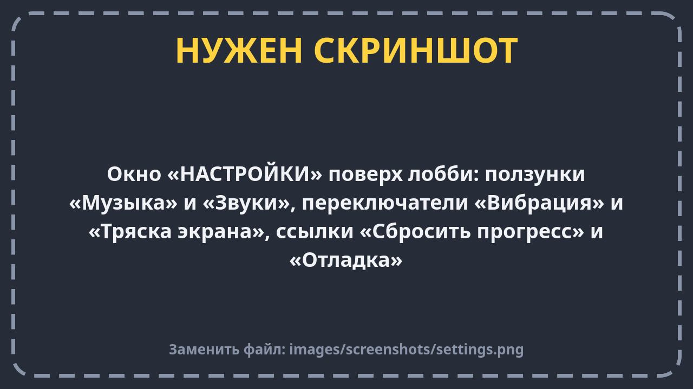

# Меню и гараж

В меню три экрана и окно настроек:

На всех экранах вверху одно и то же: слева кнопка **«назад»**, справа твои **шестерёнки** и кнопка **настроек**.

## Лобби — главный экран

| Что видно | Что это значит |
| --- | --- |
| Танк на подставке | Твой танк. Он всегда синий |
| «МОЙ ТАНК» и «РАНГ» | Ранг — это сколько улучшений ты купил всего. Чем он выше, тем сильнее и ты, и боты |
| «ХАРАКТЕРИСТИКИ» | Пять свойств танка: корпус (здоровье), двигатель (скорость), орудие (урон), скорострельность, нитро. Рядом — уровень («Ур. 2») и текущее значение |
| «ГАРАЖ» | Переход в гараж. Красный кружок с цифрой — сколько улучшений можно купить прямо сейчас |
| Карточка режима | Какой режим выбран («РЕЖИМ · 3 × 3» или «РЕЖИМ · 4 игрока») и на какой карте. Нажми — откроется выбор режима и карты |
| «В БОЙ!» | Начать бой в выбранном режиме, на выбранной карте и сложности |
| «ВЫХОД» | Только на компьютере: закрыть игру. На телефоне игра закрывается кнопкой «Назад» на главном экране |

## Режим и карта

1. **Карточки режимов.** Три карточки: «Команда на команду», «Удержание точки», «Все против всех». На выбранной
   сверху вкладка **«ВЫБРАН»**.
2. **Сложность.** На каждой карточке можно выбрать сложность: «Лёгкая», «Средняя» или «Сложная».
3. **Карта.** Ряд внизу — «Арена», «Перекрёсток», «Река», «Лабиринт». Нажми на нужную.
4. **«ГОТОВО»** — вернуться в лобби с выбранным.

### Как открываются сложности

Сначала в каждом режиме открыта только **«Лёгкая»**. Победил на лёгкой — открылась **«Средняя»**. Победил на
средней — открылась **«Сложная»**. Каждый режим открывается отдельно: победа в «Команде на команду» не открывает
сложность в «Удержании точки».

Закрытую сложность можно выбрать и посмотреть, но играть на ней нельзя: на карточке будет написано
**«Закрыта: победите на …»**, а кнопка выключится.

Чем отличаются сложности — на странице [Боты и сложность](bots.md).

## Гараж

Здесь шестерёнки превращаются в улучшения танка. Улучшения **навсегда** — они остаются после выхода из игры
и работают во всех боях.

| Улучшение | Что даёт каждый уровень | Первый уровень стоит |
| --- | --- | --- |
| **Корпус** | +10 здоровья | 100 шестерёнок |
| **Двигатель** | танк едет чуть быстрее | 90 |
| **Орудие** | снаряды бьют сильнее | 140 |
| **Скорострельность** | пушка перезаряжается чуть быстрее | 130 |
| **Нитро** | нитро хватает чуть дольше | 80 |

- На каждой карточке видно: **какой сейчас уровень**, **сколько сейчас** и **сколько станет** после покупки.
- Каждый следующий уровень дороже предыдущего примерно на треть.
- Если денег не хватает, на кнопке написано, сколько ещё нужно: **«не хватает 35»**.
- Карточка **«РАНГ УГРОЗЫ»** показывает, насколько усилились боты от твоих покупок.

Почему боты тоже усиливаются? Чтобы играть не становилось слишком легко. Но ботам достаётся меньше, чем тебе,
так что покупать улучшения всё равно выгодно.

## Настройки

Кнопка настроек справа сверху открывает окно поверх меню.

| Настройка | Что делает |
| --- | --- |
| **Музыка** | Громкость музыки (ползунок) |
| **Звуки** | Громкость выстрелов, взрывов и кнопок |
| **Вибрация** | Телефон вздрагивает, когда в тебя попали |
| **Тряска экрана** | Экран трясётся при попаданиях и взрывах. Если от тряски неудобно — выключи |
| **Сбросить прогресс** | Начать всё сначала: шестерёнки, улучшения, открытые сложности и статистика обнулятся. Игра переспросит, потому что отменить это нельзя. Громкость и другие настройки останутся |
| **Отладка** | Для команды разработчиков: тестовые арены, «+500 шестерёнок», «Открыть все сложности» |

Всё сохраняется в телефоне само — специально сохранять ничего не нужно.
