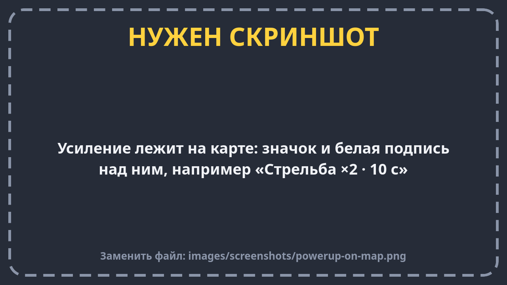
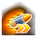
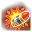
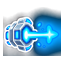
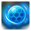
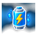
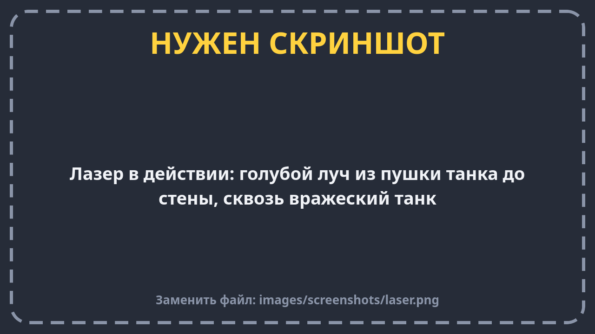
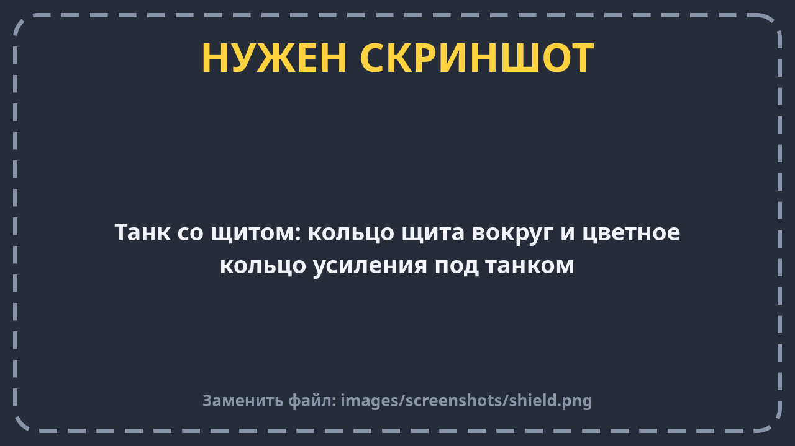

# Усиления

**Усиления** (их ещё называют павер-апами или бонусами) — это значки, которые появляются на земле во время боя.
Наехал на значок — получил бонус. Подобрать его может кто угодно: ты, союзник или враг. Кто первый, того и бонус.

Над каждым значком есть маленькая надпись — что он даёт и на сколько секунд.

## Все усиления

| Значок | Название | Что даёт | Сколько длится |
| --- | --- | --- | --- |
|  | **Скорострельность** | Пушка перезаряжается в 2 раза быстрее: стреляешь вдвое чаще | 10 секунд |
|  | **Взрывные снаряды** | Каждый выстрел взрывается: 50 урона в цель и 30 всем врагам рядом, ломает кирпичи вокруг | 7 секунд |
|  | **Лазер** | Вместо пушки — луч. Он бьёт всех врагов на линии (20 урона примерно раз в полсекунды), проходит сквозь танки, но не сквозь стены. Пока светит, танк едет медленнее | 4 секунды |
|  | **Щит** | Вокруг танка появляется кольцо. Оно поглощает одно попадание — любое: снаряд, взрыв, лазер или таран. За 2 секунды до конца кольцо мигает | до первого попадания или 15 секунд |
|  | **Ремонт** | Сразу +30 здоровья (но не больше полного) | сразу |
|  | **Заряд нитро** | Сразу полное нитро | сразу |

## Как это работает

- **Первое усиление** появляется через 8–12 секунд после начала боя. Потом — примерно раз в 25 секунд.
  На большой карте чаще, на маленькой реже.
- **На карте одновременно не больше двух** усилений.
- **Если усиление никто не берёт 20 секунд, оно исчезает.** За 3 секунды до этого оно начинает мигать.
- Усиления появляются в заранее выбранных местах — обычно там, где за них приходится драться.
- В начале каждого раунда все усиления с карты убираются.

## Несколько усилений сразу

- **Разные усиления работают вместе.** Можно одновременно иметь щит и скорострельность.
- **Одинаковое усиление продлевает время**, а не складывает: подобрал второй щит — щит снова на 15 секунд.
- Пока работает хоть одно усиление, **под танком светится цветное кольцо**. Так видно, у кого бонус, — и у врагов тоже.
- Внизу экрана таймер показывает последнее подобранное усиление и сколько ему осталось.
- Если танк подбили, все его усиления пропадают.

## Боты тоже любят бонусы

Боты подбирают усиления, когда видят их рядом. «Ремонт» им нужен, только когда они ранены, а «Заряд нитро» —
когда нитро мало. Если бот ранен и отступает, он часто едет как раз к «Ремонту».

## Не путай с зарядной точкой нитро

На картах есть ещё **зарядные точки нитро** — фиолетовые кружки на земле. Это не усиление: точка не исчезает,
а после зарядки ждёт 12–16 секунд и снова готова. Подробнее — в [Правилах боя](rules.md#нитро).
