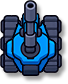
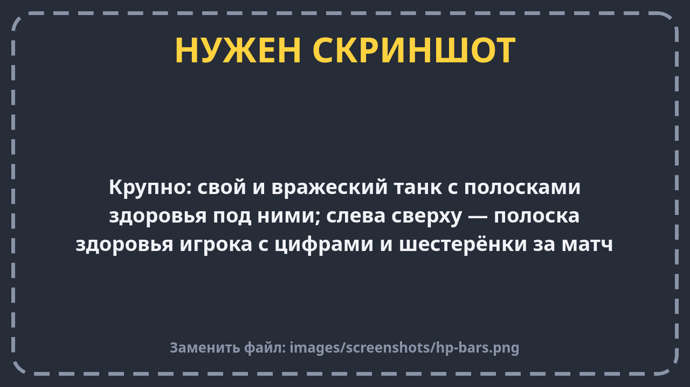
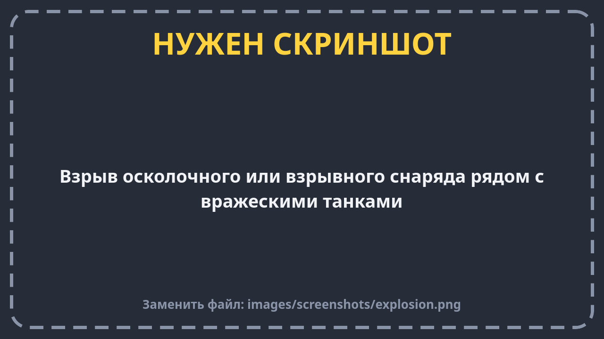
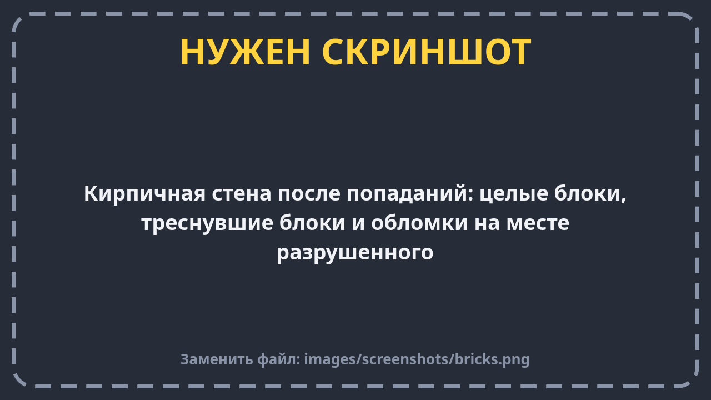
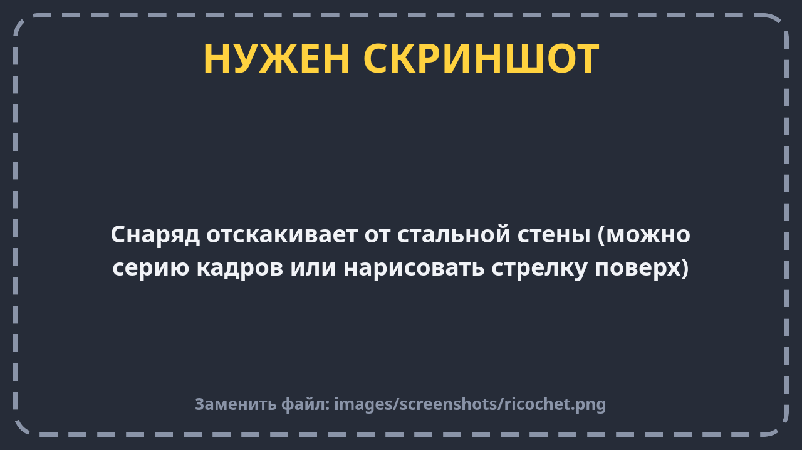
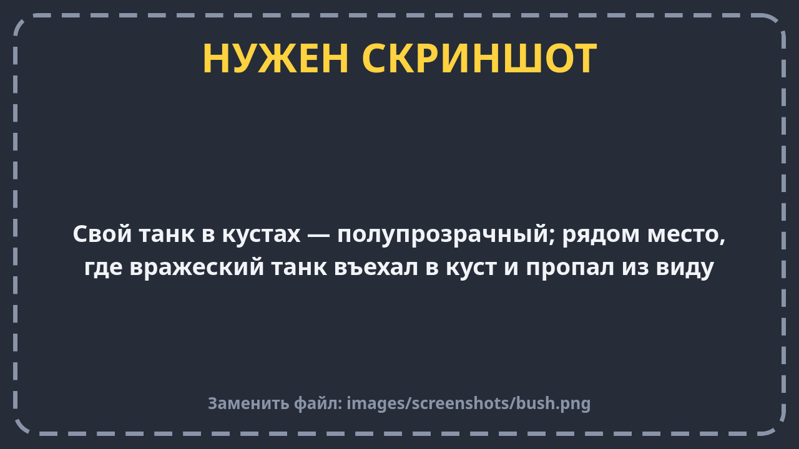
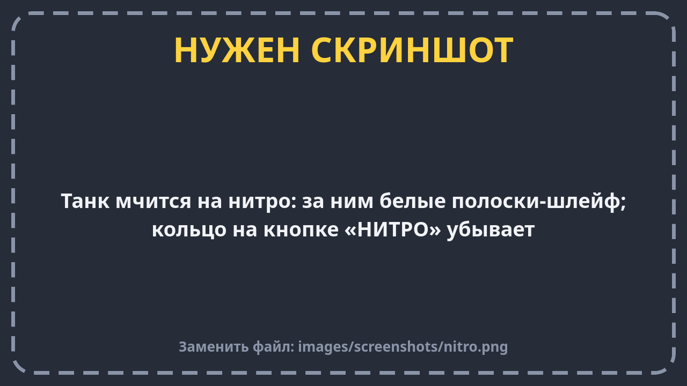
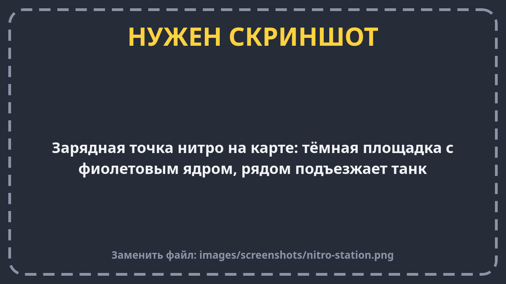
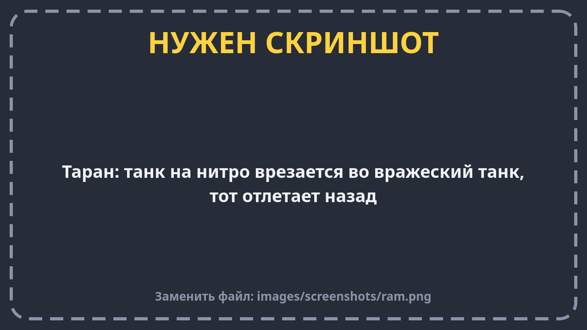

# Правила боя

Здесь — как всё устроено на поле: танки, выстрелы, стены, кусты, нитро и таран. Про бонусы на земле — отдельная
страница [Усиления](powerups.md).

Все числа здесь — **стартовые**. Команда будет менять их после тестов. Расстояния меряем **в танках**:
«4 танка» — это четыре танка в ряд.

## Танк

| | Твой танк | Танк бота |
| --- | --- | --- |
| Здоровье | 100 | 100 |
| Скорость | почти 3 танка в секунду | чуть медленнее |
| На нитро | 5 танков в секунду | так же |

- **Здоровье само не восстанавливается.** Вылечиться можно только усилением «Ремонт».
- **Под каждым танком — полоска здоровья.** Зелёная и длинная — танк цел, красная и короткая — почти разбит.
- Своё здоровье ты видишь ещё и цифрами в левом верхнем углу.

- **После попадания** танк мигает, и ещё 0,3 секунды его нельзя повредить. Это защита от двух снарядов,
  прилетевших почти одновременно.
- **После появления на карте** (начало раунда или возвращение после гибели) танк 2–3 секунды мигает медленно
  и неуязвим. Боты в такой танк не стреляют.
- **Когда здоровье кончилось**, танк взрывается и исчезает. Вернётся ли он — зависит от режима.

## Выстрелы

Пушка стреляет **туда, куда смотрит нос танка**. Снаряд летит по прямой, пока во что-нибудь не врежется.

У твоего танка **два типа снарядов**, их переключает кнопка «СНАРЯД»:

| Снаряд | Надпись на кнопке | Урон | Особенность |
| --- | --- | --- | --- |
| **Бронебойный** | БРОНЕБ | 50 | Сильный удар по одной цели. Отскакивает от стали |
| **Осколочный** | ОСКОЛ | 30 в цель + 25 всем врагам рядом | Взрывается и задевает соседей. От стали не отскакивает, а взрывается |

Снаряд бота наносит 35 урона.

Простая арифметика: **твоим бронебойным бот уничтожается за 2 попадания, тебя ботом — за 3.**

- Пушке нужно меньше секунды, чтобы **перезарядиться**. Переключение снаряда перезарядку не сбрасывает.
- **Снаряды крупные, но не очень быстрые.** Издалека от них можно увернуться, вблизи — почти не промахнёшься.
- **Свои не страдают:** твои снаряды пролетают сквозь союзников.
- **Снаряд можно сбить.** Если твой снаряд встретит вражеский, оба исчезнут. Так можно защититься.
- **У снаряда нет дальности:** он летит, пока во что-нибудь не врежется.

**Взрыв не проходит сквозь стены.** Если враг стоит за стеной, взрыв его не заденет. Но если враг выглядывает
из-за угла, взрыв достанет и его.

## Поле

Карта собрана из клеток, как из плитки. Одна клетка — размером с танк. Танк проезжает даже в проход шириной
в одну клетку.

| Что | Танк | Снаряд |
| --- | --- | --- |
| **Бортик** (край карты) | не проедет | исчезает |
| **Сталь** | не проедет | **отскакивает**, как мячик (до двух раз) |
| **Кирпич** | не проедет, но **на нитро пробьёт насквозь** | ломает кирпич |
| **Вода** | не проедет | **пролетает над водой** |
| **Кусты** | проезжает | пролетает |

### Кирпич

- Кирпич выдерживает **2 удара**. Бронебойный снаряд ломает блок сразу, осколочный — со второго раза
  (или сразу, если попал вплотную: удар плюс взрыв).
- Треснувший кирпич выглядит треснувшим, а на месте разбитого остаются обломки.
- Разбитый кирпич **вырастает обратно через 5 секунд**. Перед этим он полсекунды мигает — это предупреждение.
- Кирпич не вырастет прямо под танком: подождёт, пока танк уедет.

### Сталь и рикошет

Снаряд, попавший в сталь, отскакивает под тем же углом, как мячик от стены. Так можно попасть во врага из-за угла.

**Осторожно:** после отскока снаряд может попасть и в тебя самого. Не стреляй в сталь в упор.

### Кусты

- Заехал в куст (центром танка) — **враги тебя не видят**. Ни тебя, ни твою полоску здоровья.
- **Себя и союзников** в кустах ты видишь полупрозрачными, чтобы не потерять.
- **Боты тоже не видят** тех, кто в кустах. Но они не глупые: если ты пропал в кустах у них на глазах, они могут
  подъехать и выстрелить в куст.
- Выстрел из куста виден: снаряд вылетает наружу.

## Нитро

- Полный запас — **3 секунды** ускорения (улучшение «Нитро» в гараже добавляет время).
- Тратится, только пока кнопка зажата **и танк едет**. Упёрся в стену — нитро не тратится.
- Само восстанавливается: полностью примерно за 14 секунд.
- Израсходовал всё до нуля — нитро «перегревается» и включится, только когда накопится хотя бы десятая часть.
- Нитро не защищает от урона.
- За танком на нитро тянутся белые полоски — так видно, кто мчится.

**Зарядная точка нитро** — фиолетовый кружок на земле. Наехал — нитро снова полное. Потом точке нужно 12–16 секунд,
чтобы зарядиться снова.

## Таран

Таран — это удар танком на полной скорости. Работает, только если ты **на нитро, разогнался и врезался носом**
(если скользишь боком вдоль стены — это не таран).

| Во что врезался | Что будет |
| --- | --- |
| Вражеский танк | Враг теряет **25 здоровья** и отлетает назад |
| Тот же враг ещё раз | Только когда вы разъедетесь и ты снова разгонишься. Прижать врага к стене и бить без остановки нельзя |
| Враг со щитом | Щит поглотит удар, но враг всё равно отлетит |
| Только что появившийся враг | Ничего: он неуязвим |
| Свой танк | Ничего |
| Кирпич | Пробиваешь насквозь |
| Сталь, вода, бортик | Ничего, танк просто упрётся |
