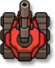
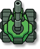
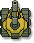

# Tank Brawl

   

Мобильная игра про бои танков на маленьких аренах: **«Танчики» с Денди в темпе Brawl Stars.**
Вид сверху, свободная езда, крупные медленные снаряды, нитро и таран, разрушаемые стены и кусты для засад,
временные усиления, три режима против ботов и прокачка танка между матчами. Делается на хакатоне FunFlow.

## Об игре — для всех

Не нужно разбираться в программировании.

| Хочу узнать… | Страница |
| --- | --- |
| что это за игра и в чём её фишка | [Что за игра](game/overview.md) |
| что нажимать с самого первого запуска | [Первый бой — пошагово](game/first-battle.md) |
| какие кнопки нажимать на телефоне и компьютере | [Управление](game/controls.md) |
| что есть в лобби, гараже и настройках | [Меню и гараж](game/menu.md) |
| как работают попадания, стены, кусты, нитро, таран | [Правила боя](game/rules.md) |
| какие бывают усиления и что они дают | [Усиления](game/powerups.md) |
| какие есть режимы, как считаются очки, что дают шестерёнки | [Режимы и матч](game/match.md) |
| какие есть карты | [Карты](game/maps.md) |
| как играют боты и чем отличаются сложности | [Боты и сложность](game/bots.md) |
| что уже сделано и что в планах | [Что уже готово](game/progress.md) |
| как поиграть в прототип и сообщить о проблеме | [Плейтест](game/playtest.md) |
| как поменять скорость, урон, правила режимов, сложность или поведение ботов | [Как настраивать игру](game/tuning.md) |
| что значит незнакомое слово | [Словарь терминов](game/glossary.md) |

## Для разработчиков

| Хочу… | Страница |
| --- | --- |
| понять, как устроен код целиком | [Архитектура](articles/architecture.md) |
| разобраться в танке, оружии, усилениях, карте или ботах | [Танк](articles/tank.md) · [Оружие](articles/weapons.md) · [Усиления](articles/powerups.md) · [Карта](articles/map.md) · [Карты и генератор](articles/maps.md) · [Боты и сложность](articles/bots.md) |
| разобраться в матче, режимах, прокачке | [Матч и режимы](articles/match.md) · [Прокачка и сохранение](articles/progression.md) |
| разобраться в меню, экранном управлении, звуке и эффектах | [Интерфейс и управление](articles/ui.md) · [Звук и эффекты](articles/audio-fx.md) |
| найти, какое поле в инспекторе за что отвечает | [Параметры в инспекторе](articles/inspector.md) |
| добавить сцену, снаряд, усиление, режим, звук или характер бота | [Рецепты](articles/recipes.md) |
| посмотреть все классы и методы | [API](api/TankBrawl.Core.yml) |
| снять недостающие скриншоты | [Скриншоты для документации](articles/screenshots.md) |
| дописать документацию | [Как писать документацию](articles/writing-docs.md) |

## Как собрать этот сайт у себя

Нужен только .NET SDK 10 (Unity не нужна):

```sh
./Documentation/build.sh --serve     # Linux / macOS
Documentation\build.cmd --serve      # Windows
```

Сайт откроется на <http://localhost:8080>. При пуше в ветку `dev` он публикуется на GitHub Pages автоматически.
